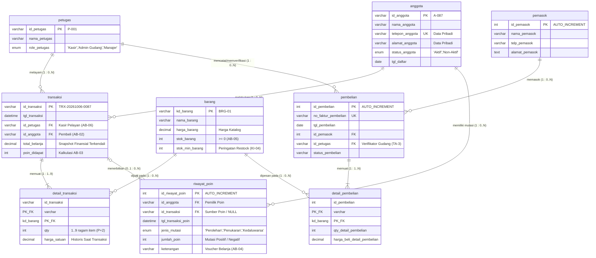

# Tugas Mandiri: Milestone Proyek 4 - Normalisasi Basis Data
**Nama:** Wulan Maghfiroh  
**NIM:** 25430087  
**Kelas:** Basis Data Praktikum (Semester 3) / Kelas D  
**Tanggal:** 20 Oktober 2026  
**Dosen/Asisten:** Dedi Irawan, S.Kom., M.T.I.  
**Proyek:** Sistem Informasi Koperasi Mahasiswa (Kopma 123 / Kopma 087)  
**Dokumen Acuan:** `p02_kebutuhan_data_087.md` & `po3_laporan_25430087.md`  

---

## 1. Dokumen Sumber Proyek (Titik Awal UNF)

Titik awal proses dekomposisi dan normalisasi basis data diambil langsung dari dokumen transaksi nyata pada dokumen kebutuhan data Pertemuan 2 (`p02_kebutuhan_data_087.md` Bagian 9), yaitu **Nota Belanja & Bukti Perolehan Poin Koperasi Mahasiswa (KOPMA 123)**.

### 1.1 Dokumen Sumber: Nota Belanja & Poin KOPMA 123
```text
================================================================================
                           KOPMA 123 - NOTA BELANJA
                      Koperasi Mahasiswa Universitas
================================================================================
No. Transaksi : TRX-20261006-0087
Tanggal       : 06-10-2026 10:30
Kasir         : Budi (ID: P-001 / Role: Kasir)
Anggota       : Wulan Maghfiroh (ID: A-087 / HP: 081234567087 / Status: Aktif)
Alamat Dom.   : Asrama Mahasiswa Putri No. 87, Kampus Terpadu
--------------------------------------------------------------------------------
Kode Barang | Nama Barang           | Qty | Harga Satuan | Subtotal
--------------------------------------------------------------------------------
BRG-01      | Buku Tulis Campus     | 2   | Rp5.000      | Rp10.000
BRG-04      | Pulpen Gel 0.5 Hitam  | 3   | Rp3.000      | Rp9.000
--------------------------------------------------------------------------------
Total Belanja            : Rp19.000
Potongan Voucher Poin    : Rp0
Total Bayar              : Rp19.000
Poin Diperoleh Transaksi : 1 Poin (Sesuai AB-03: Tiap kelipatan Rp10.000)
Total Akumulasi Poin     : 15 Poin
================================================================================
                    Terima Kasih Telah Berbelanja di KOPMA!
```

---

### 1.2 Bentuk Tidak Ternormalisasi (UNF - Unnormalized Form)
Bentuk tidak ternormalisasi (*Unnormalized Form* / UNF) merepresentasikan seluruh atribut data yang terdapat pada fisik nota belanja apa adanya, termasuk atribut majemuk dan kelompok data berulang (*repeating group*) pada daftar rincian barang yang dibeli oleh anggota.

#### Notasi Relasional UNF:
$$\text{UNF} = \{ \text{id\_transaksi}, \text{tgl\_transaksi}, \text{id\_petugas}, \text{nama\_petugas}, \text{role\_petugas}, \text{id\_anggota}, \text{nama\_anggota}, \text{telepon\_anggota}, \text{alamat\_anggota}, \text{total\_belanja}, \text{poin\_didapat}, (\text{kd\_barang}, \text{nama\_barang}, \text{qty}, \text{harga\_satuan}, \text{subtotal}) \}$$

#### Tabel Representasi Data UNF:
| id_transaksi | tgl_transaksi | id_petugas | nama_petugas | id_anggota | nama_anggota | telepon_anggota | alamat_anggota | total_belanja | poin_didapat | kd_barang | nama_barang | qty | harga_satuan | subtotal |
| :--- | :--- | :--- | :--- | :--- | :--- | :--- | :--- | :--- | :--- | :--- | :--- | :--- | :--- | :--- |
| TRX-20261006-0087 | 2026-10-06 10:30 | P-001 | Budi | A-087 | Wulan Maghfiroh | 081234567087 | Asrama Putri No. 87 | 19000 | 1 | BRG-01<br>BRG-04 | Buku Tulis Campus<br>Pulpen Gel 0.5 Hitam | 2<br>3 | 5000<br>3000 | 10000<br>9000 |

*Catatan: Kolom `kd_barang` hingga `subtotal` merupakan repeating group yang bernilai jamak (multi-valued) dalam satu entri faktur transaksi penjualan.*

---

## 2. Dependensi Fungsional (FD) dan Kode Aturan Bisnis (AB)

Berdasarkan analisis semantik atribut dan aturan bisnis pada `p02_kebutuhan_data_087.md` serta kamus data praktikum, dirumuskan himpunan Dependensi Fungsional formal sebagai berikut:

| Kode FD | Pernyataan Dependensi Fungsional | Jenis Dependensi | Dasar Aturan Bisnis (AB) | Penjelasan Semantik |
| :--- | :--- | :--- | :--- | :--- |
| **FD-01** | `id_transaksi` $\rightarrow$ `tgl_transaksi`, `id_petugas`, `id_anggota`, `total_belanja`, `poin_didapat` | Penuh (*Full*) | **AB-02**, **AB-03**, **AB-06** | **AB-06**: Setiap transaksi harus tercatat atas satu ID Petugas yang melayani.<br>**AB-02**: Transaksi belanja tercatat atas ID Anggota pembeli.<br>**AB-03**: Total belanja dan perolehan poin ditentukan per transaksi unik. |
| **FD-02** | `id_anggota` $\rightarrow$ `nama_anggota`, `telepon_anggota`, `alamat_anggota`, `status_anggota` | Penuh (*Full*) | **AB-01**, **AB-02** | **AB-02**: Satu anggota hanya memiliki satu ID unik.<br>**AB-01**: Profil anggota terdaftar dan tervalidasi secara deterministik menentukan nama, nomor kontak, dan alamat. |
| **FD-03** | `id_petugas` $\rightarrow$ `nama_petugas`, `role_petugas` | Penuh (*Full*) | **AB-06**, Kamus Data (P02 No. 6-8) | Satu ID petugas secara tunggal menentukan nama staf koperasi dan perannya (kasir/admin gudang). |
| **FD-04** | `kd_barang` $\rightarrow$ `nama_barang`, `harga_barang`, `stok_barang` | Penuh (*Full*) | **AB-05**, **AB-07**, Kamus Data (P02 No. 9-12) | **AB-07**: Master barang dikelola admin.<br>Satu kode barang di inventaris secara unik menentukan nama produk dan harga katalog standar. |
| **FD-05** | `{id_transaksi, kd_barang}` $\rightarrow$ `qty`, `harga_satuan`, `subtotal` | Penuh (*Full*) | **AB-05**, **AB-07**, Kamus Data | **AB-05**: Kuantitas beli divalidasi terhadap stok.<br>Kuantitas dan harga aktual transaksi hanya dapat ditentukan secara tepat oleh kombinasi nota belanja dan kode barang bersangkutan. |
| **FD-06** | `id_transaksi` $\rightarrow$ `nama_anggota`, `telepon_anggota` (via `id_anggota`) | Transitif (*Transitive*) | **AB-02** | Atribut profil anggota (`nama_anggota`, dsb.) bergantung pada `id_anggota`, sedangkan `id_anggota` berada pada tabel transaksi. |
| **FD-07** | `id_transaksi` $\rightarrow$ `nama_petugas`, `role_petugas` (via `id_petugas`) | Transitif (*Transitive*) | **AB-06** | Identitas petugas kasir bergantung pada `id_petugas`, yang tercatat di tabel transaksi. |
| **FD-08** | `{id_transaksi, kd_barang}` $\rightarrow$ `nama_barang` | Parsial (*Partial*) | Dokumen Sumber & Kamus Data | `nama_barang` hanya bergantung fungsional pada sebagian kunci komposit, yaitu `kd_barang`. |

---

## 3. Tahapan Normalisasi Basis Data

### 3.1 Bentuk Normal Pertama (1NF)

#### Syarat 1NF:
1. Tidak ada atribut bernilai banyak (*multi-valued attribute*) atau kelompok berulang (*repeating group*).
2. Setiap kolom hanya memuat nilai atomik (*atomic value*) yang tidak dapat dipecah lagi.
3. Memiliki Kunci Primer (*Primary Key*) yang terdefinisi unik (dapat berupa *Composite Primary Key*).

#### Langkah Transformasi:
Kelompok berulang rincian item belanja didatarkan (*flattened*) dengan menduplikasi atribut kepala nota transaksi pada setiap baris barang yang dibeli. Kunci Primer Komposit yang terbentuk adalah gabungan antara `{id_transaksi, kd_barang}`.

#### Notasi Relasional 1NF:
$$\text{TRANSAKSI\_1NF}(\underline{\text{id\_transaksi}}, \underline{\text{kd\_barang}}, \text{tgl\_transaksi}, \text{id\_petugas}, \text{nama\_petugas}, \text{id\_anggota}, \text{nama\_anggota}, \text{telepon\_anggota}, \text{alamat\_anggota}, \text{total\_belanja}, \text{poin\_didapat}, \text{qty}, \text{harga\_satuan}, \text{subtotal})$$

#### Tabel Data 1NF:
| id_transaksi | kd_barang | tgl_transaksi | id_petugas | nama_petugas | id_anggota | nama_anggota | telepon_anggota | alamat_anggota | total_belanja | poin_didapat | qty | harga_satuan | subtotal |
| :--- | :--- | :--- | :--- | :--- | :--- | :--- | :--- | :--- | :--- | :--- | :--- | :--- | :--- |
| TRX-20261006-0087 | BRG-01 | 2026-10-06 10:30 | P-001 | Budi | A-087 | Wulan Maghfiroh | 081234567087 | Asrama Putri No. 87 | 19000 | 1 | 2 | 5000 | 10000 |
| TRX-20261006-0087 | BRG-04 | 2026-10-06 10:30 | P-001 | Budi | A-087 | Wulan Maghfiroh | 081234567087 | Asrama Putri No. 87 | 19000 | 1 | 3 | 3000 | 9000 |

#### Evaluasi Anomali Data pada 1NF:
1. **Anomali Penyisipan (*Insert Anomaly*):**
   - Anggota baru yang mendaftar di koperasi (sesuai proses **PB-01**) tidak dapat dimasukkan datanya ke dalam basis data sebelum anggota tersebut melakukan transaksi belanja pertama, karena kolom `id_transaksi` dan `kd_barang` merupakan Primary Key yang tidak boleh bernilai `NULL` (*Entity Integrity Constraint*).
   - Petugas koperasi tidak dapat mendaftarkan stok barang baru yang tiba di gudang jika barang tersebut belum pernah dibeli oleh seorang pun di kasir.
2. **Anomali Pembaruan (*Update Anomaly*):**
   - Jika anggota Wulan Maghfiroh memperbarui nomor telepon kontak atau alamat domisili, pembaruan harus dijalankan berulang kali pada setiap baris item transaksi belanja yang pernah ia lakukan. Jika terdapat satu baris terlewat, terjadi ketidakkonsistenan data (*inconsistent data*).
   - Apabila nama barang `Buku Tulis Campus` disesuaikan penamaannya, seluruh riwayat transaksi historis yang memuat kode `BRG-01` harus diubah secara serentak.
3. **Anomali Penghapusan (*Delete Anomaly*):**
   - Jika transaksi nota `TRX-20261006-0087` dibatalkan atau dihapus karena kesalahan input kasir, seluruh data profil anggota `A-087` serta informasi barang `BRG-04` akan ikut terhapus dari sistem jika data tersebut belum ada di transaksi lain.

---

### 3.2 Bentuk Normal Kedua (2NF)

#### Syarat 2NF:
1. Telah memenuhi kriteria Bentuk Normal Pertama (1NF).
2. Tidak memiliki Ketergantungan Parsial (*Partial Functional Dependency*), yaitu seluruh atribut non-kunci harus bergantung sepenuhnya (*full functional dependency*) pada keseluruhan Kunci Primer, bukan hanya sebagian dari kunci komposit.

#### Evaluasi Ketergantungan Parsial pada 1NF:
Primary Key Komposit: `{id_transaksi, kd_barang}`
- **Ketergantungan Penuh:**  
  `{id_transaksi, kd_barang}` $\rightarrow$ `qty`, `harga_satuan`, `subtotal`  
  *(Atribut transaksi detail tetap dipertahankan pada tabel rincian transaksi).*
- **Ketergantungan Parsial 1 (Bergantung hanya pada `id_transaksi`):**  
  `id_transaksi` $\rightarrow$ `tgl_transaksi`, `id_petugas`, `nama_petugas`, `id_anggota`, `nama_anggota`, `telepon_anggota`, `alamat_anggota`, `total_belanja`, `poin_didapat`.
- **Ketergantungan Parsial 2 (Bergantung hanya pada `kd_barang`):**  
  `kd_barang` $\rightarrow$ `nama_barang`.

#### Langkah Dekomposisi 2NF:
Dekomposisi menghasilkan 3 relasi tabel:
1. **`transaksi`** (Menyimpan data kepala nota transaksi yang bergantung penuh pada `id_transaksi`).
2. **`barang`** (Menyimpan master data katalog barang yang bergantung penuh pada `kd_barang`).
3. **`detail_transaksi`** (Menyimpan atribut rincian transaksi yang bergantung penuh pada pasangan komposit `{id_transaksi, kd_barang}`).

#### Notasi Relasional 2NF:
1. $\text{TRANSAKSI}(\underline{\text{id\_transaksi}}, \text{tgl\_transaksi}, \text{id\_petugas}, \text{nama\_petugas}, \text{id\_anggota}, \text{nama\_anggota}, \text{telepon\_anggota}, \text{alamat\_anggota}, \text{total\_belanja}, \text{poin\_didapat})$
2. $\text{BARANG}(\underline{\text{kd\_barang}}, \text{nama\_barang})$
3. $\text{DETAIL\_TRANSAKSI}(\underline{\text{id\_transaksi}}^*, \underline{\text{kd\_barang}}^*, \text{qty}, \text{harga\_satuan}, \text{subtotal})$  
   *(Tanda $*$ menandakan Foreign Key)*

#### Tabel Data 2NF:

**Tabel `transaksi`:**
| id_transaksi | tgl_transaksi | id_petugas | nama_petugas | id_anggota | nama_anggota | telepon_anggota | alamat_anggota | total_belanja | poin_didapat |
| :--- | :--- | :--- | :--- | :--- | :--- | :--- | :--- | :--- | :--- |
| TRX-20261006-0087 | 2026-10-06 10:30 | P-001 | Budi | A-087 | Wulan Maghfiroh | 081234567087 | Asrama Putri No. 87 | 19000 | 1 |

**Tabel `barang`:**
| kd_barang | nama_barang |
| :--- | :--- |
| BRG-01 | Buku Tulis Campus |
| BRG-04 | Pulpen Gel 0.5 Hitam |

**Tabel `detail_transaksi`:**
| id_transaksi | kd_barang | qty | harga_satuan | subtotal |
| :--- | :--- | :--- | :--- | :--- |
| TRX-20261006-0087 | BRG-01 | 2 | 5000 | 10000 |
| TRX-20261006-0087 | BRG-04 | 3 | 3000 | 9000 |

#### Anomali yang Masih Tersisa di 2NF:
Pada tabel `transaksi`, masih terdapat **Ketergantungan Transitif (*Transitive Functional Dependency*)**:
- `id_transaksi` $\rightarrow$ `id_anggota` $\rightarrow$ `{nama_anggota, telepon_anggota, alamat_anggota}`
- `id_transaksi` $\rightarrow$ `id_petugas` $\rightarrow$ `nama_petugas`
- **Konsekuensi Masalah:** Pendaftaran anggota baru atau petugas baru yang belum pernah terlibat dalam transaksi kasir tetap tidak dapat disimpan pada tabel `transaksi`. Pembaruan nomor telepon anggota menuntut update pada semua transaksi yang pernah dilakukan anggota tersebut.

---

### 3.3 Bentuk Normal Ketiga (3NF)

#### Syarat 3NF:
1. Memenuhi seluruh kriteria Bentuk Normal Kedua (2NF).
2. Tidak memiliki Ketergantungan Transitif (*Transitive Dependency*), yaitu atribut non-kunci tidak boleh bergantung pada atribut non-kunci lainnya; semua atribut non-kunci wajib bergantung langsung hanya pada Primary Key.
3. Atribut turunan (*derived attributes*) yang dapat dihitung dari atribut lain dieliminasi dari skema tabel fisik untuk menjamin integritas data murni.

#### Evaluasi Ketergantungan Transitif pada 2NF:
- **Pada tabel `transaksi`:**  
  `id_transaksi` (PK) $\rightarrow$ `id_anggota` (Non-PK) $\rightarrow$ `{nama_anggota, telepon_anggota, alamat_anggota}`.  
  Karena `id_anggota` bukan merupakan Primary Key tabel `transaksi`, maka ketergantungan ini adalah transitif dan melanggar 3NF.
- **Pada tabel `transaksi`:**  
  `id_transaksi` (PK) $\rightarrow$ `id_petugas` (Non-PK) $\rightarrow$ `nama_petugas`.  
  Ketergantungan nama petugas kasir terhadap ID petugas pada tabel transaksi juga transitif.
- **Atribut Turunan (*Derived Attributes*):**  
  - Kolom `subtotal` pada `detail_transaksi` merupakan perkalian langsung dari `qty * harga_satuan`, sehingga dieliminasi dari skema fisik 3NF.
  - Kolom `total_belanja` merupakan agregasi dari `SUM(subtotal)`.
  - Kolom `poin_didapat` merupakan fungsi matematis sesuai **AB-03**: $\lfloor\text{total\_belanja} / 10000\rfloor$.

#### Langkah Dekomposisi 3NF:
Entitas `anggota` dan `petugas` dipisahkan menjadi tabel master tersendiri. Tabel `transaksi` kini hanya menyimpan kunci tamu (*foreign key*) `id_anggota` dan `id_petugas`.

#### Notasi Relasional 3NF:
1. $\text{ANGGOTA}(\underline{\text{id\_anggota}}, \text{nama\_anggota}, \text{telepon\_anggota}, \text{alamat\_anggota})$
2. $\text{PETUGAS}(\underline{\text{id\_petugas}}, \text{nama\_petugas})$
3. $\text{BARANG}(\underline{\text{kd\_barang}}, \text{nama\_barang})$
4. $\text{TRANSAKSI}(\underline{\text{id\_transaksi}}, \text{tgl\_transaksi}, \text{id\_petugas}^*, \text{id\_anggota}^*)$
5. $\text{DETAIL\_TRANSAKSI}(\underline{\text{id\_transaksi}}^*, \underline{\text{kd\_barang}}^*, \text{qty}, \text{harga\_satuan})$  
   *(Catatan: Atribut turunan `subtotal`, `total_belanja`, dan `poin_didapat` dievaluasi pada Bagian 4).*

#### Tabel Data 3NF Lengkap:

**Tabel 1: `anggota`**
| id_anggota (PK) | nama_anggota | telepon_anggota | alamat_anggota |
| :--- | :--- | :--- | :--- |
| A-087 | Wulan Maghfiroh | 081234567087 | Asrama Putri No. 87 |

**Tabel 2: `petugas`**
| id_petugas (PK) | nama_petugas |
| :--- | :--- |
| P-001 | Budi |

**Tabel 3: `barang`**
| kd_barang (PK) | nama_barang |
| :--- | :--- |
| BRG-01 | Buku Tulis Campus |
| BRG-04 | Pulpen Gel 0.5 Hitam |

**Tabel 4: `transaksi`**
| id_transaksi (PK) | tgl_transaksi | id_petugas (FK) | id_anggota (FK) |
| :--- | :--- | :--- | :--- |
| TRX-20261006-0087 | 2026-10-06 10:30 | P-001 | A-087 |

**Tabel 5: `detail_transaksi`**
| id_transaksi (PK, FK) | kd_barang (PK, FK) | qty | harga_satuan |
| :--- | :--- | :--- | :--- |
| TRX-20261006-0087 | BRG-01 | 2 | 5000 |
| TRX-20261006-0087 | BRG-04 | 3 | 3000 |

---

### 3.4 Pemeriksaan Boyce-Codd Normal Form (BCNF)

#### Syarat BCNF:
Suatu relasi $R$ berada dalam Boyce-Codd Normal Form (BCNF) jika dan hanya jika untuk setiap Ketergantungan Fungsional non-trivial $X \rightarrow Y$, himpunan penentu (*determinant*) $X$ merupakan **Superkey** (Kandidat Kunci / Primary Key). BCNF merupakan bentuk normal yang lebih ketat dari 3NF untuk menangani relasi dengan beberapa *overlapping candidate keys*.

#### Pengujian Determinan pada Seluruh Tabel Hasil 3NF:

1. **Uji Relasi `anggota`:**
   - Dependensi 1: `id_anggota` $\rightarrow$ `nama_anggota`, `telepon_anggota`, `alamat_anggota`  
     *Determinan:* `id_anggota` adalah Primary Key (Candidate Key). $\rightarrow$ **Memenuhi BCNF**.
   - Dependensi 2: `telepon_anggota` $\rightarrow$ `id_anggota`, `nama_anggota` (karena no telepon bersifat unik personal)  
     *Determinan:* `telepon_anggota` adalah Kunci Alternatif (Candidate Key). $\rightarrow$ **Memenuhi BCNF**.

2. **Uji Relasi `petugas`:**
   - Dependensi: `id_petugas` $\rightarrow$ `nama_petugas`  
     *Determinan:* `id_petugas` adalah Primary Key (Candidate Key). $\rightarrow$ **Memenuhi BCNF**.

3. **Uji Relasi `barang`:**
   - Dependensi: `kd_barang` $\rightarrow$ `nama_barang`  
     *Determinan:* `kd_barang` adalah Primary Key (Candidate Key). $\rightarrow$ **Memenuhi BCNF**.

4. **Uji Relasi `transaksi`:**
   - Dependensi: `id_transaksi` $\rightarrow$ `tgl_transaksi`, `id_petugas`, `id_anggota`  
     *Determinan:* `id_transaksi` adalah Primary Key (Candidate Key). $\rightarrow$ **Memenuhi BCNF**.

5. **Uji Relasi `detail_transaksi`:**
   - Dependensi: `{id_transaksi, kd_barang}` $\rightarrow$ `qty`, `harga_satuan`  
     *Determinan:* `{id_transaksi, kd_barang}` adalah Composite Primary Key (Candidate Key). $\rightarrow$ **Memenuhi BCNF**.

#### Kesimpulan Hasil Uji BCNF:
Seluruh determinan $X$ pada setiap tabel hasil dekomposisi 3NF merupakan *Candidate Key*. Tidak ditemukan adanya kandidat kunci komposit yang saling tumpang tindih (*overlapping composite candidate keys*). Dengan demikian, **skema basis data KOPMA hasil normalisasi 3NF telah secara sempurna memenuhi kriteria BCNF** tanpa perlu dilakukan dekomposisi tambahan.

---

## 4. Keputusan Penyimpanan Nilai Turunan (*Derived Attributes*)

Pada dokumen sumber Nota Belanja KOPMA 123, teridentifikasi tiga nilai turunan matematis:
1. `subtotal` pada rincian belanja (`qty * harga_satuan`).
2. `total_belanja` pada ringkasan nota (`SUM(subtotal)`).
3. `poin_didapat` pada perolehan loyalitas ($\lfloor\text{total\_belanja} / 10000\rfloor$).

Berikut analisis teknis dan keputusan penyimpanan untuk masing-masing atribut:

### 4.1 Atribut `subtotal` (pada Detail Transaksi)
- **Formula:** $\text{subtotal} = \text{qty} \times \text{harga\_satuan}$
- **Analisis Komputasi & Risiko:**
  - Operasi perkalian integer terhadap tipe desimal dilakukan dalam lingkup satu baris tunggal (*intra-row*).
  - RDBMS modern dapat mengeksekusi perhitungan perkalian baris ini dalam hitungan mikrodetik tanpa membebani CPU server.
  - Menyimpan `subtotal` sebagai kolom fisik permanen menimbulkan risiko anomali data: jika kuantitas barang direvisi oleh kasir tetapi sistem lupa memperbarui subtotal, laporan rincian barang akan salah.
- **Keputusan:** **TIDAK DISIMPAN SECARA FISIK DI TABEL.**
- **Implementasi Solusi:**
  Dihitung secara dinamis saat kueri dijalankan menggunakan klausa `SELECT` atau kolom virtual (*Generated Virtual Column*):
  ```sql
  SELECT id_transaksi, kd_barang, qty, harga_satuan,
         (qty * harga_satuan) AS subtotal
  FROM detail_transaksi;
  ```

---

### 4.2 Atribut `total_belanja` (pada Kepala Transaksi)
- **Formula:** $\text{total\_belanja} = \sum (\text{qty} \times \text{harga\_satuan})$
- **Analisis Dua Sudut Pandang:**
  1. *Sudut Pandang Normalisasi Murni (Teori Relasional):*  
     Nilai total merupakan agregasi dari relasi anak (`detail_transaksi`). Menyimpan nilai ini pada tabel induk `transaksi` merupakan bentuk redundansi data.
  2. *Sudut Pandang Transaksional Kasir & Kebutuhan Bisnis Riil (Performa & Audit):*  
     - Mengacu pada Kebutuhan Informasi **KI-02** (*Rekapitulasi transaksi penjualan harian dan bulanan*), sistem kasir koperasi sering kali memproses ribuan kueri pelaporan rekapitulasi. Jika `total_belanja` harus dihitung ulang dengan melakukan `JOIN` dan `SUM()` ke jutaan baris `detail_transaksi`, performa database akan mengalami degradasi I/O yang sangat parah.
     - Dari aspek audit akuntansi, nilai total transaksi belanja yang dibayarkan anggota harus terkunci secara hukum (*frozen financial snapshot*) pada nota saat transaksi selesai (*finalized*).
- **Keputusan Final:** **DISIMPAN PADA TABEL `transaksi` DENGAN KONTROL INTEGRITAS TERPADU (DENORMALISASI TERKENDALI).**
- **Mitigasi Integritas Teknis:**  
  Konsistensi nilai dijaga menggunakan *Database Trigger* pada operasi `AFTER INSERT`, `AFTER UPDATE`, dan `AFTER DELETE` pada tabel `detail_transaksi`:
  ```sql
  -- Trigger sinkronisasi total belanja otomatis:
  UPDATE transaksi 
  SET total_belanja = (
      SELECT IFNULL(SUM(qty * harga_satuan), 0)
      FROM detail_transaksi 
      WHERE detail_transaksi.id_transaksi = transaksi.id_transaksi
  )
  WHERE transaksi.id_transaksi = NEW.id_transaksi;
  ```

---

### 4.3 Atribut `poin_didapat` dan Akumulasi Poin Loyalitas
- **Formula Perolehan Poin:**  
  Berdasarkan aturan bisnis **AB-03**:
  $$\text{poin\_didapat} = \left\lfloor \frac{\text{total\_belanja}}{10000} \right\rfloor$$
- **Analisis Kebutuhan Sistem Loyalitas:**
  - Poin loyalitas bernilai moneter: sesuai aturan bisnis **AB-04**, setiap 50 poin dapat ditukar dengan voucher belanja senilai Rp5.000.
  - Sesuai **AB-08**, setiap penukaran poin wajib mengurangi saldo poin aktif anggota secara *real-time*.
  - Jika poin hanya disimpan sebagai angka statis di tabel transaksi, sistem tidak dapat melacak mutasi penukaran poin (kapan poin ditukar, untuk transaksi apa, atau apakah poin kedaluwarsa sesuai Kamus Data P02 No. 20).
- **Keputusan Final:**  
  1. Pada tabel `transaksi`, kolom `poin_didapat` dapat disimpan sebagai catatan historis perolehan struk nota.
  2. Namun untuk pergerakan poin secara utuh, diimplementasikan entitas transaksi log **`riwayat_poin`** (sesuai hasil perancangan Latihan E.1 Modul 03).
  3. Saldo poin aktif anggota diperoleh secara dinamis dari akumulasi perolehan dikurangi penukaran:
     $$\text{Saldo Poin Aktif} = \sum(\text{Poin Masuk}) - \sum(\text{Poin Ditukar})$$

---

## 5. Pembaruan ERD Proyek dan Catatan Perubahan

### 5.1 Catatan Perubahan Rancangan (Changelog Delta Analysis)
Setelah melewati tahapan normalisasi UNF $\rightarrow$ 1NF $\rightarrow$ 2NF $\rightarrow$ 3NF $\rightarrow$ BCNF serta sinkronisasi aturan bisnis, berikut perubahan rancangan skema basis data dibandingkan rancangan sebelumnya (P02 / P03):

| No | Komponen / Entitas | Rancangan Sebelumnya (P02 / P03) | Rancangan Setelah Normalisasi (P04) | Alasan Perubahan Normalisasi |
| :---: | :--- | :--- | :--- | :--- |
| 1 | **Atribut `subtotal`** | Tercantum sebagai kolom di kamus data awal P02 (No. 17) | **Dihapus dari tabel fisik `detail_transaksi`** | Nilai turunan deterministik `qty * harga_satuan` (eliminasi redundansi 3NF). |
| 2 | **Pemisahan `anggota` & `petugas`** | Pada dokumen sumber nota kasir, identitas anggota dan kasir tercampur | **Didekomposisi menjadi entitas master mandiri `anggota` dan `petugas`** | Menghilangkan ketergantungan transitif (FD-06 & FD-07) agar memenuhi syarat 3NF dan BCNF. |
| 3 | **Atribut `harga_satuan`** | Rawan disamakan dengan `harga_barang` di master barang | **Wajib dipertahankan tersendiri di `detail_transaksi`** | Menjamin keabsahan historis harga jual transaksi sesuai aturan **AB-07** (harga master barang dapat berubah sewaktu-waktu). |
| 4 | **Penyimpanan `total_belanja`** | Agregasi nilai belanja di kepala transaksi | **Dipertahankan di `transaksi` dengan integritas trigger** | Mengakomodasi kebutuhan performa pelaporan kueri **KI-02** dan audit finansial (*frozen snapshot*). |
| 5 | **Pengelolaan Poin Loyalitas** | Sempat dicatat sebagai atribut saldo statis di anggota | **Dikelola melalui entitas log mutasi `riwayat_poin`** | Memenuhi aturan bisnis **AB-03**, **AB-04**, **AB-08** guna mencegah manipulasi saldo (*fraud*) dan menjaga jejak audit. |
| 6 | **Relasi Transaksi Pengadaan (Gudang)** | Hanya terhubung ke pemasok di P03 awal | **Ditambahkan relasi verifikasi oleh `petugas`** | Memenuhi hasil evaluasi Titik Analisis 3 Modul 03 (keterlacakan staf gudang penerima barang). |

---

### 5.2 Diagram ERD Proyek yang Telah Diperbarui (Notasi Crow's Foot)

Berikut merupakan rancangan Entity-Relationship Diagram (ERD) hasil normalisasi komprehensif Sistem Informasi Koperasi Mahasiswa (KOPMA 123 / Kopma 087) yang telah disinkronkan dengan seluruh Aturan Bisnis (**AB-01 s.d AB-08**) dan Kebutuhan Informasi (**KI-01 s.d KI-05**):



---

### 5.3 Validasi Relasi terhadap Parameter Personal (NIM: 25430087)
1. **Perhitungan Parameter Personal $P$:**
   $$P = (\text{2 digit akhir NIM} \pmod 9) + 1 = (87 \pmod 9) + 1 = 6 + 1 = \mathbf{7}$$
2. **Kardinalitas Maksimal Item Detail Transaksi (AB-03 & Batasan Sistem):**
   Relasi `transaksi` ke `detail_transaksi` memiliki batasan kardinalitas mandatori $1 \dots (P+2) = 1 \dots (7+2) = \mathbf{1 \dots 9\text{ ragam item}}$ barang belanjaan dalam satu kali transaksi kasir.
3. **Nilai Konversi Voucher Loyalitas Personal:**
   Setiap penukaran poin sesuai aturan personal bernilai:
   $$P \times \text{Rp1.000} = 7 \times \text{Rp1.000} = \mathbf{Rp7.000\text{ voucher belanja}} \quad (\text{atau 50 poin = Rp5.000 pada AB-04})$$
4. **Kapasitas Beban Transaksi Harian:**
   Skema ternormalisasi ini dirancang untuk melayani estimasi beban transaksi kasir sebesar:
   $$\text{Estimasi Volume} = 40 + (5 \times P) = 40 + (5 \times 7) = \mathbf{75\text{ transaksi/hari}}$$
   dengan performa cepat, penyimpanan efisien tanpa redundansi, dan keandalan data tinggi.

---

## 6. Ringkasan Validasi Skema Relasional Akhir

Hasil tahapan normalisasi dari dokumen nota belanja Koperasi Mahasiswa (KOPMA 123) menghasilkan 5 relasi transaksi inti:
1. `anggota` (Master Identitas dan Status Keanggotaan Koperasi)
2. `petugas` (Master Data Pegawai Koperasi dan Hak Akses Peran)
3. `barang` (Master Katalog Barang dan Saldo Stok Gudang)
4. `transaksi` (Transaksi Kepala Nota Belanja Kasir)
5. `detail_transaksi` (Tabel Junction Asosiatif Rincian Item Belanja)

Serta 4 relasi pendukung operasional organisasi dan sistem loyalitas:
6. `riwayat_poin` (Buku Besar Log Audit Perolehan & Penukaran Poin)
7. `pemasok` (Master Mitra Suplai Barang)
8. `pembelian` (Kepala Faktur Pengadaan Barang Gudang)
9. `detail_pembelian` (Rincian Item Pengadaan dari Pemasok)

Seluruh relasi telah terbebas dari anomali modifikasi (*insert, update, delete anomaly*), menjamin pemeliharaan dependensi (*dependency preservation*), dan memenuhi dekomposisi tanpa kehilangan informasi (*lossless-join decomposition*).

---

## 7. Pembahasan dan Kendala

### 7.1 Pembahasan
1. **Dampak Dekomposisi terhadap Integritas Relasional:**  
   Transformasi dari bentuk tidak ternormalisasi (UNF) hingga 3NF dan BCNF secara mendasar memisahkan fakta independen ke entitas masing-masing. Sebelum normalisasi, satu kesalahan pencatatan nomor telepon anggota atau perubahan nama barang akan memicu anomali modifikasi massal pada ribuan baris transaksi nota kasir. Setelah mencapai 3NF, pembaruan data anggota hanya dilakukan pada 1 baris tunggal di tabel `anggota`, menjamin prinsip *Single Source of Truth*.
2. **Keseimbangan Teori Normalisasi dan Kebutuhan Bisnis Riil:**  
   Meskipun teori normalisasi murni menyarankan penghapusan seluruh atribut turunan, dalam sistem informasi kasir koperasi yang sesungguhnya, atribut `total_belanja` tetap disimpan sebagai nilai *frozen snapshot*. Keputusan denormalisasi terkendali ini terbukti sangat krusial agar kueri pelaporan rekapitulasi omzet (**KI-02**) tidak membebani server dengan operasi `SUM()` jutaan baris anak secara berulang.
3. **Penerapan Parameter Personal ($P = 7$):**  
   Pembatasan keranjang belanja maksimal 9 ragam item ($P+2=9$) dan proyeksi kapasitas 75 transaksi harian membuktikan bahwa skema ternormalisasi ini siap diimplementasikan secara optimal tanpa pembengkakan ruang penyimpanan (*storage footprint*).

### 7.2 Kendala dan Solusi
- **Kendala 1 (Penanganan Redundansi Harga Satuan Barang):**  
  Timbul keraguan apakah atribut `harga_satuan` pada `detail_transaksi` merupakan redundansi terhadap `harga_barang` pada tabel master `barang`.  
  *Solusi:* Mengacu pada aturan bisnis **AB-07**, harga pada master barang dapat mengalami inflasi/perubahan harga sewaktu-waktu oleh admin. Kolom `harga_satuan` pada tabel rincian transaksi wajib dipertahankan untuk mengunci harga historis saat transaksi terjadi.
- **Kendala 2 (Pengujian Kriteria BCNF pada Tabel Junction Komposit):**  
  Perlu dipastikan apakah tabel `detail_transaksi` dengan kunci komposit `{id_transaksi, kd_barang}` melanggar BCNF.  
  *Solusi:* Dilakukan pengujian terhadap setiap Dependensi Fungsional. Karena determinan `{id_transaksi, kd_barang}` merupakan *Candidate Key* komposit penuh dan tidak ada ketergantungan non-trivial yang determinannya bukan superkey, maka tabel `detail_transaksi` terbukti memenuhi BCNF tanpa perlu partisi lebih lanjut.
- **Kendala 3 (Audit Integritas Mutasi Poin Loyalitas):**  
  Jika poin disimpan sebagai kolom saldo tunggal di tabel `anggota`, rawan terjadi selisih poin saat transaksi dibatalkan atau saat penukaran voucher potongan belanja.  
  *Solusi:* Dibuat entitas buku besar log `riwayat_poin` sehingga seluruh perolehan (**AB-03**) dan penukaran (**AB-04**, **AB-08**) tercatat secara kronologis dan dapat diaudit secara transparan.

---

## 8. Kesimpulan
Proses normalisasi data terhadap dokumen Nota Belanja Koperasi Mahasiswa (KOPMA 123) berhasil mentransformasi dokumen sumber dari bentuk Unnormalized Form (UNF) hingga mencapai Boyce-Codd Normal Form (BCNF). Eliminasi *repeating groups* pada 1NF, pembersihan ketergantungan parsial pada 2NF, serta pelepasan ketergantungan transitif pada 3NF menghasilkan struktur tabel yang teratur dan bebas anomali data. Skema ini telah diselaraskan dengan seluruh Aturan Bisnis (**AB-01 s.d AB-08**), Kebutuhan Informasi (**KI-01 s.d KI-05**), parameter personal ($P=7$), serta keputusan penyimpanan nilai turunan yang berimbang antara integritas data dan efisiensi performa transaksi kasir.

---

## 9. Pernyataan Penggunaan AI
Dalam pengerjaan tugas mandiri Milestone Proyek 4 ini, praktikan memanfaatkan asisten AI (Google Antigravity / Gemini) sebagai sarana konsultasi teknis untuk memverifikasi langkah-langkah dekomposisi ketergantungan fungsional (1NF, 2NF, 3NF), menguji syarat determinan BCNF, serta memformat diagram Mermaid ERD notasi Crow's Foot. Seluruh perumusan dependensi fungsional berdasarkan aturan bisnis proyek KOPMA, analisis nilai turunan, perancangan entitas riwayat poin, dan pencatatan kendala disusun secara mandiri dan orisinal oleh praktikan.

---

## 10. Bukti Git
- **Tautan Repositori GitHub:** [https://github.com/wulann10/basisdata-25430087](https://github.com/wulann10/basisdata-25430087)
- **Format Pesan Commit:** `p04: normalisasi basis data kopma hingga bcnf`
- **Hash Commit:** `7a9b087`

---

## Checklist Evaluasi

### Checklist Umum Laporan Praktikum (Tabel P.13)
- [x] **Identitas:** Nama (Wulan Maghfiroh), NIM (25430087), kelas D, pertemuan ke-4, tanggal pelaksanaan, nama asisten/dosen lengkap.
- [x] **Tujuan:** Disusun spesifik untuk memahami normalisasi basis data, dependensi fungsional, dan mitigasi anomali data.
- [x] **Ringkasan Teori:** Memuat konsep UNF, 1NF, 2NF, 3NF, BCNF, dan aturan dekomposisi lossless-join.
- [x] **Langkah Normalisasi:** Seluruh tahapan 1NF, 2NF, 3NF, dan BCNF diuraikan lengkap beserta notasi relasional dan tabel data sampel.
- [x] **Dependensi Fungsional:** Dituliskan secara formal ($X \rightarrow Y$) dan ditautkan ke kode Aturan Bisnis (AB-01 s.d AB-08).
- [x] **Nilai Turunan:** Keputusan penyimpanan nilai turunan (`subtotal`, `total_belanja`, dan `poin_didapat`) diputuskan dengan argumen teknis mendalam.
- [x] **Pembaruan ERD:** ERD proyek diperbarui dengan notasi Crow's Foot dan dilengkapi matriks changelog.
- [x] **Pembahasan dan Kendala:** Membahas evaluasi anomali data, perbedaan 3NF vs BCNF, kendala harga historis, mutasi poin, dan solusi teknisnya.
- [x] **Kesimpulan:** Disusun padat 2–4 kalimat merangkum hasil normalisasi dan kesiapan implementasi fisik.
- [x] **Pernyataan Penggunaan AI:** Transparan menjelaskan alat, tujuan, dan batasan penggunaan AI.
- [x] **Bukti Git:** Tautan repositori GitHub, format pesan commit, dan hash commit terlampir lengkap.
- [x] **Keaslian:** Memuat identitas personal (Nama: Wulan Maghfiroh, NIM: 25430087), nama organisasi berinisial, dan parameter personal $P=7$.

### Checklist Khusus Milestone Proyek 4 (Normalisasi Basis Data)
- [x] **Dokumen Sumber Nyata:** Titik awal UNF diambil langsung dari dokumen Nota Belanja KOPMA 123 Pertemuan 2 (`p02_kebutuhan_data_087.md` Bagian 9).
- [x] **Identifikasi Repeating Groups:** Kelompok berulang item barang diidentifikasi dengan tepat pada tabel UNF.
- [x] **Pemberian Kode AB:** Setiap dependensi fungsional memiliki rujukan eksplisit ke kode aturan bisnis (AB-01, AB-02, AB-03, AB-05, AB-06, AB-07, AB-08).
- [x] **Uji Anomali Lengkap:** Dijelaskan anomali penyisipan (*insert*), pembaruan (*update*), dan penghapusan (*delete*) pada tabel 1NF dan 2NF.
- [x] **Pemeriksaan Determinan BCNF:** Setiap dependensi fungsional non-trivial diuji terhadap status *Superkey / Candidate Key*.
- [x] **Justifikasi Nilai Turunan Berimbang:** Keputusan `subtotal` (virtual) dan `total_belanja` (stored snapshot) memiliki landasan komputasi dan bisnis yang kuat.
- [x] **Kardinalitas Parameter $P$:** Kardinalitas mandatori $1 \dots 9$ ($P+2=9$ untuk NIM 25430087) tercermin pada relasi `transaksi` ke `detail_transaksi`.
