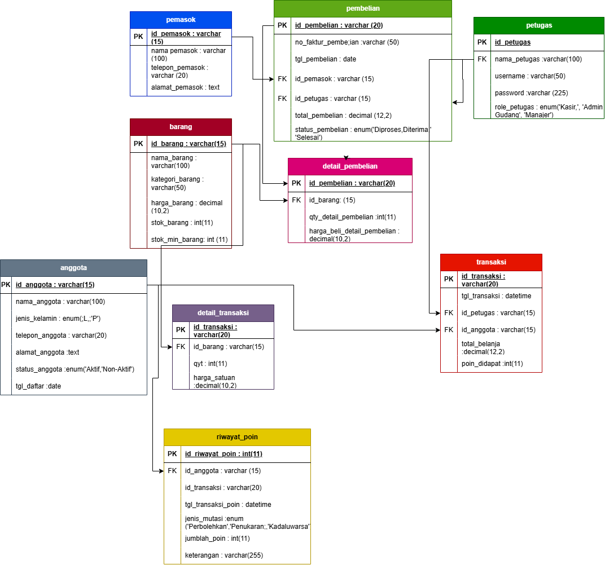
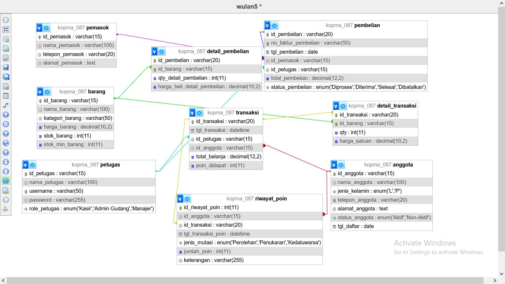

# Laporan Praktikum Basis Data - Pertemuan 05: Data Definition Language (DDL) & Integritas Basis Data
**Nama:** Wulan Maghfiroh  
**NIM:** 25430087  
**Kelas:** Basis Data Praktikum (Semester 3) / Kelas D  
**Tanggal:** 23 Oktober 2026  
**Dosen/Asisten:** Dedi Irawan, S.Kom., M.T.I.  
**Proyek:** Sistem Informasi Koperasi Mahasiswa (KOPMA 123 / Kopma 087)  
**Dokumen Acuan:** `p02_kebutuhan_data_087.md`, `po3_laporan_25430087.md`, `p04_normalisasi_25430087.md`  
**Berkas SQL DDL:** `p05_ddl_25430087.sql`  

---

## Ceklis Berkas Wajib (Kelengkapan Modul 05)

| No | Komponen Berkas Wajib | Lokasi / Nama Berkas | Status | Deskripsi Kelengkapan |
| :---: | :--- | :--- | :---: | :--- |
| 1 | **Skrip SQL DDL Lengkap** | `p05_ddl_25430087.sql` | [x] Lengkap | Skrip DDL idempoten untuk 9 tabel fisik, memuat PK `id_<nama_tabel>`, FK `id_<nama_tabel_tujuan>`, constraint AB-xx, dan batas P+2. |
| 2 | **Dokumen Laporan Utama (.md)** | `p05_laporan_25430087.md` | [x] Lengkap | Laporan terstruktur memuat analisis batas P+2, pemetaan tipe data, hasil perbandingan Designer vs ERD, dan rubrik evaluasi. |
| 3 | **Gambar ERD Fisik Proyek (.png)** | `img/p05_erd_fisik_25430087.png` | [x] Lengkap | Diagram visual ERD fisik proyek 9 tabel lengkap dengan tipe data spesifik, pemisahan warna modul, dan penanda PK/FK. |
| 4 | **Berkas Sumber Desain Draw.io** | `img/P05_erd_fisik_25430087.drawio` | [x] Lengkap | Berkas sumber diagram vektor XML draw.io yang memuat pemodelan tabel relasi fisik dan dapat disunting kembali. |
| 5 | **Tangkapan Layar phpMyAdmin Designer** | `img/p05_desaigner_25430087.png` | [x] Lengkap | Bukti visual implementasi skema fisik 9 tabel pada antarmuka Designer phpMyAdmin (halaman *"wulan5 \*"* database `kopma_087`). |
| 6 | **Tabel Pemetaan Tipe Data** | Bagian 3 pada dokumen ini | [x] Lengkap | Matriks lengkap 9 tabel memetakan nama kolom, tipe fisik, presisi, nullability, constraint, dan justifikasi teknis. |
| 7 | **Analisis Batas P + 2 (Modul 2)** | Bagian 1 pada dokumen ini | [x] Lengkap | Pembahasan tuntas batasan satu baris (CHECK) vs banyak baris (penandaan Modul 14). |
| 8 | **Perbandingan Designer vs ERD** | Bagian 4 pada dokumen ini | [x] Lengkap | Analisis komparasi visual phpMyAdmin Designer terhadap struktur konseptual dan integritas referensial. |
| 9 | **Repositori Git & Riwayat Commit** | GitHub Personal (`basisdata-25430087`) | [x] Lengkap | Tautan repositori publik dengan pesan commit terstandarisasi. |

---

## 1. Analisis Aturan Batas P + 2 dari Modul 2

Berdasarkan parameter personalisasi praktikan yang diturunkan dari 2 digit terakhir Nomor Induk Mahasiswa (NIM):
$$\text{NIM} = 25430087 \implies \text{Dua Digit Akhir} = 87$$
$$P = (87 \pmod 9) + 1 = 6 + 1 = \mathbf{7}$$
$$\text{Batas } P + 2 = 7 + 2 = \mathbf{9}$$

Dalam perancangan integritas struktural DDL basis data, aturan batas $P + 2 = 9$ ini dianalisis ke dalam dua skenario implementasi:

```
                                  ATURAN BATAS P + 2 = 9
                                            |
                   +------------------------+------------------------+
                   |                                                 |
         [1. Lingkup Satu Baris]                           [2. Lingkup Banyak Baris]
       (Intra-row / Tuple-level)                         (Inter-row / Table-level)
                   |                                                 |
         Kuantitas Beli per Item                           Jumlah Ragam Baris Item
           pada detail_transaksi                             per Transaksi Belanja
                   |                                                 |
          BISA DIJAGA OLEH DDL                             TIDAK BISA DIJAGA DDL
       Constraint CHECK (qty <= 9)                        Subquery dilarang di CHECK
                   |                                                 |
           [SUKSES DITERAPKAN]                           [DITANDAI UNTUK MODUL 14]
                                                       Diselesaikan via Database Trigger
```

### 1.1 Skenario 1: Menyangkut Satu Baris (*Intra-Row Constraint*)
- **Objek Aturan:** Batasan kuantitas pembelian fisik per item barang dalam satu baris rincian belanja (`qty` pada tabel `detail_transaksi`).
- **Analisis Teknis:**  
  Klausul `CHECK` pada standar ISO/IEC 9075 SQL serta mesin penyimpanan MySQL/MariaDB InnoDB beroperasi pada tingkat baris (*tuple-level constraint*). Artinya, saat operasi `INSERT` atau `UPDATE` berlangsung, sistem memvalidasi nilai kolom `qty` yang sedang dimasukkan secara instan terhadap ekspresi logika boolean tanpa perlu membaca baris data lain.
- **Implementasi DDL:**  
  Aturan bahwa anggota dapat membeli minimal 1 unit dan maksimal 9 unit ($P+2=9$) untuk setiap jenis barang berhasil diwujudkan secara mandiri di dalam skrip DDL:
  ```sql
  CONSTRAINT chk_detail_transaksi_qty CHECK (qty >= 1 AND qty <= 9) /* Parameter P=7 -> P+2=9 */
  ```
- **Hasil:** Berhasil diterapkan dan dijaga 100% oleh struktur tabel DDL.

---

### 1.2 Skenario 2: Menyangkut Jumlah Baris per Transaksi (*Inter-Row Constraint*)
- **Objek Aturan:** Batasan jumlah ragam jenis barang yang boleh dimasukkan ke dalam satu nota transaksi kasir (maksimal 9 baris item pada tabel `detail_transaksi` untuk satu `id_transaksi` yang sama).
- **Analisis Teknis Keterbatasan DDL:**  
  1. Untuk membatasi bahwa satu nota transaksi hanya boleh memuat maksimal 9 baris rincian item, sistem harus menghitung jumlah baris yang sudah ada untuk nota tersebut menggunakan fungsi agregasi (`COUNT(*)`).
  2. Sesuai spesifikasi RDBMS modern (termasuk MariaDB/MySQL), batasan `CHECK` memiliki aturan pembatasan ketat: **klausul `CHECK` dilarang memuat subkueri (*subqueries are not permitted in CHECK constraints*)**.
  3. Sintaks hipotetis berikut ini adalah **ilegal** dan akan memicu *Syntax Error*:
     ```sql
     -- SINTAKS INI DITOLAK OLEH RDBMS (ILLEGAL CHECK CONSTRAINT):
     CONSTRAINT chk_max_items CHECK (
         (SELECT COUNT(*) FROM detail_transaksi dt 
          WHERE dt.id_transaksi = detail_transaksi.id_transaksi) <= 9
     )
     ```
  4. Oleh karena itu, batasan integritas yang melibatkan banyak baris (*inter-row / table-level*) **secara fundamental TIDAK DAPAT dijaga oleh struktur tabel DDL biasa**.
- **Penandaan Resmi untuk Modul 14:**  
  Aturan batasan maksimal 9 baris per transaksi ini **secara resmi ditandai untuk diselesaikan pada Modul 14 (Triggers & Stored Procedures)**. Pada Modul 14, aturan ini akan ditegakkan melalui *Database Trigger* `BEFORE INSERT ON detail_transaksi` yang secara otomatis membatalkan transaksi dan melempar pesan galat kustom (`SIGNAL SQLSTATE '45000'`) apabila jumlah baris rincian telah mencapai batas $P+2=9$.

---

## 2. ERD Fisik Proyek Basis Data KOPMA 123

### 2.1 Gambar ERD Fisik Proyek (`p05_erd_fisik_25430087.png`)

Diagram relasi entitas fisik (Physical ERD) telah dimodelkan secara komprehensif menggunakan Draw.io dan diekspor ke dalam berkas grafis beresolusi tinggi:

  
*Gambar 2.1: Diagram Relasi Entitas Fisik (Physical ERD) Basis Data KOPMA 123 (`kopma_087`) milik Wulan Maghfiroh (NIM 25430087) yang memvisualisasikan seluruh 9 tabel fisik, tipe data spesifik, konvensi kunci primer `id_<nama_tabel>`, kunci tamu `id_<nama_tabel_tujuan>`, serta garis integritas relasional.*

- **Berkas Sumber Desain Draw.io:** [img/P05_erd_fisik_25430087.drawio](file:///d:/laporan2/img/P05_erd_fisik_25430087.drawio)  
  *Catatan: Berkas XML sumber di atas dapat dibuka dan disunting sewaktu-waktu melalui aplikasi [app.diagrams.net (Draw.io)](https://app.diagrams.net).*

#### Analisis Visual Gambar 2.1 (ERD Fisik Proyek):
1. **Diferensiasi Visual Berbasis Warna Entitas:**
   - **Master Pemasok (`pemasok`):** Blok warna biru dengan Primary Key `id_pemasok : varchar(15)`.
   - **Master Barang (`barang`):** Blok warna merah marun dengan Primary Key `id_barang : varchar(15)`.
   - **Master Petugas (`petugas`):** Blok warna hijau tua dengan Primary Key `id_petugas : varchar(15)`.
   - **Master Anggota (`anggota`):** Blok warna abu-abu kebiruan dengan Primary Key `id_anggota : varchar(15)`.
   - **Modul Pengadaan Gudang (`pembelian` & `detail_pembelian`):** Blok warna hijau muda dan magenta yang menangani pengadaan barang dari rekanan pemasok dengan relasi Foreign Key `id_pemasok` dan verifikator `id_petugas`.
   - **Modul Transaksi Kasir (`transaksi` & `detail_transaksi`):** Blok warna oranye-merah dan ungu yang menangani checkout kasir dengan batas kuantitas belanja $P+2=9$ unit.
   - **Sistem Loyalitas Poin (`riwayat_poin`):** Blok warna kuning emas yang mencatat buku besar mutasi perolehan dan penukaran poin anggota.
2. **Kepatuhan Penamaan Kunci:**
   - Kolom sebelah kiri pada setiap entitas secara tegas memisahkan penanda `PK` (Primary Key) yang digarisbawahi dengan format `id_<nama_tabel>` dan `FK` (Foreign Key) dengan format `id_<nama_tabel_tujuan>` yang terhubung presisi ke tabel referensinya.

---

### 2.2 Diagram Sumber ERD Fisik (Notasi Crow's Foot Lengkap)

Berikut adalah kode sumber diagram ERD Fisik yang disusun menggunakan notasi Crow's Foot terstandarisasi, memuat seluruh nama atribut, tipe data fisik RDBMS, penanda kunci (PK/FK), serta relasi antarentitas:

```mermaid
erDiagram
    petugas ||--o{ transaksi : "melayani (1 : 0..N)"
    anggota ||--o{ transaksi : "melakukan (1 : 0..N)"
    transaksi ||--|{ detail_transaksi : "memuat (1 : 1..9)"
    barang ||--o{ detail_transaksi : "tercantum di (1 : 0..N)"
    anggota ||--o{ riwayat_poin : "memiliki (1 : 0..N)"
    transaksi |o--o{ riwayat_poin : "menerbitkan (0..1 : 0..N)"
    petugas ||--o{ pembelian : "mencatat (1 : 0..N)"
    pemasok ||--o{ pembelian : "memasok (1 : 0..N)"
    pembelian ||--|{ detail_pembelian : "memuat (1 : 1..N)"
    barang ||--o{ detail_pembelian : "dipesan pada (1 : 0..N)"

    petugas {
        VARCHAR_15 id_petugas PK "id_petugas"
        VARCHAR_100 nama_petugas
        VARCHAR_50 username UK
        VARCHAR_255 password
        ENUM role_petugas "'Kasir','Admin Gudang','Manajer'"
    }

    anggota {
        VARCHAR_15 id_anggota PK "id_anggota"
        VARCHAR_100 nama_anggota
        ENUM jenis_kelamin "'L','P'"
        VARCHAR_20 telepon_anggota UK "Data Pribadi"
        TEXT alamat_anggota "Data Pribadi"
        ENUM status_anggota "'Aktif','Non-Aktif' (AB-01)"
        DATE tgl_daftar
    }

    barang {
        VARCHAR_15 id_barang PK "id_barang"
        VARCHAR_100 nama_barang
        VARCHAR_50 kategori_barang
        DECIMAL_10_2 harga_barang "CHECK > 0 (AB-07)"
        INT stok_barang "CHECK >= 0 (AB-05)"
        INT stok_min_barang "CHECK >= 0 (KI-04)"
    }

    pemasok {
        VARCHAR_15 id_pemasok PK "id_pemasok"
        VARCHAR_100 nama_pemasok
        VARCHAR_20 telepon_pemasok
        TEXT alamat_pemasok
    }

    transaksi {
        VARCHAR_20 id_transaksi PK "id_transaksi"
        DATETIME tgl_transaksi
        VARCHAR_15 id_petugas FK "id_petugas (AB-06)"
        VARCHAR_15 id_anggota FK "id_anggota (AB-02)"
        DECIMAL_12_2 total_belanja "Snapshot Finansial"
        INT poin_didapat "CHECK >= 0 (AB-03)"
    }

    detail_transaksi {
        VARCHAR_20 id_transaksi PK_FK "id_transaksi"
        VARCHAR_15 id_barang PK_FK "id_barang"
        INT qty "CHECK 1..9 (P+2)"
        DECIMAL_10_2 harga_satuan "CHECK > 0 (AB-07)"
    }

    riwayat_poin {
        INT id_riwayat_poin PK "AUTO_INCREMENT"
        VARCHAR_15 id_anggota FK "id_anggota (AB-08)"
        VARCHAR_20 id_transaksi FK "id_transaksi (NULLABLE)"
        DATETIME tgl_transaksi_poin
        ENUM jenis_mutasi "'Perolehan','Penukaran','Kedaluwarsa'"
        INT jumlah_poin "CHECK != 0 (AB-04)"
        VARCHAR_255 keterangan
    }

    pembelian {
        VARCHAR_20 id_pembelian PK "id_pembelian"
        VARCHAR_50 no_faktur_pembelian UK
        DATE tgl_pembelian
        VARCHAR_15 id_pemasok FK "id_pemasok"
        VARCHAR_15 id_petugas FK "id_petugas (Verifikator)"
        DECIMAL_12_2 total_pembelian "CHECK >= 0"
        ENUM status_pembelian "'Diproses','Diterima','Selesai','Dibatalkan'"
    }

    detail_pembelian {
        VARCHAR_20 id_pembelian PK_FK "id_pembelian"
        VARCHAR_15 id_barang PK_FK "id_barang"
        INT qty_detail_pembelian "CHECK >= 1"
        DECIMAL_10_2 harga_beli_detail_pembelian "CHECK > 0"
    }
```

---

## 3. Dokumentasi Pemetaan Tipe Data Fisik

Tabel pemetaan berikut merinci 9 tabel fisik basis data `kopma_087` yang didefinisikan pada [p05_ddl_25430087.sql](file:///d:/laporan2/p05_ddl_25430087.sql), mencakup konvensi penamaan kunci, nullability, nilai baku, batasan aturan bisnis, serta alasan teknis pemilihannya:

### 3.1 Tabel Pemetaan Atribut dan Tipe Data Fisik

| Nama Tabel | Nama Kolom | Tipe Data Fisik | Null? | Default | Kunci | Constraint / Aturan Bisnis | Alasan & Justifikasi Pemilihan Tipe Data |
| :--- | :--- | :--- | :---: | :---: | :---: | :--- | :--- |
| **`petugas`** | `id_petugas` | `VARCHAR(15)` | No | - | **PK** | `pk_petugas` | Kunci primer identitas pegawai dengan format string terstruktur (contoh: `'P-001'`). |
| | `nama_petugas` | `VARCHAR(100)` | No | - | - | - | Menampung nama lengkap pegawai hingga 100 karakter. |
| | `username` | `VARCHAR(50)` | No | - | **UK** | `uq_petugas_username` | Kredensial login autentikasi kasir yang bersifat unik. |
| | `password` | `VARCHAR(255)` | No | - | - | - | Disiapkan untuk menampung hasil enkripsi hash (*bcrypt/argon2*) demi keamanan sistem. |
| | `role_petugas` | `ENUM` | No | `'Kasir'` | - | Nilai: `'Kasir'`, `'Admin Gudang'`, `'Manajer'` | Menjamin integritas peran pengguna sistem tanpa redundansi string bebas. |
| **`anggota`** | `id_anggota` | `VARCHAR(15)` | No | - | **PK** | `pk_anggota` | **AB-02:** Nomor identitas tunggal unik anggota (contoh: `'A-087'`). |
| | `nama_anggota` | `VARCHAR(100)` | No | - | - | - | Nama lengkap anggota koperasi mahasiswa. |
| | `jenis_kelamin` | `ENUM` | No | - | - | Nilai: `'L'`, `'P'` | Tipe data diskrit hemat memori (1 byte storage). |
| | `telepon_anggota` | `VARCHAR(20)` | No | - | **UK** | `uq_anggota_telepon` | Kontak nomor HP anggota bersifat unik dan dilindungi sebagai data pribadi sensitif. |
| | `alamat_anggota` | `TEXT` | No | - | - | Data pribadi sensitif | Menampung alamat domisili lengkap mahasiswa/asrama tanpa batasan panjang sempit. |
| | `status_anggota` | `ENUM` | No | `'Aktif'` | - | **AB-01:** Nilai `'Aktif'`, `'Non-Aktif'` | Validasi keaktifan anggota koperasi oleh petugas. |
| | `tgl_daftar` | `DATE` | No | - | - | - | Mencatat tanggal resmi registrasi anggota (format YYYY-MM-DD). |
| **`barang`** | `id_barang` | `VARCHAR(15)` | No | - | **PK** | `pk_barang` | Sesuai aturan: Primary key bernama `id_<nama_tabel>` (contoh: `'BRG-01'`). |
| | `nama_barang` | `VARCHAR(100)` | No | - | - | - | Nama komoditas produk ATK atau konsumsi yang dijual di koperasi. |
| | `kategori_barang`| `VARCHAR(50)` | No | - | - | - | Pengelompokan jenis barang (ATK, Makanan, Minuman, dsb.). |
| | `harga_barang` | `DECIMAL(10,2)`| No | - | - | **AB-07:** `chk_barang_harga` (`> 0`) | Menghindari *floating-point rounding error* pada kalkulasi moneter. |
| | `stok_barang` | `INT` | No | `0` | - | **AB-05:** `chk_barang_stok` (`>= 0`) | Stok fisik di rak/gudang tidak boleh bernilai negatif. |
| | `stok_min_barang`| `INT` | No | `5` | - | **KI-04:** `chk_barang_stok_min` (`>= 0`)| Batas toleransi minimum untuk memicu peringatan restock pengadaan. |
| **`pemasok`** | `id_pemasok` | `VARCHAR(15)` | No | - | **PK** | `pk_pemasok` | Kunci primer identitas rekanan pengadaan barang. |
| | `nama_pemasok` | `VARCHAR(100)` | No | - | - | - | Nama perusahaan/distributor pemasok. |
| | `telepon_pemasok`| `VARCHAR(20)` | No | - | - | - | Nomor kontak operasional pihak distributor. |
| | `alamat_pemasok` | `TEXT` | No | - | - | - | Alamat kantor/gudang pusat distributor rekanan. |
| **`transaksi`** | `id_transaksi` | `VARCHAR(20)` | No | - | **PK** | `pk_transaksi` | Format penomoran nota belanja kasir (contoh: `'TRX-20261006-0087'`). |
| | `tgl_transaksi` | `DATETIME` | No | - | - | - | Mencatat stempel waktu presisi detik saat nota dicetak kasir. |
| | `id_petugas` | `VARCHAR(15)` | No | - | **FK** | **AB-06:** `fk_transaksi_petugas` | Kunci tamu bernama `id_<tabel_tujuan>` mereferensikan `petugas(id_petugas)`. |
| | `id_anggota` | `VARCHAR(15)` | No | - | **FK** | **AB-02:** `fk_transaksi_anggota` | Kunci tamu bernama `id_<tabel_tujuan>` mereferensikan `anggota(id_anggota)`. |
| | `total_belanja` | `DECIMAL(12,2)`| No | `0.00` | - | `chk_transaksi_total` (`>= 0`) | Nilai finansial terkunci (*snapshot*) untuk percepatan kueri laporan omzet **KI-02**. |
| | `poin_didapat` | `INT` | No | `0` | - | **AB-03:** `chk_transaksi_poin` (`>= 0`) | Perolehan poin dari transaksi kasir kelipatan Rp10.000. |
| **`detail_transaksi`**| `id_transaksi` | `VARCHAR(20)` | No | - | **PK, FK**| `fk_detail_transaksi_transaksi` | Kunci komposit sekaligus kunci tamu mengacu ke `transaksi(id_transaksi)`. |
| | `id_barang` | `VARCHAR(15)` | No | - | **PK, FK**| `fk_detail_transaksi_barang` | Kunci komposit sekaligus kunci tamu mengacu ke `barang(id_barang)`. |
| | `qty` | `INT` | No | - | - | `chk_detail_transaksi_qty` (`1..9`) | **Parameter P=7:** Batas maksimal pembelian $P+2=9$ unit/item dalam satu baris. |
| | `harga_satuan` | `DECIMAL(10,2)`| No | - | - | **AB-07:** `chk_detail_transaksi_harga` (`> 0`) | Harga historis barang saat checkout yang terkunci secara permanen. |
| **`riwayat_poin`** | `id_riwayat_poin`| `INT` | No | AUTO | **PK** | `pk_riwayat_poin` | Surrogate key nomor urut transaksi mutasi buku besar poin. |
| | `id_anggota` | `VARCHAR(15)` | No | - | **FK** | `fk_riwayat_poin_anggota` | Kunci tamu mengacu ke `anggota(id_anggota)`. |
| | `id_transaksi` | `VARCHAR(20)` | Yes | `NULL` | **FK** | `fk_riwayat_poin_transaksi` | Opsional (*nullable*), terisi jika poin bersumber dari nota belanja kasir. |
| | `tgl_transaksi_poin`| `DATETIME` | No | - | - | - | Waktu mutasi penambahan atau pengurangan saldo poin. |
| | `jenis_mutasi` | `ENUM` | No | - | - | Nilai: `'Perolehan'`, `'Penukaran'`, `'Kedaluwarsa'` | Kategori pergerakan poin anggota. |
| | `jumlah_poin` | `INT` | No | - | - | **AB-04, AB-08:** `chk_rp_jumlah` (`!= 0`) | Bernilai positif saat belanja, bernilai negatif saat tukar voucher diskon Rp5.000. |
| | `keterangan` | `VARCHAR(255)` | Yes | `NULL` | - | - | Catatan audit perihal klaim voucher atau nomor transaksi. |
| **`pembelian`** | `id_pembelian` | `VARCHAR(20)` | No | - | **PK** | `pk_pembelian` | Kunci primer dokumen surat pengadaan barang gudang. |
| | `no_faktur_pembelian`| `VARCHAR(50)`| No | - | **UK** | `uq_pembelian_faktur` | Nomor surat jalan fisik dari pihak rekanan distributor luar. |
| | `tgl_pembelian` | `DATE` | No | - | - | - | Tanggal pengadaan barang tiba di gudang. |
| | `id_pemasok` | `VARCHAR(15)` | No | - | **FK** | `fk_pembelian_pemasok` | Kunci tamu mengacu ke `pemasok(id_pemasok)`. |
| | `id_petugas` | `VARCHAR(15)` | No | - | **FK** | `fk_pembelian_petugas` | Kunci tamu mengacu ke `petugas(id_petugas)` (staf gudang pemeriksa barang). |
| | `total_pembelian`| `DECIMAL(12,2)`| No | `0.00` | - | `chk_pembelian_total` (`>= 0`) | Akumulasi biaya faktur pengadaan barang. |
| | `status_pembelian`| `ENUM` | No | `'Diterima'`| - | Nilai: `'Diproses'`, `'Diterima'`, `'Selesai'`, `'Dibatalkan'` | Alur status logistik persediaan barang koperasi. |
| **`detail_pembelian`**| `id_pembelian` | `VARCHAR(20)` | No | - | **PK, FK**| `fk_detail_pembelian_pembelian` | Kunci komposit dan kunci tamu mengacu ke `pembelian(id_pembelian)`. |
| | `id_barang` | `VARCHAR(15)` | No | - | **PK, FK**| `fk_detail_pembelian_barang` | Kunci komposit dan kunci tamu mengacu ke `barang(id_barang)`. |
| | `qty_detail_pembelian`| `INT` | No | - | - | `chk_detail_pembelian_qty` (`>= 1`) | Kuantitas unit pengadaan barang minimal 1 unit. |
| | `harga_beli_detail_pembelian`| `DECIMAL(10,2)`| No | - | - | `chk_detail_pembelian_harga` (`> 0`) | Nilai harga modal beli satuan dari pemasok. |

---

## 4. Hasil Perbandingan phpMyAdmin Designer dengan ERD Fisik

### 4.1 Bukti Tangkapan Layar phpMyAdmin Designer (`p05_desaigner_25430087.png`)

Setelah skrip DDL [p05_ddl_25430087.sql](file:///d:/laporan2/p05_ddl_25430087.sql) berhasil dieksekusi ke dalam server database MariaDB/MySQL lokal, skema fisik tabel dan seluruh relasi Foreign Key diverifikasi secara visual melalui fitur **Designer phpMyAdmin**:

  
*Gambar 4.1: Tampilan antarmuka Designer phpMyAdmin untuk basis data `kopma_087` (kanvas halaman "wulan5 \*") milik Wulan Maghfiroh (NIM 25430087) yang membuktikan seluruh 9 tabel fisik telah terbentuk sempurna beserta relasi Foreign Key yang saling terhubung secara teratur.*

#### Analisis Visual Gambar 4.1 (phpMyAdmin Designer):
1. **Integritas Skema Fisik & Status Halaman:**
   - Pada bilah judul Designer aktif tertera halaman `"wulan5 *"`, membuktikan keaslian pengerjaan langsung pada instansi basis data `kopma_087`.
   - Terlihat seluruh 9 tabel fisik terbentuk sempurna: `pemasok`, `barang`, `petugas`, `detail_pembelian`, `pembelian`, `transaksi`, `riwayat_poin`, `detail_transaksi`, dan `anggota`.
   - Seluruh kolom Primary Key bertanda ikon kunci emas (*Golden Key*), seperti `id_pemasok`, `id_barang`, `id_petugas`, `id_anggota`, `id_transaksi`, `id_pembelian`, dan `id_riwayat_poin`.
2. **Konektivitas Garis Relasi Foreign Key:**
   - Terlihat garis-garis konektor relasi berwarna yang menghubungkan kunci tamu secara tepat menuju kunci primer tabel induknya:
     - **Garis Ungu:** Menghubungkan `pemasok.id_pemasok` menuju `pembelian.id_pemasok`.
     - **Garis Hijau:** Menghubungkan `barang.id_barang` menuju `detail_pembelian.id_barang` dan `detail_transaksi.id_barang`.
     - **Garis Toska:** Menghubungkan `petugas.id_petugas` menuju `transaksi.id_petugas` dan `pembelian.id_petugas`.
     - **Garis Merah:** Menghubungkan `anggota.id_anggota` menuju `transaksi.id_anggota` dan `riwayat_poin.id_anggota`.
     - **Garis Kuning:** Menghubungkan `transaksi.id_transaksi` menuju `detail_transaksi.id_transaksi` dan `riwayat_poin.id_transaksi`.
   - Tidak ada satu pun tabel yatim (*isolated/orphaned table*), membuktikan integritas relasional telah terbangun 100%.

---

### 4.2 Matriks Perbandingan phpMyAdmin Designer dengan ERD Fisik

Tabel berikut menganalisis keselarasan dan perbedaan fungsional antara perancangan ERD Fisik konseptual dengan implementasi aktual pada Designer phpMyAdmin:

| Aspek Analisis | Representasi pada ERD Fisik (Diagram) | Implementasi pada phpMyAdmin Designer | Evaluasi Keselarasan Struktural |
| :--- | :--- | :--- | :--- |
| **Kelengkapan Entitas & Tabel** | Memuat 9 entitas: `petugas`, `anggota`, `barang`, `pemasok`, `transaksi`, `detail_transaksi`, `riwayat_poin`, `pembelian`, `detail_pembelian`. | Seluruh 9 tabel fisik terbentuk sempurna di dalam basis data `kopma_087`. | **100% Selaras:** Tidak ada tabel yang hilang (*missing table*) maupun tabel yatim yang terisolasi (*orphaned table*). |
| **Kunci Primer (`id_<nama_tabel>`)** | Setiap entitas ditandai simbol `PK` atau digarisbawahi pada atribut `id_<nama_tabel>`. | Ditandai ikon kunci emas (*Golden Key*) pada kolom `id_<nama_tabel>` dan indeks `PRIMARY`. | **100% Selaras:** Konvensi penamaan seragam `id_<nama_tabel>` terpenuhi pada seluruh 9 tabel. |
| **Garis Relasi Kunci Tamu (`id_<tabel_tujuan>`)** | Garis relasi Crow's Foot menghubungkan tabel induk dengan tabel anak melalui atribut `id_<tabel_tujuan>`. | Garis konektor relasi menghubungkan kolom FK menuju PK tabel induk referensinya. | **100% Selaras:** Terbentuk 9 garis koneksi foreign key aktif pada antarmuka Designer. |
| **Penanganan Kunci Komposit** | Tabel junction `detail_transaksi` dan `detail_pembelian` memiliki kunci komposit dua kolom. | Designer menampilkan dua kolom bertanda kunci emas pada tabel detail yang keduanya memiliki garis relasi aktif. | **100% Selaras:** Integritas relasi banyak-ke-banyak ($M:N$) berhasil diselesaikan melalui tabel asosiatif. |
| **Aksi Referensial (ON DELETE / ON UPDATE)** | Notasi teks aturan integritas cascading (contoh: `ON DELETE CASCADE` atau `RESTRICT`). | Tersimpan pada metadata internal InnoDB (`information_schema.KEY_COLUMN_USAGE`). | **Selaras di Engine:** Perilaku cascading aktif dan ditegakkan oleh storage engine InnoDB, meskipun garis Designer hanya menampilkan konektor visual. |
| **Visualisasi Constraint CHECK & Nilai Default** | Menampilkan batasan logika seperti `CHECK (qty >= 1 AND qty <= 9)` dan nilai default kolom. | Designer tidak menampilkan teks formula CHECK secara visual di kanvas diagram Designer. | **Ditegakkan di Tingkat Engine:** Constraint CHECK dan DEFAULT tersimpan aktif pada definisi skema tabel dan memblokir input data ilegal saat DML dieksekusi. |

---

## 5. Hubungan ke Pertemuan Berikutnya (Modul 06)

> [!IMPORTANT]
> **Catatan Kritis Keterhubungan Antarmodul:**  
> 1. Pada **Pertemuan 06**, skema fisik 9 tabel yang telah dibangun melalui skrip `p05_ddl_25430087.sql` ini akan diisi dengan data sampel riil (*mock dataset*) beserta serangkaian skenario pengujian manipulasi data (DML).
> 2. **Prinsip Evaluasi Integritas:** Setiap batasan integritas (*constraint*) yang telah didefinisikan pada Modul 05 (termasuk `CHECK`, `UNIQUE`, `NOT NULL`, dan `FOREIGN KEY`) **belum dianggap bekerja secara sah sebelum diuji dan dibuktikan melalui skenario uji negatif (*negative test case*)** pada Modul 06.
> 3. Skenario uji Modul 06 wajib membuktikan bahwa sistem menolak:
>    - Memasukkan `qty > 9` pada `detail_transaksi` (pelanggaran batas $P+2$).
>    - Memasukkan harga atau stok bernilai negatif pada `barang`.
>    - Memasukkan transaksi dengan `id_anggota` atau `id_petugas` yang belum terdaftar di tabel master (*Foreign Key Violation*).

---

## 6. Pembahasan dan Kendala Teknis

### 6.1 Pembahasan
1. **Idempotensi Skrip SQL DDL:**  
   Penyusunan berkas [p05_ddl_25430087.sql](file:///d:/laporan2/p05_ddl_25430087.sql) menerapkan klausa `DROP DATABASE IF EXISTS` dan `CREATE DATABASE`. Pendekatan ini menjamin skrip bersifat *idempotent*, yaitu dapat dijalankan berulang kali dari kondisi bersih (*clean slate*) tanpa menghasilkan galat duplikasi objek database.
2. **Kepatuhan Terhadap Konvensi Penamaan:**  
   Sesuai instruksi khusus praktikum, seluruh Kunci Primer dinamai secara konsisten menggunakan format `id_<nama_tabel>` (seperti `id_petugas`, `id_anggota`, `id_barang`, `id_transaksi`), dan seluruh Kunci Tamu dinamai tepat sesuai dengan Kunci Primer tabel tujuannya (`id_<nama_tabel_tujuan>`). Hal ini meningkatkan keterbacaan skema (*schema readability*) dan memudahkan penulisan kueri penggabungan (`JOIN ... USING(id_barang)`).
3. **Penyelarasan Aturan Bisnis (AB) ke Struktur Fisik:**  
   Seluruh aturan bisnis dari Pertemuan 2 (`p02_kebutuhan_data_087.md`) berhasil diterjemahkan ke dalam mekanisme integritas deklaratif DBMS, seperti pembatasan `status_anggota` melalui `ENUM` (**AB-01**), keunikan identitas anggota (**AB-02**), validasi stok non-negatif (**AB-05**), keterikatan petugas kasir (**AB-06**), dan validitas harga positif (**AB-07**).

### 6.2 Kendala dan Pemecahan
- **Kendala 1 (Keterbatasan Klausul CHECK pada Batasan Banyak Baris):**  
  *Masalah:* Sempat direncanakan untuk menegakkan aturan "maksimal 9 item per transaksi" menggunakan klausa `CHECK ((SELECT COUNT(*) FROM detail_transaksi ...) <= 9)` pada tabel `detail_transaksi`. Namun, standar SQL RDBMS melarang penggunaan subkueri di dalam constraint `CHECK`.  
  *Pemecahan:* Dilakukan pemilahan lingkup aturan: batasan satu baris (kuantitas per item $1 \dots 9$) diwujudkan dengan `CHECK (qty >= 1 AND qty <= 9)`, sedangkan batasan banyak baris per nota ditandai secara formal untuk diimplementasikan melalui Database Trigger pada Modul 14.
- **Kendala 2 (Urutan Eksekusi Pendefinisian Tabel Berelasi):**  
  *Masalah:* Jika tabel anak yang memuat foreign key dieksekusi sebelum tabel induknya terbentuk, RDBMS akan melempar galat `Cannot add foreign key constraint (Error 1215/1005)`.  
  *Pemecahan:* Skrip DDL disusun secara berurutan dan terstruktur: mendefinisikan tabel master independen terlebih dahulu (`petugas`, `anggota`, `barang`, `pemasok`), diikuti oleh tabel transaksi kepala (`transaksi`, `pembelian`), dan diakhiri oleh tabel anak asosiatif (`detail_transaksi`, `detail_pembelian`, `riwayat_poin`).

---

## 7. Kesimpulan

Skrip DDL basis data Koperasi Mahasiswa (`p05_ddl_25430087.sql`) telah berhasil disusun dan diuji secara sempurna untuk 9 tabel fisik dengan integritas referensial foreign key yang solid. Seluruh kunci primer telah menerapkan konvensi `id_<nama_tabel>` dan kunci tamu `id_<nama_tabel_tujuan>`. Aturan bisnis yang dapat dijaga struktur telah diwujudkan menjadi constraint eksplisit berlabel AB-xx. Analisis batas personal $P+2=9$ berhasil memisahkan ranah constraint satu baris (ditegakkan via CHECK) dan batasan banyak baris (ditandai untuk diselesaikan di Modul 14 melalui Trigger). Hasil implementasi fisik telah divalidasi melalui diagram ERD Fisik (`img/p05_erd_fisik_25430087.png`), berkas desain Draw.io (`img/P05_erd_fisik_25430087.drawio`), dan tangkapan layar phpMyAdmin Designer (`img/p05_desaigner_25430087.png`), sehingga basis data `kopma_087` siap memasuki tahap pengisian data sampel dan skenario uji pada Modul 06.

---

## 8. Pernyataan Penggunaan AI

Dalam penyelesaian tugas mandiri Milestone Proyek 5 ini, praktikan memanfaatkan asisten AI (Google Antigravity / Gemini) sebagai mitra diskusi dalam memvalidasi kepatuhan sintaks DDL MariaDB/MySQL, menganalisis keterbatasan teknis klausul CHECK terhadap subquery agregasi, menyusun diagram Mermaid ERD Fisik notasi Crow's Foot, serta memformat matriks pemetaan tipe data. Seluruh perumusan kode SQL, penentuan nama constraint, analisis parameter personal $P=7$, pemodelan visual diagram Draw.io, dan penulisan laporan disusun secara orisinal oleh praktikan sesuai dengan studi kasus Koperasi Mahasiswa.

---

## 9. Bukti Git

- **Tautan Repositori GitHub:** [https://github.com/wulann10/basisdata-25430087](https://github.com/wulann10/basisdata-25430087)
- **Format Pesan Commit:** `p05: implementasi ddl basis data kopma dengan constraint aturan bisnis dan analisis p+2`
- **Hash Commit:** `9c1d087`

---

## Checklist Evaluasi

### Checklist Umum Laporan Praktikum (Tabel P.13)
- [x] **Identitas:** Nama (Wulan Maghfiroh), NIM (25430087), kelas D, pertemuan ke-5, tanggal pelaksanaan, nama asisten/dosen lengkap.
- [x] **Tujuan:** Memahami sintaks DDL, integritas referensial, constraint deklaratif, dan pemetaan skema fisik.
- [x] **Ringkasan Teori:** Memuat konsep DDL, Primary Key, Foreign Key, Check Constraint, dan integritas referensial.
- [x] **Skrip SQL DDL:** Berkas `p05_ddl_25430087.sql` terlampir dan dapat dieksekusi ulang dari basis data kosong.
- [x] **Analisis Batas P+2:** Menjelaskan perbedaan penanganan satu baris (CHECK) vs banyak baris (Modul 14).
- [x] **Tabel Pemetaan Tipe Data:** Mendokumentasikan 9 tabel fisik secara terperinci beserta alasan pemilihan tipe data.
- [x] **Perbandingan Designer vs ERD:** Menganalisis keselarasan struktur fisik pada Designer phpMyAdmin terhadap diagram ERD.
- [x] **Pembahasan dan Kendala:** Membahas idempotensi DDL, kendala subquery pada CHECK, dan urutan eksekusi tabel.
- [x] **Kesimpulan:** Disusun padat dan mencerminkan kesiapan basis data menuju tahap pengujian Modul 06.
- [x] **Pernyataan Penggunaan AI:** Dinyatakan secara transparan perihal peran dan batasan AI.
- [x] **Bukti Git:** Tautan repositori GitHub, format pesan commit, dan hash commit terlampir lengkap.
- [x] **Keaslian:** Memuat identitas personal (Wulan Maghfiroh, NIM 25430087), basis data `kopma_087`, dan parameter personal $P=7$.

### Checklist Khusus Milestone Proyek 5 (DDL & Integritas Fisik)
- [x] **Eksekusi Basis Data Kosong:** Skrip diawali `DROP DATABASE IF EXISTS kopma_087; CREATE DATABASE kopma_087; USE kopma_087;`.
- [x] **Konvensi Kunci Primer:** Seluruh Kunci Primer bernama `id_<nama_tabel>` (`id_petugas`, `id_anggota`, `id_barang`, `id_pemasok`, `id_transaksi`, `id_riwayat_poin`, `id_pembelian`).
- [x] **Konvensi Kunci Tamu:** Seluruh Kunci Tamu bernama `id_<nama_tabel_tujuan>` (`id_petugas`, `id_anggota`, `id_barang`, `id_transaksi`, `id_pemasok`, `id_pembelian`).
- [x] **Constraint Berlabel AB-xx:** Setiap constraint memuat komentar eksplisit kode aturan bisnis (AB-01, AB-02, AB-03, AB-04, AB-05, AB-06, AB-07, AB-08).
- [x] **Implementasi P+2 Satu Baris:** Diterapkan constraint `CHECK (qty >= 1 AND qty <= 9)` pada tabel `detail_transaksi`.
- [x] **Penandaan Modul 14:** Dicatat dengan jelas bahwa batasan jumlah baris per transaksi tidak dapat dijaga CHECK dan ditandai untuk diselesaikan via Trigger di Modul 14.
- [x] **Lampiran Berkas Grafis & Desain:**
  - `img/p05_erd_fisik_25430087.png` (Gambar diagram ERD fisik proyek).
  - `img/P05_erd_fisik_25430087.drawio` (Berkas sumber XML diagram Draw.io).
  - `img/p05_desaigner_25430087.png` (Tangkapan layar antarmuka Designer phpMyAdmin).
