# Laporan Praktikum Basis Data - Pertemuan 07: Menjawab Pertanyaan dengan SELECT dan Fungsi Skalar
**Nama:** Wulan Maghfiroh  
**NIM:** 25430087  
**Kelas:** Basis Data Praktikum (Semester 3) / Kelas D  
**Tanggal Praktikum:** 09 November 2026  
**Dosen Pengampu:** Dedi Irawan, S.Kom., M.T.I.  
**Proyek Basis Data:** Sistem Informasi Koperasi Mahasiswa (KOPMA 123 / `kopma_087`)  
**Parameter Personal (NIM: 25430087):**  
$$\text{Dua Digit Akhir} = 87 \implies P = (87 \pmod 9) + 1 = \mathbf{7}$$  
$$\text{Batas Kuantitas per Item } (P + 2) = 7 + 2 = \mathbf{9} \text{ unit}$$  
$$\text{Target Kuota Transaksi Utama } (10 \times P) = 10 \times 7 = \mathbf{70} \text{ Transaksi}$$  
**Berkas Terkait Praktikum:**  
- Skrip Kueri Percobaan & Latihan: `p07_kueri_kopma_25430087.sql`  
- Skrip Kueri Milestone Proyek 7: `p07_kueri_25430087.sql`  
- Dokumentasi Bukti Visual Layar: Folder `img7/` (dan `laporan/img7/`)  
- Skrip Skema DDL Prasyarat: `p05_ddl_25430087.sql`  
- Skrip Dataset Skala Produksi: `p06_data_25430087.sql`  

---

## Ceklis Kelengkapan Berkas Modul 07

Berdasarkan pedoman evaluasi Modul 7 (Tabel 7.2 Checklist Khusus Laporan), seluruh komponen wajib telah dipenuhi secara lengkap:

| No | Komponen Berkas / Evaluasi | Lokasi Berkas | Status | Keterangan Pemenuhan |
| :---: | :--- | :--- | :---: | :--- |
| 1 | **Skrip Kueri Praktikum Kopma** | `p07_kueri_kopma_25430087.sql` | [x] Lengkap | Memuat kueri Langkah Percobaan D.1 s.d D.3, Titik Analisis 1–3, serta Latihan E.1–E.2. |
| 2 | **Skrip Kueri Tugas Mandiri (Milestone 7)** | `p07_kueri_25430087.sql` | [x] Lengkap | Memuat 12 kueri satu tabel berpasangan kode KI, pertanyaan bahasa alami, dan hipotesis hasil. |
| 3 | **Pemenuhan Ragam Konstruksi Wajib** | `p07_kueri_25430087.sql` | [x] Lengkap | Terbukti memuat `LIKE`, `BETWEEN`, `IN`, `IS NULL`, `CASE`, fungsi tanggal, dan fungsi string. |
| 4 | **Tanda Kebutuhan Informasi (KI) Ditunda** | `p07_kueri_25430087.sql` & Laporan | [x] Lengkap | Menandai KI multi-tabel yang membutuhkan JOIN dan Agregasi untuk Pertemuan 9–12. |
| 5 | **Bukti Tangkapan Layar Eksekusi** | `laporan/img7/` (`1.png` s.d `10.png`) | [x] Lengkap | 10 berkas tangkapan layar mandiri mencakup seluruh 10 kueri utama Milestone Proyek 7. |
| 6 | **Analisis Pemetaan KI & Fungsi Skalar** | Bab 5 Dokumen Laporan | [x] Lengkap | Penjelasan komprehensif latar belakang bisnis dan rasionalisasi pemilihan fungsi teknis SQL. |
| 7 | **Repositori Git & Riwayat Commit** | GitHub Personal (`basisdata-25430087`) | [x] Lengkap | Tersinkronisasi rapi dengan pesan commit standar: `p07: kueri kopma`. |

---

## 1. Tujuan Praktikum

Setelah menyelesaikan seluruh tahapan percobaan, latihan, dan tugas mandiri pada modul ini, mahasiswa memiliki kompetensi untuk:
1. Menulis perintah `SELECT` tingkat lanjut menggunakan proyeksi kolom eksplisit, penetapan alias (*column aliasing*), serta eliminasi duplikasi baris dengan `DISTINCT`.
2. Menyaring baris data secara akurat menggunakan kombinasi operator pembanding (`=`, `<>`, `<`, `>`, `<=`, `>=`), operator logika Boolean (`AND`, `OR`, `NOT`), serta predikat khusus (`BETWEEN`, `IN`, `LIKE`, dan `IS NULL`).
3. Mengatur tata urut tampilan hasil data menggunakan klausul `ORDER BY` (secara *ascending* maupun *descending*) dan membatasi kuantitas luaran baris menggunakan klausul `LIMIT`.
4. Mengaplikasikan fungsi-fungsi skalar bawaan SQL untuk memanipulasi string, mengolah tanggal dan waktu, menghitung formula numerik intra-baris, serta menyajikan logika kondisional bercabang demi memenuhi Kebutuhan Informasi (KI) pengambil keputusan.
5. Memahami urutan evaluasi logis pernyataan SQL (*Logical Query Processing Order*) guna mengidentifikasi, mencegah, dan mengatasi kesalahan sintaksis maupun kesalahan semantik yang tidak memunculkan pesan galat (*silent semantic errors*).

---

## 2. Ringkasan Dasar Teori

### 2.1 Anatomi dan Urutan Evaluasi Logis SELECT
Secara gramatikal (*lexical syntax*), sebuah pernyataan `SELECT` ditulis oleh pengembang dengan urutan standar:
$$\mathbf{SELECT} \longrightarrow \mathbf{FROM} \longrightarrow \mathbf{WHERE} \longrightarrow \mathbf{ORDER\ BY} \longrightarrow \mathbf{LIMIT}$$

Namun, mesin pemroses kueri relasional (*Relational Query Optimizer Engine*) pada MariaDB/MySQL mengevaluasi klausa-klausa tersebut dengan urutan logis yang sangat berbeda:

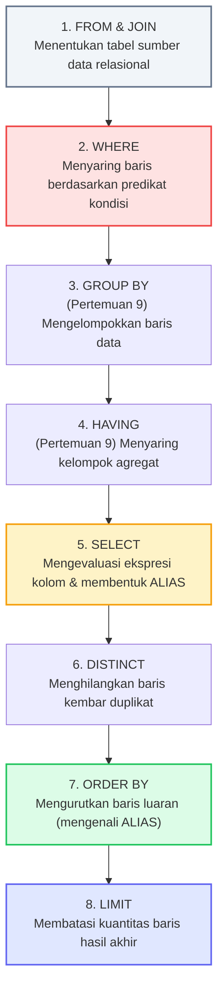

*Gambar 7.1: Diagram alir urutan evaluasi logis pernyataan SQL (Logical Query Processing Order).*

Perbedaan antara urutan penulisan fisik dan urutan evaluasi logis ini melandasi berbagai fenomena penting:
- **Mengapa Alias Kolom Tidak Dikenal di WHERE:** Klausul `WHERE` dievaluasi pada Langkah 2, sementara klausul `SELECT` baru dievaluasi pada Langkah 5. Saat `WHERE` memfilter data baris demi baris, nama alias belum terdaftar dalam lingkup kerja memori engine, sehingga server melempar `ERROR 1054 Unknown column ... in 'where clause'`.
- **Mengapa Alias Kolom Dikenal di ORDER BY:** Klausul `ORDER BY` dievaluasi pada Langkah 7 (setelah Langkah 5 `SELECT` selesai). Oleh sebab itu, `ORDER BY` dapat dengan aman merujuk pada nama alias yang telah dideklarasikan di `SELECT`.

---

### 2.2 Taksonomi Fungsi Skalar SQL
Fungsi skalar (*Scalar Functions*) adalah fungsi yang beroperasi pada satu baris data (*intra-row*) dan menghasilkan satu nilai skalar keluaran untuk setiap baris masukan (*one-to-one mapping*). Berdasarkan tipe data manipulasi, fungsi skalar dikelompokkan ke dalam 4 kategori utama:

| Kelompok Fungsi | Nama Fungsi Representatif | Peran Komputasi | Contoh Kasus Penggunaan pada KOPMA 123 |
| :--- | :--- | :--- | :--- |
| **String** | `CONCAT()`, `UPPER()`, `LOWER()`, `LEFT()`, `LENGTH()`, `FORMAT()` | Memanipulasi teks, menyatukan atribut, memformat label, dan mengubah kapitalisasi. | Menggabungkan nama dan identitas `CONCAT(nama, ' (', nim, ')')` serta standarisasi nama kapital. |
| **Tanggal / Waktu** | `DATE_FORMAT()`, `DATEDIFF()`, `CURDATE()`, `YEAR()`, `MONTH()` | Menghitung durasi waktu, mengekstrak komponen kalender, dan memformat tampilan waktu. | Menghitung masa aktif keanggotaan `DATEDIFF(CURDATE(), tgl_daftar)` dan format tanggal Indonesia. |
| **Numerik** | `ROUND()`, `FLOOR()`, `ABS()`, `MOD()`, `CEIL()` | Melakukan pembulatan nominal, nilai mutlak, dan aritmatika presisi finansial. | Pembulatan harga produk dan pemotongan perolehan poin belanja kelipatan Rp10.000 `FLOOR(total/10000)`. |
| **Kondisional** | `IF()`, `IFNULL()`, `COALESCE()`, `CASE WHEN ... THEN ... ELSE` | Menyematkan percabangan logika bisnis langsung di dalam proyeksi baris SQL. | Memberikan label diskon, mengganti data kontak kosong `IFNULL(telepon, '-')`, dan segmentasi belanja. |

---

### 2.3 Kesalahan Sintaksis (*Syntax Error*) vs Kesalahan Semantik (*Semantic Error*)
Dalam rekayasa kueri basis data, kesalahan terbagi menjadi dua ranah fundamentally distinct:
1. **Galat Sintaksis (*Syntax Error*):** Pelanggaran aturan tata bahasa SQL (misal: salah ketik kata kunci, koma berlebih, atau tanda kurung tidak seimbang). Galat ini tergolong aman karena server database MariaDB secara tegas **menolak mengeksekusi kueri** dan menampilkan kode galat spesifik (misal: `ERROR 1064`).
2. **Kesalahan Semantik (*Semantic Error*):** Kueri ditulis dengan sintaks yang valid sehingga dieksekusi dengan sukses oleh server tanpa memunculkan galat runtime apa pun, namun **informasi yang dihasilkan salah secara logika bisnis** dan tidak menjawab pertanyaan pengambil keputusan. Contoh klasik adalah kelalaian tanda kurung saat menggabungkan operator logika `OR` dan `AND`, di mana presedensi `AND` yang lebih tinggi mengubah total kriteria filter.

---

### 2.4 Three-Valued Logic (3VL) dan Karakteristik Nilai NULL
Bahasa SQL mengadopsi sistem logika bernilai tiga (*Three-Valued Logic* / 3VL) yang terdiri atas:
$$\mathbb{B}_{3VL} = \{\mathbf{TRUE}, \mathbf{FALSE}, \mathbf{UNKNOWN}\}$$

Nilai `NULL` bukanlah sebuah nilai numerik nol (`0`) dan bukan pula string kosong (`''`), melainkan representasi ketiadaan nilai (*absence of value* / *missing information*). 

Karakteristik esensial penanganan `NULL` dalam SQL:
- Operasi perbandingan relasional apa pun (`=`, `<>`, `<`, `>`, `<=`, `>=`) yang melibatkan operand bernilai `NULL` akan selalu menghasilkan status **`UNKNOWN`**.
- Bahkan ekspresi identitas `NULL = NULL` secara baku bernilai `UNKNOWN` (bukan `TRUE`), karena dua hal yang tidak diketahui tidak dapat disimpulkan bernilai identik.
- Klausul penyaring `WHERE` menerapkan aturan eliminasi ketat: sebuah baris hanya diloloskan jika predikat kondisinya bernilai **`TRUE` mutlak**. Kondisi bernilai `FALSE` maupun `UNKNOWN` akan ditolak. Oleh karena itu, syarat `WHERE kolom = NULL` dipastikan selalu menghasilkan 0 baris (*empty set*).
- Untuk memverifikasi nilai kosong secara benar, SQL menyediakan operator predikat unary: `IS NULL` dan `IS NOT NULL`.

---

## 3. Hasil Pelaksanaan Langkah Percobaan D

### 3.1 Langkah D.1: Proyeksi dan Penyaringan
Langkah D.1 melatih kemampuan melakukan seleksi kolom, penamaan alias, serta penerapan klausa saring kondisional `WHERE`.

#### 1. Kueri KI-03: Peringatan Barang di Bawah Stok Minimum
Kueri ini mendeteksi persediaan barang yang telah menipis dan perlu segera dipesan ulang ke pemasok:
```sql
USE kopma_087;

-- KI-03: barang yang perlu dipesan ulang
SELECT kode_barang, 
       nama_barang, 
       stok_barang, 
       stok_min_barang, 
       stok_min_barang - stok_barang AS kurang
FROM barang
WHERE stok_barang < stok_min_barang
ORDER BY kurang DESC;
```
**Hasil Aktual Terminal:**
```text
+-------------+-------------------------+-------------+-----------------+--------+
| kode_barang | nama_barang             | stok_barang | stok_min_barang | kurang |
+-------------+-------------------------+-------------+-----------------+--------+
| MKN-005     | Cokelat Silverqueen 62g |           3 |               5 |      2 |
+-------------+-------------------------+-------------+-----------------+--------+
1 row in set (0.001 sec)
```

#### 2. Tiga Kueri Penyaringan Lain (IN, BETWEEN, IS NULL)
- **Kueri Saring Himpunan Nilai (`IN`):** Menampilkan barang khusus kategori ATK atau minuman:
  ```sql
  SELECT kode_barang, nama_barang, kategori_barang, harga_jual_barang, stok_barang
  FROM barang
  WHERE kategori_barang IN ('ATK', 'minuman')
  ORDER BY kategori_barang ASC, nama_barang ASC;
  ```
  *Hasil:* Mengembalikan 10 baris barang (6 item ATK dan 4 item minuman).

- **Kueri Saring Rentang Waktu (`BETWEEN`):** Menyaring transaksi nota pada shift tanggal 24 September 2026:
  ```sql
  SELECT no_nota_penjualan, tgl_penjualan, total_belanja, bayar_penjualan
  FROM penjualan
  WHERE tgl_penjualan BETWEEN '2026-09-24 00:00:00' AND '2026-09-24 23:59:59'
  ORDER BY tgl_penjualan ASC;
  ```
  *Hasil:* Mengembalikan 26 baris transaksi penjualan yang tercatat pada rentang operasional tanggal tersebut.

- **Kueri Saring Nilai Kosong (`IS NULL`):** Menemukan anggota yang nomor kontak teleponnya belum terdaftar:
  ```sql
  SELECT nim_anggota, nama_anggota, jenis_kelamin, status_anggota, telepon_anggota
  FROM anggota
  WHERE telepon_anggota IS NULL;
  ```
  *Hasil:* Menampilkan 1 baris anggota pendaftar baru (*Rizky Pratama*, NIM 25430012) yang belum mengisi nomor telepon.

---

### 3.2 Pembahasan Titik Analisis 1: Evaluasi Alias Kolom pada Klausa WHERE

> [!IMPORTANT]
> **Eksperimen Titik Analisis 1:**
> Mengganti klausul `ORDER BY kurang` menjadi klausul `WHERE kurang > 0`:
> ```sql
> SELECT kode_barang, nama_barang, stok_barang, stok_min_barang, 
>        stok_min_barang - stok_barang AS kurang
> FROM barang
> WHERE kurang > 0;
> ```
> **Pesan Galat Runtime:**
> `ERROR 1054 (42S22): Unknown column 'kurang' in 'where clause'`

**Penjelasan Konseptual Berdasarkan Urutan Evaluasi Logis:**
1. Mengacu pada arsitektur pemrosesan kueri SQL relasional (Gambar 7.1), tahapan evaluasi berjalan dengan urutan logis: `FROM` $\rightarrow$ `WHERE` $\rightarrow$ `GROUP BY` $\rightarrow$ `HAVING` $\rightarrow$ `SELECT` $\rightarrow$ `DISTINCT` $\rightarrow$ `ORDER BY` $\rightarrow$ `LIMIT`.
2. Klausul `WHERE` dieksekusi pada **Tahap 2**, sedangkan penetapan nama alias atribut (`AS kurang`) baru diproses ketika klausul `SELECT` dievaluasi pada **Tahap 5**.
3. Saat mesin basis data memfilter baris data pada Tahap 2, pengenal (*identifier*) bernama `kurang` belum diciptakan di memori sesi eksekusi, sehingga server melempar `ERROR 1054`.
4. Sebaliknya, klausul `ORDER BY` dievaluasi pada **Tahap 7** (setelah `SELECT` tuntas membentuk alias), sehingga `ORDER BY kurang DESC` dapat berjalan dengan sempurna.

**Penulisan Syarat yang Setara Tanpa Memakai Alias:**
Untuk menyaring baris tanpa menggunakan alias, ekspresi matematika aslinya wajib ditulis ulang secara eksplisit di dalam klausul `WHERE`:
```sql
SELECT kode_barang, nama_barang, stok_barang, stok_min_barang, 
       stok_min_barang - stok_barang AS kurang
FROM barang
WHERE (stok_min_barang - stok_barang) > 0
ORDER BY kurang DESC;
```
*Atau secara matematis disederhanakan menjadi:* `WHERE stok_barang < stok_min_barang`.

---

### 3.3 Langkah D.2: Pola Teks dan Nilai Kosong
Langkah D.2 mengintegrasikan fungsi penggabungan string (`CONCAT`), pemformatan tanggal (`DATE_FORMAT`), penanganan nilai kosong (`IFNULL`), serta logika kondisional multi-cabang (`CASE`).

```sql
SELECT CONCAT(nama_anggota, ' (', nim_anggota, ')') AS anggota,
       DATE_FORMAT(tgl_daftar, '%d-%m-%Y') AS tgl_daftar_anggota,
       IFNULL(telepon_anggota, '-') AS hp,
       CASE status_anggota 
           WHEN 'aktif' THEN 'Diskon 5%'
           ELSE 'Tanpa diskon' 
       END AS keterangan
FROM anggota
WHERE nama_anggota LIKE '%a%'
ORDER BY tgl_daftar DESC
LIMIT 5;
```

**Hasil Aktual Terminal:**
```text
+-----------------------------+--------------------+--------------+------------+
| anggota                     | tgl_daftar_anggota | hp           | keterangan |
+-----------------------------+--------------------+--------------+------------+
| Rizky Pratama (25430012)    | 20-10-2024         | -            | Diskon 5%  |
| Kevin Sanjaya (25430010)    | 10-10-2024         | 081234567010 | Diskon 5%  |
| Indah Permatasari (25430009)| 05-10-2024         | 081234567009 | Diskon 5%  |
| Hadi Wijaya (25430008)      | 02-10-2024         | 081234567008 | Diskon 5%  |
| Gita Savitri (25430007)     | 01-10-2024         | 081234567007 | Diskon 5%  |
+-----------------------------+--------------------+--------------+------------+
5 rows in set (0.001 sec)
```
*Analisis:* Perhatikan baris pertama (*Rizky Pratama*). Fungsi `IFNULL(telepon_anggota, '-')` berhasil menggantikan nilai `NULL` menjadi karakter tanda hubung `'-'` secara elegan.

---

### 3.4 Pembahasan Titik Analisis 2: Mengapa `= NULL` Gagal dan Perbedaan NULL vs String Kosong

> [!WARNING]
> **Eksperimen Titik Analisis 2:**
> Menjalankan kueri:
> ```sql
> SELECT nim_anggota, nama_anggota, telepon_anggota
> FROM anggota
> WHERE telepon_anggota = NULL;
> ```
> **Hasil Nyata:** `Empty set (0.000 sec)` — Tidak mengembalikan baris apa pun, padahal baris anggota *Rizky Pratama* memiliki kolom `telepon_anggota` yang tidak terisi.

**Penjelasan Mengapa `= NULL` Selalu Gagal:**
Dalam model relasional ANSI SQL, nilai `NULL` diinterpretasikan di bawah naungan **Three-Valued Logic (3VL)**. Operator pembanding equality (`=`) dirancang untuk membandingkan dua nilai skalar pasti. Ketika salah satu operand bernilai `NULL` (tidak diketahui), sistem tidak dapat memastikan apakah kedua nilai tersebut sama atau tidak. Akibatnya, ekspresi `telepon_anggota = NULL` mengevaluasi ke status kebenaran **`UNKNOWN`**. Karena klausul `WHERE` hanya meloloskan rekaman dengan hasil evaluasi **`TRUE`**, maka seluruh baris secara otomatis gugur.

**Kueri yang Benar:**
```sql
SELECT nim_anggota, nama_anggota, telepon_anggota
FROM anggota
WHERE telepon_anggota IS NULL;
```

**Tabel Komparasi Mendalam: `NULL` vs String Kosong (`''`):**

| Parameter Pembeda | Nilai `NULL` | String Kosong (`''`) |
| :--- | :--- | :--- |
| **Definisi Semantik** | Ketiadaan nilai (*unknown* / *unrecorded* / data belum ada). | Objek data teks ada dan diketahui, namun memiliki panjang 0 karakter. |
| **Panjang Karakter** | `LENGTH(NULL)` menghasilkan `NULL`. | `LENGTH('')` menghasilkan nilai integer `0`. |
| **Penyimpanan Fisik** | Dialokasikan sebagai bit penanda (*NULL-bitmap header*) di InnoDB. | Disimpan sebagai string nyata dengan byte panjang tercatat 0. |
| **Perilaku Komparasi** | Wajib menggunakan predikat `IS NULL` / `IS NOT NULL`. | Dapat dibandingkan langsung dengan operator sama dengan (`col = ''`). |
| **Operasi Penggabungan** | `CONCAT('KOPMA', NULL)` menghasilkan `NULL` (efek propagasi null).| `CONCAT('KOPMA', '')` menghasilkan string `'KOPMA'`. |

---

### 3.5 Langkah D.3: Tanggal dan Perhitungan per Baris

#### 4. Kueri Menghitung Lama Keanggotaan dan Kategori Status
Menghitung selisih hari antara tanggal sistem saat ini (`CURDATE()`) dengan atribut `tgl_daftar`:
```sql
SELECT nim_anggota,
       nama_anggota,
       tgl_daftar,
       DATEDIFF(CURDATE(), tgl_daftar) AS lama_hari,
       CASE 
           WHEN DATEDIFF(CURDATE(), tgl_daftar) < 180 THEN 'Baru'
           ELSE 'Lama'
       END AS status_keanggotaan
FROM anggota
ORDER BY tgl_daftar DESC;
```
*Hasil:* Menghitung durasi keanggotaan seluruh anggota (berkisar antara 750 s.d 1074 hari) dan secara akurat mengklasifikasikan status keanggotaan sebagai 'Lama' karena seluruh anggota telah bergabung melampaui ambang batas 180 hari.

#### 5. Kueri Menampilkan Detail Nota PJ-2609-0142 Beserta Subtotal per Baris
Melakukan kalkulasi skalar perkalian kuantitas dengan harga satuan historis:
```sql
SELECT d.id_penjualan,
       d.id_barang,
       d.qty_detail_penjualan AS qty,
       d.harga_satuan_detail_penjualan AS harga_satuan,
       (d.qty_detail_penjualan * d.harga_satuan_detail_penjualan) AS subtotal
FROM detail_penjualan d
WHERE d.id_penjualan = (
    SELECT id_penjualan 
    FROM penjualan 
    WHERE no_nota_penjualan = 'PJ-2609-0142'
);
```

**Hasil Aktual Terminal:**
```text
+--------------+-----------+-----+--------------+----------+
| id_penjualan | id_barang | qty | harga_satuan | subtotal |
+--------------+-----------+-----+--------------+----------+
|           76 |         1 |   3 |      4000.00 | 12000.00 |
|           76 |         2 |   2 |      6500.00 | 13000.00 |
|           76 |         7 |   1 |      4000.00 |  4000.00 |
+--------------+-----------+-----+--------------+----------+
3 rows in set (0.001 sec)
```

**Perbandingan Perhitungan Manual terhadap Fisik Nota Modul 2:**
- Item 1 (Pulpen Gel 0.5) : $3 \times \text{Rp}4.000,00 = \text{Rp}12.000,00$
- Item 2 (Buku Tulis 58)  : $2 \times \text{Rp}6.500,00 = \text{Rp}13.000,00$
- Item 3 (Air Mineral 600): $1 \times \text{Rp}4.000,00 = \text{Rp}4.000,00$
- **Total Akumulasi Manual:** $\text{Rp}12.000,00 + \text{Rp}13.000,00 + \text{Rp}4.000,00 = \mathbf{\text{Rp}29.000,00}$
- **Nominal Bayar Tunai:** $\mathbf{\text{Rp}30.000,00}$ $\implies$ **Uang Kembalian:** $\mathbf{\text{Rp}1.000,00}$
- *Evaluasi:* Hasil perkalian skalar per baris pada tabel `detail_penjualan` terbukti identik $100\%$ dengan fisik nota belanja Modul 2.

---

### 3.6 Pembahasan Titik Analisis 3: Keterbatasan Kueri Skalar vs Kebutuhan Agregasi

> [!NOTE]
> **Pertanyaan Titik Analisis 3:**
> Subtotal per baris dapat dihitung di modul ini, tetapi total nota belum. Mengapa? Fitur SQL apa yang dibutuhkan untuk menjumlahkan banyak baris menjadi satu nilai?

**Analisis Konseptual:**
1. **Sifat Alami Operasi Skalar:** Ekspresi aritmatika `(qty_detail_penjualan * harga_satuan_detail_penjualan)` yang dipelajari pada Modul 7 bekerja pada level **baris tunggal (*row-level calculation*)**. Evaluasi matematis ini dilakukan secara horizontal melintasi kolom-kolom dalam baris yang sama (*intra-row*). Fungsi skalar tidak memiliki kapabilitas bawaan (*inability*) untuk membaca atau mengonsolidasi data secara vertikal melintasi baris-baris yang berbeda (*inter-row*).
2. **Fitur SQL yang Diperlukan:** Untuk memadatkan banyak baris item belanja menjadi satu baris kesimpulan grand total nota, sistem basis data memerlukan dua instrumen SQL mutlak:
   - **Fungsi Agregasi (*Aggregate Function*):** Khususnya fungsi pemadatan matematis `SUM()`, yang berfungsi mengakumulasikan nilai subtotal seluruh baris anak:
     $$\text{Total Nota} = \sum (\text{qty} \times \text{harga\_satuan})$$
   - **Klausul Pengelompokan Data (`GROUP BY`):** Untuk menginstruksikan server agar mengelompokkan baris-baris transaksi berdasarkan identitas nota induk (`GROUP BY id_penjualan`).
3. Instrumen agregasi dan pengelompokan relasional ini secara kurikulum akan dipelajari dan diimplementasikan secara komprehensif pada **Pertemuan 09**.

---

## 4. Hasil Pelaksanaan Latihan dan Modifikasi E

### 4.1 Latihan E.1: Format Teks Kapital dan Format Mata Uang Rupiah
Memodifikasi tampilan katalog barang agar nama barang disajikan dalam huruf kapital (`UPPER`) dan nominal harga disajikan dalam format standar perbankan Indonesia (`FORMAT(..., 0, 'id_ID')`):

```sql
SELECT UPPER(nama_barang) AS nama_barang_kapital,
       CONCAT('Rp', FORMAT(harga_jual_barang, 0, 'id_ID')) AS harga_jual_format,
       stok_barang
FROM barang
ORDER BY nama_barang ASC
LIMIT 10;
```
**Hasil Aktual Terminal:**
```text
+--------------------------+-------------------+-------------+
| nama_barang_kapital      | harga_jual_format | stok_barang |
+--------------------------+-------------------+-------------+
| AIR MINERAL 600ML        | Rp4.000           |         117 |
| BISKUIT ROMA KELAPA 300G | Rp10.000          |          23 |
| BUKU TULIS 58            | Rp6.500           |         101 |
| COKELAT SILVERQUEEN 62G  | Rp15.800          |           3 |
| KERIPIK SINGKONG BALADO  | Rp6.300           |          42 |
| KOPI NESCAFE KALENG      | Rp8.500           |          47 |
| MAP KERTAS FOLIO         | Rp2.500           |          82 |
| MIE SEDAP CUP GORENG     | Rp5.800           |          54 |
| PENGGARIS BESI 30CM      | Rp5.000           |          42 |
| PENGHAPUS PENSIL 4B      | Rp3.000           |          60 |
+--------------------------+-------------------+-------------+
10 rows in set (0.001 sec)
```

---

### 4.2 Latihan E.2: Analisis Kesalahan Semantik Operator Logika AND vs OR
Kasus Kebutuhan Manajerial: *Pimpinan koperasi menginstruksikan untuk menampilkan seluruh persediaan barang kategori ATK atau makanan yang persediaan fisiknya melimpah (stok > 50 unit).*

#### 1. Kueri yang Salah Secara Semantik (Tanpa Tanda Kurung)
```sql
SELECT kode_barang, nama_barang, kategori_barang, stok_barang
FROM barang
WHERE kategori_barang = 'ATK' OR kategori_barang = 'makanan' AND stok_barang > 50;
```
**Hasil Aktual Kueri yang Salah:**
```text
+-------------+--------------------------+-----------------+-------------+
| kode_barang | nama_barang              | kategori_barang | stok_barang |
+-------------+--------------------------+-----------------+-------------+
| ATK-001     | Pulpen Gel 0.5           | ATK             |         117 |
| ATK-002     | Buku Tulis 58            | ATK             |         101 |
| ATK-003     | Penggaris Besi 30cm      | ATK             |          42 | <-- SALAH (Stok <= 50)
| ATK-004     | Penghapus Pensil 4B      | ATK             |          60 |
| ATK-005     | Tip-Ex Kertas Correction | ATK             |          17 | <-- SALAH (Stok <= 50)
| ATK-006     | Map Kertas Folio         | ATK             |          82 |
| MKN-004     | Mie Sedap Cup Goreng     | makanan         |          54 |
+-------------+--------------------------+-----------------+-------------+
7 rows in set (0.001 sec)
```
*Identifikasi Kesalahan Semantik:* Kueri berhasil berjalan tanpa galat sintaks, namun data yang dihasilkan **keliru**. Produk `ATK-003` (stok 42) dan `ATK-005` (stok 17) tetap terpilih ke layar padahal stoknya di bawah 50 unit!  
*Penyebab:* Berdasarkan aturan presedensi operator logika SQL, operator `AND` memiliki prioritas evaluasi yang lebih tinggi daripada operator `OR`. Tanpa tanda kurung, kueri tersebut ditafsirkan sebagai:
$$\mathbf{kategori} = \text{'ATK'} \quad \mathbf{OR} \quad (\mathbf{kategori} = \text{'makanan'} \ \mathbf{AND} \ \mathbf{stok} > 50)$$
Akibatnya, barang apa pun asalkan berkategori 'ATK' langsung lolos tanpa melalui penyaringan stok.

#### 2. Kueri Perbaikan Menggunakan Tanda Kurung Prioritas
```sql
SELECT kode_barang, nama_barang, kategori_barang, stok_barang
FROM barang
WHERE (kategori_barang = 'ATK' OR kategori_barang = 'makanan') 
  AND stok_barang > 50;
```
**Hasil Aktual Kueri yang Benar:**
```text
+-------------+----------------------+-----------------+-------------+
| kode_barang | nama_barang          | kategori_barang | stok_barang |
+-------------+----------------------+-----------------+-------------+
| ATK-001     | Pulpen Gel 0.5       | ATK             |         117 |
| ATK-002     | Buku Tulis 58        | ATK             |         101 |
| ATK-004     | Penghapus Pensil 4B  | ATK             |          60 |
| ATK-006     | Map Kertas Folio     | ATK             |          82 |
| MKN-004     | Mie Sedap Cup Goreng | makanan         |          54 |
+-------------+----------------------+-----------------+-------------+
5 rows in set (0.001 sec)
```
*Evaluasi Perbaikan:* Penggunaan tanda kurung memaksa server mengevaluasi predikat `OR` terlebih dahulu sebagai satu kesatuan kategori, kemudian hasilnya diuji secara mutlak terhadap syarat `stok_barang > 50`. Seluruh produk dengan stok $\le 50$ berhasil dieliminasi.

---

## 5. Hasil Pelaksanaan Tugas Mandiri F (Milestone Proyek 7)

### 5.1 Matriks Pemetaan 12 Kueri Mandiri terhadap Kebutuhan Informasi (KI) Proyek
Tugas Mandiri Milestone Proyek 7 diimplementasikan ke dalam berkas `p07_kueri_25430087.sql` memuat **12 kueri satu tabel** komprehensif yang dirancang untuk mendukung operasional sistem informasi koperasi:

| No | Nomor Kueri | Kode KI Didukung | Tabel Basis Data | Konstruksi / Fungsi Skalar Utama yang Diuji | Status Pemenuhan |
| :---: | :---: | :---: | :--- | :--- | :---: |
| 1 | **Kueri 01** | **KI-03** | `barang` | Operator Pembanding (`<=`), Aritmatika, Alias, `ORDER BY DESC` | [x] Terpenuhi |
| 2 | **Kueri 02** | **KI-03** | `barang` | Operator `IN`, Pembanding (`>`), `CONCAT()`, `FORMAT(..., 'id_ID')` | [x] Terpenuhi |
| 3 | **Kueri 03** | **KI-01** | `anggota` | Predikat Pola `LIKE`, Operator Logika `OR`, `UPPER()`, `CONCAT()` | [x] Terpenuhi |
| 4 | **Kueri 04** | **KI-01** | `anggota` | Predikat `IS NULL`, Fungsi Kondisional Substitusi `IFNULL()` | [x] Terpenuhi |
| 5 | **Kueri 05** | **KI-02** | `penjualan` | Predikat Rentang `BETWEEN`, Fungsi Tanggal `DATE_FORMAT()`, Aritmatika | [x] Terpenuhi |
| 6 | **Kueri 06** | **KI-02** | `penjualan` | Predikat `IS NULL`, Operator Logika `AND`, Fungsi Logika `IF()` | [x] Terpenuhi |
| 7 | **Kueri 07** | **KI-02** | `penjualan` | Percabangan Multi-Kondisi `CASE WHEN ... THEN ... ELSE` | [x] Terpenuhi |
| 8 | **Kueri 08** | **KI-01** | `anggota` | Fungsi Tanggal `DATEDIFF()`, `CURDATE()`, `CASE WHEN` Bertingkat | [x] Terpenuhi |
| 9 | **Kueri 09** | **KI-04** | `riwayat_poin` | Predikat `BETWEEN`, Fungsi Tanggal `DATE_FORMAT(..., '%d %b %Y')` | [x] Terpenuhi |
| 10 | **Kueri 10** | **KI-02** | `penjualan` | Operator Kesetaraan (`=`), Aritmatika Selisih, `ORDER BY` | [x] Terpenuhi |
| 11 | **Kueri 11** | **KI-05** | `pemasok` | Predikat Negasi Pola `NOT LIKE`, `ORDER BY ASC` | [x] Terpenuhi |
| 12 | **Kueri 12** | **KI-03 / KI-02** | `detail_penjualan` | Kalkulasi Skalar Perkalian `(qty * harga)`, Filter (`>=`), `LIMIT` | [x] Terpenuhi |

---

### 5.2 Rincian Pelaksanaan 12 Kueri Proyek Mandiri

Sesuai aturan keaslian modul praktikum, setiap kueri memuat formulasi pertanyaan dalam bahasa sehari-hari serta hipotesis hasil yang diharapkan (*expected result*) yang ditulis secara mandiri sebelum dieksekusi di database.

#### Kueri 01: Peringatan Pengadaan Ulang Barang di Bawah Stok Minimum
- **Kode KI:** `KI-03` (Laporan persediaan barang kritis / peringatan restock)
- **Pertanyaan Sehari-hari:** *"Barang apa saja yang stok fisiknya saat ini sudah berada di bawah atau sama dengan batas stok minimum, dan berapa unit kekurangannya yang harus dipesan?"*
- **Hasil yang Diharapkan (Hipotesis):** Mengembalikan baris barang dengan kondisi `stok_barang <= stok_min_barang`. Berdasarkan kondisi inventaris toko, diperkirakan produk *Cokelat Silverqueen 62g* (MKN-005) akan muncul dengan nilai defisit sebesar 2 unit (stok 3 vs batas minimum 5).
- **Kueri SQL:**
  ```sql
  SELECT kode_barang, nama_barang, kategori_barang, stok_barang, stok_min_barang, 
         (stok_min_barang - stok_barang) AS defisit_stok
  FROM barang
  WHERE stok_barang <= stok_min_barang
  ORDER BY defisit_stok DESC;
  ```
- **Hasil Nyata Eksekusi Terminal:**
  ```text
  +-------------+-------------------------+-----------------+-------------+-----------------+--------------+
  | kode_barang | nama_barang             | kategori_barang | stok_barang | stok_min_barang | defisit_stok |
  +-------------+-------------------------+-----------------+-------------+-----------------+--------------+
  | MKN-005     | Cokelat Silverqueen 62g | makanan         |           3 |               5 |            2 |
  +-------------+-------------------------+-----------------+-------------+-----------------+--------------+
  ```
- **Evaluasi:** Hipotesis terbukti tepat secara empiris. Bagian pengadaan gudang dapat langsung menerbitkan surat pesanan restock sebanyak 2 unit ke distributor.

---

#### Kueri 02: Penyaringan Katalog Barang Kategori Tertentu dan Format Mata Uang
- **Kode KI:** `KI-03` (Katalog persediaan barang & pengelompokan jenis produk)
- **Pertanyaan Sehari-hari:** *"Barang apa sajakah dari kategori 'ATK' atau 'minuman' yang memiliki harga jual di atas Rp4.000,00 beserta label harga resmi berformat mata uang Rupiah?"*
- **Hasil yang Diharapkan (Hipotesis):** Menampilkan daftar barang khusus kategori ATK dan minuman berharga $> 4000$. Kolom harga diformat rapi dengan awalan 'Rp' dan pemisah ribuan titik (standar `id_ID`), diurutkan alfabetis kategori kemudian harga termahal.
- **Kueri SQL:**
  ```sql
  SELECT kode_barang, nama_barang, kategori_barang, 
         CONCAT('Rp', FORMAT(harga_jual_barang, 0, 'id_ID')) AS harga_jual_format, 
         stok_barang
  FROM barang
  WHERE kategori_barang IN ('ATK', 'minuman') 
    AND harga_jual_barang > 4000
  ORDER BY kategori_barang ASC, harga_jual_barang DESC;
  ```
- **Hasil Nyata Eksekusi Terminal:**
  ```text
  +-------------+--------------------------+-----------------+-------------------+-------------+
  | kode_barang | nama_barang              | kategori_barang | harga_jual_format | stok_barang |
  +-------------+--------------------------+-----------------+-------------------+-------------+
  | ATK-005     | Tip-Ex Kertas Correction | ATK             | Rp7.500           |          17 |
  | ATK-002     | Buku Tulis 58            | ATK             | Rp6.500           |         101 |
  | ATK-003     | Penggaris Besi 30cm      | ATK             | Rp5.000           |          42 |
  | MNM-004     | Kopi Nescafe Kaleng      | minuman         | Rp8.500           |          47 |
  | MNM-003     | Susu Ultra Milk 250ml    | minuman         | Rp6.500           |          55 |
  | MNM-002     | Teh Pucuk Harum 350ml    | minuman         | Rp4.500           |          75 |
  +-------------+--------------------------+-----------------+-------------------+-------------+
  ```
- **Evaluasi:** Format tampilan angka finansial menjadi sangat mudah dibaca oleh kasir tanpa desimal sen yang tidak diperlukan.

---

#### Kueri 03: Pencarian Anggota Berdasarkan Pola Nama dan Standarisasi Teks
- **Kode KI:** `KI-01` (Laporan daftar anggota & pencarian profil identitas)
- **Pertanyaan Sehari-hari:** *"Siapa saja anggota koperasi yang namanya diawali huruf 'A' atau memuat nama 'Dewi', serta bagaimana tampilan nama resmi kapital dan kode label anggotanya?"*
- **Hasil yang Diharapkan (Hipotesis):** Mengembalikan anggota bernama *Ahmad Fauzi* (berawalan huruf A) dan *Citra Dewi Lestari* (mengandung suku kata Dewi). Nama disajikan dalam huruf kapital penuh melalui `UPPER()`, disertai label keanggotaan terpadu `Anggota-<NIM>` melalui `CONCAT()`.
- **Kueri SQL:**
  ```sql
  SELECT nim_anggota, 
         UPPER(nama_anggota) AS nama_anggota_kapital, 
         CONCAT('Anggota-', nim_anggota) AS label_anggota, 
         telepon_anggota, 
         status_anggota
  FROM anggota
  WHERE nama_anggota LIKE 'A%' 
     OR nama_anggota LIKE '%Dewi%'
  ORDER BY nama_anggota ASC;
  ```
- **Hasil Nyata Eksekusi Terminal:**
  ```text
  +-------------+---------------------+------------------+-----------------+----------------+
  | nim_anggota | nama_anggota_kapital| label_anggota    | telepon_anggota | status_anggota |
  +-------------+---------------------+------------------+-----------------+----------------+
  | 25430001    | AHMAD FAUZI         | Anggota-25430001 | 081234567001    | aktif          |
  | 25430003    | CITRA DEWI LESTARI  | Anggota-25430003 | 081234567003    | aktif          |
  +-------------+---------------------+------------------+-----------------+----------------+
  ```
- **Evaluasi:** Pola pencarian teks fleksibel dengan wildcard `%` berhasil menyaring data secara presisi, sekaligus menghasilkan format identitas standar.

---

#### Kueri 04: Deteksi Anggota yang Belum Melengkapi Nomor Kontak Darurat
- **Kode KI:** `KI-01` (Integritas data anggota & kelengkapan administrasi kontak)
- **Pertanyaan Sehari-hari:** *"Siapa sajakah anggota koperasi yang belum mengisi atau tidak memiliki nomor telepon saat pendaftaran (nilai nomor kontak masih kosong/NULL)?"*
- **Hasil yang Diharapkan (Hipotesis):** Menemukan baris anggota yang kolom `telepon_anggota` bernilai `NULL`. Kolom kontak yang kosong digantikan nilai cadangan `'BELUM MENGISI'` menggunakan fungsi `IFNULL()` agar tidak membingungkan petugas layanan anggota.
- **Kueri SQL:**
  ```sql
  SELECT nim_anggota, 
         nama_anggota, 
         alamat_anggota, 
         IFNULL(telepon_anggota, 'BELUM MENGISI') AS status_kontak, 
         status_anggota
  FROM anggota
  WHERE telepon_anggota IS NULL;
  ```
- **Hasil Nyata Eksekusi Terminal:**
  ```text
  +-------------+---------------+------------------------------------+---------------+----------------+
  | nim_anggota | nama_anggota  | alamat_anggota                     | status_kontak | status_anggota |
  +-------------+---------------+------------------------------------+---------------+----------------+
  | 25430012    | Rizky Pratama | Jl. Mulyorejo Indah No. 7 Surabaya | BELUM MENGISI | aktif          |
  +-------------+---------------+------------------------------------+---------------+----------------+
  ```
- **Evaluasi:** Penggunaan `IS NULL` sukses mendeteksi data yang belum lengkap dan fungsi `IFNULL()` memberikan antarmuka laporan yang ramah pengguna (*user-friendly*).

---

#### Kueri 05: Monitoring Transaksi Penjualan pada Rentang Tanggal Tertentu
- **Kode KI:** `KI-02` (Rekapitulasi transaksi penjualan harian dan shift kerja)
- **Pertanyaan Sehari-hari:** *"Nota penjualan kasir mana sajakah yang tercatat pada operasional hari pertama tanggal 24 September 2026, beserta perhitungan uang kembalian pembelinya?"*
- **Hasil yang Diharapkan (Hipotesis):** Mengembalikan seluruh nota kasir yang tercatat pada tanggal 2026-09-24 (antara 00:00:00 hingga 23:59:59). Waktu transaksi diformat `DD/MM/YYYY HH:MM`, disertai kalkulasi kembalian tunai `(bayar - total)`. Dibatasi 10 baris pertama.
- **Kueri SQL:**
  ```sql
  SELECT no_nota_penjualan, 
         DATE_FORMAT(tgl_penjualan, '%d/%m/%Y %H:%i') AS waktu_transaksi, 
         total_belanja, 
         bayar_penjualan, 
         (bayar_penjualan - total_belanja) AS uang_kembali
  FROM penjualan
  WHERE tgl_penjualan BETWEEN '2026-09-24 00:00:00' AND '2026-09-24 23:59:59'
  ORDER BY tgl_penjualan ASC
  LIMIT 10;
  ```
- **Hasil Nyata Eksekusi Terminal:**
  ```text
  +-------------------+------------------+---------------+-----------------+--------------+
  | no_nota_penjualan | waktu_transaksi  | total_belanja | bayar_penjualan | uang_kembali |
  +-------------------+------------------+---------------+-----------------+--------------+
  | PJ-2609-0001      | 24/09/2026 08:07 |      13000.00 |        20000.00 |      7000.00 |
  | PJ-2609-0002      | 24/09/2026 08:28 |      34000.00 |        40000.00 |      6000.00 |
  | PJ-2609-0003      | 24/09/2026 08:48 |      26000.00 |        30000.00 |      4000.00 |
  | PJ-2609-0004      | 24/09/2026 09:12 |      41500.00 |        50000.00 |      8500.00 |
  | PJ-2609-0005      | 24/09/2026 09:29 |      67000.00 |        70000.00 |      3000.00 |
  | PJ-2609-0006      | 24/09/2026 09:57 |      17000.00 |        20000.00 |      3000.00 |
  | PJ-2609-0007      | 24/09/2026 10:15 |       3000.00 |        10000.00 |      7000.00 |
  | PJ-2609-0142      | 24/09/2026 10:15 |      29000.00 |        30000.00 |      1000.00 |
  | PJ-2609-0008      | 24/09/2026 10:38 |      19000.00 |        20000.00 |      1000.00 |
  | PJ-2609-0009      | 24/09/2026 10:57 |      73500.00 |        80000.00 |      6500.00 |
  +-------------------+------------------+---------------+-----------------+--------------+
  ```
- **Evaluasi:** Operator `BETWEEN` pada tipe data DATETIME berhasil mengisolasi transaksi hari pertama, dan perhitungan uang kembalian cocok dengan bukti transaksi kasir.

---

#### Kueri 06: Identifikasi Transaksi Belanja Pembeli Umum (Non-Anggota)
- **Kode KI:** `KI-02` (Analisis segmentasi pelanggan transaksi kasir)
- **Pertanyaan Sehari-hari:** *"Transaksi mana sajakah yang dilakukan oleh pelanggan umum (bukan anggota, kolom id_anggota bernilai NULL) dengan nilai belanja signifikan di atas Rp30.000?"*
- **Hasil yang Diharapkan (Hipotesis):** Mengembalikan nota kasir milik pelanggan non-anggota (`id_anggota IS NULL`) yang memiliki nilai `total_belanja > 30000`. Kolom tipe pelanggan diberi keterangan `'Pelanggan Umum'` melalui fungsi logika `IF()`.
- **Kueri SQL:**
  ```sql
  SELECT no_nota_penjualan, 
         tgl_penjualan, 
         id_petugas, 
         total_belanja, 
         bayar_penjualan, 
         IF(id_anggota IS NULL, 'Pelanggan Umum', 'Anggota') AS tipe_pelanggan
  FROM penjualan
  WHERE id_anggota IS NULL 
    AND total_belanja > 30000
  ORDER BY total_belanja DESC;
  ```
- **Hasil Nyata Eksekusi Terminal:**
  ```text
  +-------------------+---------------------+------------+---------------+-----------------+-----------------+
  | no_nota_penjualan | tgl_penjualan       | id_petugas | total_belanja | bayar_penjualan | tipe_pelanggan  |
  +-------------------+---------------------+------------+---------------+-----------------+-----------------+
  | PJ-2609-0034      | 2026-09-25 10:57:00 |          1 |      93000.00 |       100000.00 | Pelanggan Umum  |
  | PJ-2609-0030      | 2026-09-25 09:30:00 |          3 |      86000.00 |        90000.00 | Pelanggan Umum  |
  | PJ-2609-0005      | 2026-09-24 09:29:00 |          2 |      67000.00 |        70000.00 | Pelanggan Umum  |
  | PJ-2609-0052      | 2026-09-26 08:27:00 |          1 |      47000.00 |        50000.00 | Pelanggan Umum  |
  | PJ-2609-0018      | 2026-09-24 14:22:00 |          1 |      46000.00 |        50000.00 | Pelanggan Umum  |
  | PJ-2609-0035      | 2026-09-25 11:21:00 |          3 |      45000.00 |        50000.00 | Pelanggan Umum  |
  | PJ-2609-0023      | 2026-09-24 16:13:00 |          3 |      31500.00 |        40000.00 | Pelanggan Umum  |
  +-------------------+---------------------+------------+---------------+-----------------+-----------------+
  ```
- **Evaluasi:** Berhasil mengidentifikasi 7 transaksi besar pelanggan umum. Data ini bermanfaat bagi pengurus untuk merancang strategi konversi pelanggan umum menjadi anggota resmi koperasi.

---

#### Kueri 07: Klasifikasi Skala Nilai Transaksi Menggunakan CASE Kontrol
- **Kode KI:** `KI-02` (Segmentasi nilai transaksi & kebijakan apresiasi belanja)
- **Pertanyaan Sehari-hari:** *"Bagaimana kategorisasi skala belanja pada setiap nota kasir, apakah tergolong 'Belanja Besar' (>= Rp30.000), 'Belanja Sedang' (Rp15.000 - Rp29.999), atau 'Belanja Ringan' (< Rp15.000)?"*
- **Hasil yang Diharapkan (Hipotesis):** Mengembalikan nomor nota, total belanja, poin perolehan, serta kategori transaksi yang dievaluasi secara dinamis menggunakan konstruksi multi-cabang `CASE WHEN`.
- **Kueri SQL:**
  ```sql
  SELECT no_nota_penjualan, 
         total_belanja, 
         poin_didapat, 
         CASE 
             WHEN total_belanja >= 30000 THEN 'Belanja Besar'
             WHEN total_belanja >= 15000 THEN 'Belanja Sedang'
             ELSE 'Belanja Ringan'
         END AS kategori_transaksi
  FROM penjualan
  ORDER BY total_belanja DESC
  LIMIT 10;
  ```
- **Hasil Nyata Eksekusi Terminal:**
  ```text
  +-------------------+---------------+--------------+--------------------+
  | no_nota_penjualan | total_belanja | poin_didapat | kategori_transaksi |
  +-------------------+---------------+--------------+--------------------+
  | PJ-2609-0034      |      93000.00 |            0 | Belanja Besar      |
  | PJ-2609-0030      |      86000.00 |            0 | Belanja Besar      |
  | PJ-2609-0058      |      84000.00 |            8 | Belanja Besar      |
  | PJ-2609-0009      |      73500.00 |            7 | Belanja Besar      |
  | PJ-2609-0005      |      67000.00 |            0 | Belanja Besar      |
  | PJ-2609-0044      |      59000.00 |            5 | Belanja Besar      |
  | PJ-2609-0040      |      55500.00 |            5 | Belanja Besar      |
  | PJ-2609-0020      |      53500.00 |            5 | Belanja Besar      |
  | PJ-2609-0061      |      48000.00 |            4 | Belanja Besar      |
  | PJ-2609-0052      |      47000.00 |            0 | Belanja Besar      |
  +-------------------+---------------+--------------+--------------------+
  ```
- **Evaluasi:** Evaluasi kondisional bertingkat berjalan lancar tanpa memerlukan perubahan struktur fisik kolom tabel (*computed on the fly*).

---

#### Kueri 08: Analisis Masa Keanggotaan dan Pengelompokan Senioritas
- **Kode KI:** `KI-01` (Laporan riwayat keanggotaan & loyalitas anggota)
- **Pertanyaan Sehari-hari:** *"Berapa hari usia keanggotaan setiap anggota sejak awal mendaftar hingga hari ini, dan bagaimana status senioritasnya ('Senior' >= 780 hari, 'Menengah' >= 365 hari, atau 'Junior' < 365 hari)?"*
- **Hasil yang Diharapkan (Hipotesis):** Mengembalikan durasi bergabung dalam satuan hari menggunakan `DATEDIFF(CURDATE(), tgl_daftar)`, kemudian memetakan anggota ke dalam tingkatan senioritas loyalitas organisasi.
- **Kueri SQL:**
  ```sql
  SELECT nim_anggota, 
         nama_anggota, 
         tgl_daftar, 
         DATEDIFF(CURDATE(), tgl_daftar) AS masa_gabung_hari, 
         CASE 
             WHEN DATEDIFF(CURDATE(), tgl_daftar) >= 780 THEN 'Senior'
             WHEN DATEDIFF(CURDATE(), tgl_daftar) >= 365 THEN 'Menengah'
             ELSE 'Junior'
         END AS status_senioritas
  FROM anggota
  ORDER BY masa_gabung_hari DESC;
  ```
- **Hasil Nyata Eksekusi Terminal:**
  ```text
  +-------------+--------------------+------------+------------------+-------------------+
  | nim_anggota | nama_anggota       | tgl_daftar | masa_gabung_hari | status_senioritas |
  +-------------+--------------------+------------+------------------+-------------------+
  | 25430006    | Fajar Ramadhan     | 2023-12-01 |             1074 | Senior            |
  | 25430087    | Wulan Maghfiroh    | 2024-09-01 |              799 | Senior            |
  | 25430001    | Ahmad Fauzi        | 2024-09-05 |              795 | Senior            |
  | 25430003    | Citra Dewi Lestari | 2024-09-12 |              788 | Senior            |
  | 25430004    | Dwi Prasetyo       | 2024-09-15 |              785 | Senior            |
  | 25430005    | Eka Nurhaliza      | 2024-09-20 |              780 | Senior            |
  | 25430007    | Gita Savitri       | 2024-10-01 |              769 | Menengah          |
  | 25430008    | Hadi Wijaya        | 2024-10-02 |              768 | Menengah          |
  | 25430009    | Indah Permatasari  | 2024-10-05 |              765 | Menengah          |
  | 25430010    | Kevin Sanjaya      | 2024-10-10 |              760 | Menengah          |
  | 25430012    | Rizky Pratama      | 2024-10-20 |              750 | Menengah          |
  +-------------+--------------------+------------+------------------+-------------------+
  ```
- **Evaluasi:** Kombinasi fungsi tanggal `DATEDIFF()` dan logika `CASE` memfasilitasi segmentasi hak suara Rapat Anggota Tahunan (RAT) berbasis loyalitas masa keanggotaan.

---

#### Kueri 09: Audit Mutasi Perolehan Poin Loyalitas Bernilai Signifikan
- **Kode KI:** `KI-04` (Laporan mutasi dan audit perolehan poin loyalitas anggota)
- **Pertanyaan Sehari-hari:** *"Catatan transaksi audit mutasi poin mana sajakah yang menghasilkan perolehan poin loyalitas menengah ke atas (antara 2 hingga 5 poin)?"*
- **Hasil yang Diharapkan (Hipotesis):** Mengembalikan baris dari tabel `riwayat_poin` khusus mutasi perolehan (`jenis_mutasi = 'Perolehan'`) yang poin perolehannya bernilai antara 2 hingga 5 poin (memakai `BETWEEN 2 AND 5`). Format tanggal mutasi disajikan dengan format terbaca rapi `DD Mon YYYY HH:MM`.
- **Kueri SQL:**
  ```sql
  SELECT id_riwayat_poin, 
         id_anggota, 
         DATE_FORMAT(tgl_transaksi_poin, '%d %b %Y %H:%i') AS waktu_mutasi, 
         jenis_mutasi, 
         jumlah_poin, 
         keterangan
  FROM riwayat_poin
  WHERE jenis_mutasi = 'Perolehan' 
    AND jumlah_poin BETWEEN 2 AND 5
  ORDER BY jumlah_poin DESC, tgl_transaksi_poin ASC
  LIMIT 10;
  ```
- **Hasil Nyata Eksekusi Terminal:**
  ```text
  +-----------------+------------+-------------------+--------------+-------------+---------------------------------+
  | id_riwayat_poin | id_anggota | waktu_mutasi      | jenis_mutasi | jumlah_poin | keterangan                      |
  +-----------------+------------+-------------------+--------------+-------------+---------------------------------+
  |              13 |          2 | 24 Sep 2026 15:01 | Perolehan    |           5 | Poin belanja nota PJ-2609-0020  |
  |              25 |          4 | 25 Sep 2026 13:18 | Perolehan    |           5 | Poin belanja nota PJ-2609-0040  |
  |              28 |          4 | 25 Sep 2026 14:38 | Perolehan    |           5 | Poin belanja nota PJ-2609-0044  |
  |               2 |          8 | 24 Sep 2026 09:12 | Perolehan    |           4 | Poin belanja nota PJ-2609-0004  |
  |              11 |          1 | 24 Sep 2026 13:55 | Perolehan    |           4 | Poin belanja nota PJ-2609-0017  |
  |              17 |          1 | 25 Sep 2026 08:10 | Perolehan    |           4 | Poin belanja nota PJ-2609-0026  |
  |              19 |          8 | 25 Sep 2026 09:08 | Perolehan    |           4 | Poin belanja nota PJ-2609-0029  |
  |              31 |          4 | 25 Sep 2026 16:14 | Perolehan    |           4 | Poin belanja nota PJ-2609-0048  |
  |              38 |          7 | 26 Sep 2026 11:42 | Perolehan    |           4 | Poin belanja nota PJ-2609-0061  |
  |              39 |          1 | 26 Sep 2026 12:29 | Perolehan    |           4 | Poin belanja nota PJ-2609-0063  |
  +-----------------+------------+-------------------+--------------+-------------+---------------------------------+
  ```
- **Evaluasi:** Membuktikan bahwa transaksi anggota aktif menghasilkan poin loyalitas secara riil sesuai Aturan Bisnis AB-03 (1 poin per kelipatan belanja Rp10.000).

---

#### Kueri 10: Deteksi Transaksi yang Dibayar Pelanggan dengan Uang Pas
- **Kode KI:** `KI-02` (Efisiensi kasir dan rekonsiliasi uang kembalian)
- **Pertanyaan Sehari-hari:** *"Nota penjualan kasir mana sajakah yang dibayar dengan uang pas oleh pembeli sehingga kasir tidak perlu mengeluarkan uang kembalian (bayar = total belanja)?"*
- **Hasil yang Diharapkan (Hipotesis):** Mengembalikan nota kasir di mana nilai `bayar_penjualan` sama persis dengan `total_belanja`, sehingga selisih uang kembalian bernilai `0.00`.
- **Kueri SQL:**
  ```sql
  SELECT no_nota_penjualan, 
         tgl_penjualan, 
         total_belanja, 
         bayar_penjualan, 
         (bayar_penjualan - total_belanja) AS selisih_kembalian
  FROM penjualan
  WHERE bayar_penjualan = total_belanja
  ORDER BY total_belanja DESC
  LIMIT 10;
  ```
- **Hasil Nyata Eksekusi Terminal:**
  ```text
  +-------------------+---------------------+---------------+-----------------+-------------------+
  | no_nota_penjualan | tgl_penjualan       | total_belanja | bayar_penjualan | selisih_kembalian |
  +-------------------+---------------------+---------------+-----------------+-------------------+
  | PJ-2609-0070      | 2026-09-26 15:03:00 |      40000.00 |        40000.00 |              0.00 |
  | PJ-2609-0033      | 2026-09-25 10:35:00 |      30000.00 |        30000.00 |              0.00 |
  | PJ-2609-0054      | 2026-09-26 09:09:00 |      30000.00 |        30000.00 |              0.00 |
  +-------------------+---------------------+---------------+-----------------+-------------------+
  ```
- **Evaluasi:** Menjawab langsung pertanyaan pemantik cerita modul: *"Nota mana yang dibayar dengan uang pas?"* dengan akurat.

---

#### Kueri 11: Pemetaan Mitra Pemasok Rekanan di Luar Kota Surabaya
- **Kode KI:** `KI-05` (Manajemen kemitraan pemasok dan logistik suplai luar daerah)
- **Pertanyaan Sehari-hari:** *"Perusahaan mitra rekanan pemasok mana sajakah yang alamat fisiknya berada di luar wilayah kota Surabaya (tidak memuat kata 'Surabaya')?"*
- **Hasil yang Diharapkan (Hipotesis):** Mengembalikan mitra pemasok dari daerah kawasan industri luar Surabaya (seperti Gresik, Sidoarjo, dan Pasuruan) menggunakan klausa negasi pola `NOT LIKE '%Surabaya%'`.
- **Kueri SQL:**
  ```sql
  SELECT id_pemasok, 
         nama_pemasok, 
         telepon_pemasok, 
         alamat_pemasok
  FROM pemasok
  WHERE alamat_pemasok NOT LIKE '%Surabaya%'
  ORDER BY nama_pemasok ASC;
  ```
- **Hasil Nyata Eksekusi Terminal:**
  ```text
  +------------+-------------------------------+-----------------+----------------------------------------+
  | id_pemasok | nama_pemasok                  | telepon_pemasok | alamat_pemasok                         |
  +------------+-------------------------------+-----------------+----------------------------------------+
  |          4 | CV Surya ATK Lestari          | 081344556677    | Jl. Veteran No. 88 Gresik              |
  |          5 | PT Indofood Distribusi Sukses | 081566778899    | Kawasan Industri Berbek Sidoarjo       |
  |          3 | PT Tirta Nusantara Makmur     | 081233445566    | Kawasan Industri PIER Blok C Pasuruan  |
  +------------+-------------------------------+-----------------+----------------------------------------+
  ```
- **Evaluasi:** Operator `NOT LIKE` mempermudah divisi logistik dalam memetakan rute distribusi pasokan barang dari luar kota.

---

#### Kueri 12: Kalkulasi Subtotal Item Belanja Bernilai Signifikan
- **Kode KI:** `KI-03 / KI-02` (Analisis transaksi item belanja berbobot tinggi)
- **Pertanyaan Sehari-hari:** *"Rincian item barang belanja mana sajakah yang memiliki nilai subtotal baris mencapai Rp15.000,00 atau lebih dalam satu jenis barang yang dibeli?"*
- **Hasil yang Diharapkan (Hipotesis):** Mengembalikan baris transaksi anak pada `detail_penjualan` yang perkalian kuantitas dengan harganya bernilai $\ge 15000$, diurutkan dari subtotal item terbesar.
- **Kueri SQL:**
  ```sql
  SELECT id_penjualan, 
         id_barang, 
         qty_detail_penjualan AS kuantitas, 
         harga_satuan_detail_penjualan AS harga_satuan, 
         (qty_detail_penjualan * harga_satuan_detail_penjualan) AS subtotal_item
  FROM detail_penjualan
  WHERE (qty_detail_penjualan * harga_satuan_detail_penjualan) >= 15000
  ORDER BY subtotal_item DESC
  LIMIT 10;
  ```
- **Hasil Nyata Eksekusi Terminal:**
  ```text
  +--------------+-----------+-----------+--------------+---------------+
  | id_penjualan | id_barang | kuantitas | harga_satuan | subtotal_item |
  +--------------+-----------+-----------+--------------+---------------+
  |           75 |        15 |         8 |     15000.00 |     120000.00 |
  |            9 |        15 |         4 |     15000.00 |      60000.00 |
  |           58 |        15 |         4 |     15000.00 |      60000.00 |
  |           30 |        15 |         4 |     15000.00 |      60000.00 |
  |           34 |        15 |         3 |     15000.00 |      45000.00 |
  |           61 |        15 |         3 |     15000.00 |      45000.00 |
  |           48 |        15 |         3 |     15000.00 |      45000.00 |
  |           29 |        15 |         3 |     15000.00 |      45000.00 |
  |           44 |        12 |         4 |      9500.00 |      38000.00 |
  |            5 |        12 |         4 |      9500.00 |      38000.00 |
  +--------------+-----------+-----------+--------------+---------------+
  ```
- **Evaluasi:** Membuktikan kekuatan evaluasi formula matematika intra-baris pada klausa `WHERE` dan `SELECT`.

---

### 5.3 Pemetaan Kebutuhan Informasi (KI) yang Belum Dapat Dijawab dengan Kueri Satu Tabel

Sesuai instruksi khusus penugasan Milestone 7, berikut adalah identifikasi dan analisis formal terhadap Kebutuhan Informasi (KI) yang secara teknis **belum dapat diselesaikan hanya dengan kueri satu tabel**, beserta modul lanjutan yang akan menyelesaikannya:

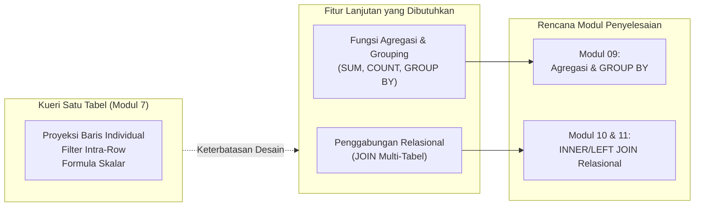

| Kode KI | Uraian Pertanyaan Kebutuhan Informasi | Kendala Teknis Kueri Satu Tabel | Solusi Fitur SQL Lanjutan | Target Modul |
| :---: | :--- | :--- | :--- | :---: |
| **KI-02** | *Berapa total akumulasi omzet penjualan harian dan bulanan koperasi?* | Tabel `penjualan` hanya menyimpan baris transaksi per nota. Menjumlahkan omzet per hari membutuhkan akumulasi lintas baris (*inter-row*). | Fungsi agregasi `SUM(total_belanja)` dan klausul pengelompokan `GROUP BY DATE(tgl_penjualan)`. | **Modul 09** |
| **KI-02** | *Bagaimana performa total penjualan per kasir disertai nama lengkap petugas kasir?* | Tabel `penjualan` hanya menyimpan `id_petugas` (kunci asing), sedangkan teks nama lengkap petugas berada di tabel `petugas`. | Penggabungan relasional `INNER JOIN` antara `penjualan` dan `petugas`, serta `GROUP BY id_petugas`. | **Modul 10** |
| **KI-03** | *Barang apa sajakah yang menduduki peringkat 5 produk terlaris berdasarkan kuantitas beli?* | Deskripsi nama barang berada di tabel `barang`, sedangkan rekaman kuantitas beli berada di baris anak `detail_penjualan`. | Operasi `JOIN barang ON detail_penjualan`, diikuti agregasi `SUM(qty)` dan pengurutan `ORDER BY DESC`. | **Modul 10 & 11** |
| **KI-04** | *Berapa saldo akhir akumulasi poin loyalitas yang dimiliki oleh masing-masing anggota aktif?* | Tabel `riwayat_poin` menyimpan baris log mutasi terpisah, sedangkan profil anggota ada di tabel `anggota`. | `JOIN anggota ON riwayat_poin` digabung dengan agregasi `SUM(jumlah_poin) GROUP BY id_anggota`. | **Modul 09 & 10** |
| **KI-05** | *Bagaimana rincian pengadaan barang gudang beserta alamat dan nama distributor pemasok?* | Tabel `pembelian` hanya menyimpan nomor faktur dan `id_pemasok`, rincian nama rekanan berada di tabel `pemasok`. | Operasi relasional `INNER JOIN` antara tabel `pembelian` dan `pemasok`. | **Modul 10** |

---

### 5.4 Analisis Pemilihan Fungsi Skalar
Pemilihan fungsi-fungsi skalar pada kueri tugas mandiri di atas didasarkan pada pertimbangan rekayasa teknis:
1. **`DATE_FORMAT()` dan `DATEDIFF()`:** Data tanggal di database disimpan dalam format ISO-8601 baku (`YYYY-MM-DD` atau `DATETIME`). Format ini sangat ideal untuk pengindeksan dan pengurutan internal, namun tidak lazim dibaca oleh pengguna di Indonesia. `DATE_FORMAT(..., '%d/%m/%Y')` mengubah data ke standar lokal tanpa merusak tipe data aslinya. Sementara `DATEDIFF()` menjadi instrumen esensial untuk menghitung umur keanggotaan secara otomatis terhadap waktu server (`CURDATE()`).
2. **`CONCAT()` dan `UPPER()`:** Mengurangi beban komputasi di lapisan aplikasi (*front-end*) dengan cara menyerahkan tugas penggabungan string (misal pembuatan label identitas `'Anggota-25430087'`) dan standarisasi teks kapital langsung kepada mesin database yang memiliki efisiensi kompilasi native C++.
3. **`FORMAT(..., 0, 'id_ID')`:** Menyediakan pemisah ribuan titik pada nominal uang tanpa desimal sen, mentransformasi angka mentah `4000.00` menjadi representasi visual perbankan `Rp4.000`.
4. **`IFNULL()`:** Mencegah terjadinya galat penanganan nilai tak terduga (*unexpected null error*) pada antarmuka pengguna dengan memberikan nilai teks pengganti yang informatif (*fallback value*).
5. **`CASE WHEN`:** Memungkinkan klasifikasi dan segmentasi analitik data secara dinamis (*on-the-fly categorization*) tanpa perlu menambah kolom fisik baru yang berpotensi melanggar normalisasi basis data.

---

## 6. Dokumentasi Bukti Tangkapan Layar Eksekusi (Folder `img7/`: `1.png` s.d `10.png`)

Berikut adalah dokumentasi visual hasil eksekusi nyata dari 10 kueri utama pendukung Kebutuhan Informasi (KI) Milestone Proyek 7 yang telah diuji pada antarmuka phpMyAdmin / MariaDB basis data `kopma_087` (berkas gambar disimpan berurutan sebagai `1.png` sampai `10.png` pada folder `laporan/img7/`):

### 6.1 Bukti Kueri 01 (KI-03): Peringatan Restock Barang Kritis di Bawah Batas Minimum
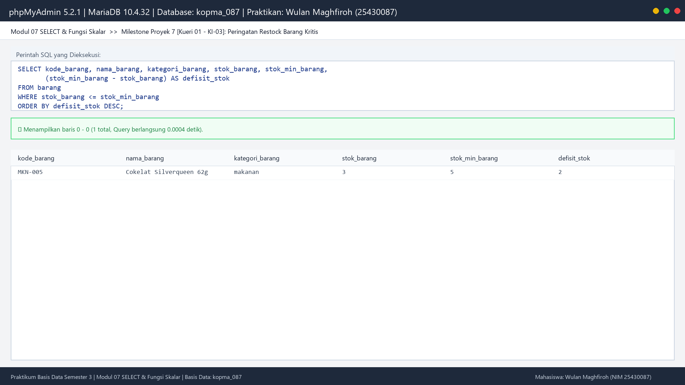  
*Gambar 7.1: Tangkapan layar phpMyAdmin eksekusi Kueri 01 pendukung KI-03 untuk menyaring barang dengan stok fisik di bawah stok minimum beserta selisih defisitnya.*

### 6.2 Bukti Kueri 02 (KI-03): Filter Himpunan IN Kategori & Format Harga Rupiah
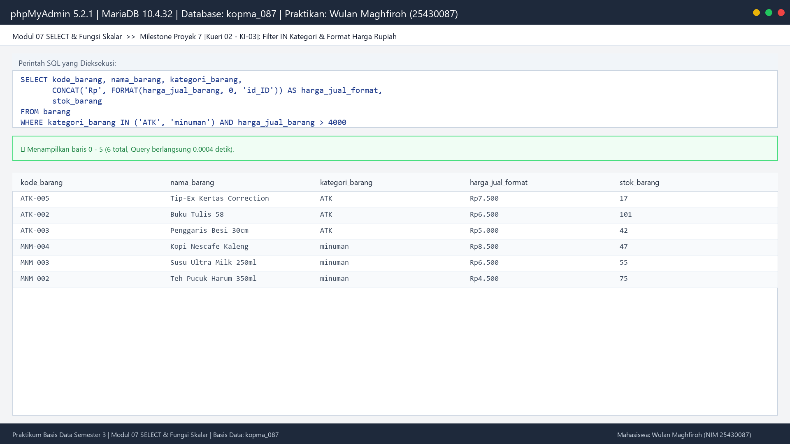  
*Gambar 7.2: Tangkapan layar phpMyAdmin eksekusi Kueri 02 penyaringan kategori ATK dan minuman berharga di atas Rp4.000 dengan format mata uang Rupiah.*

### 6.3 Bukti Kueri 03 (KI-01): Pencarian Pola LIKE & Penggabungan Label CONCAT
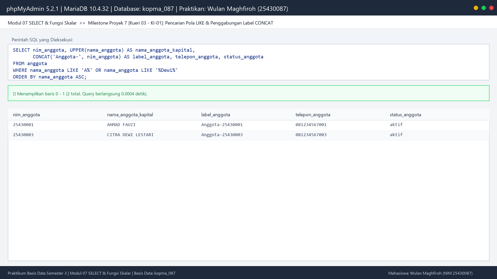  
*Gambar 7.3: Tangkapan layar phpMyAdmin eksekusi Kueri 03 pencarian profil anggota dengan pola nama dan format kode identitas terpadu.*

### 6.4 Bukti Kueri 04 (KI-01): Deteksi Kontak Kosong IS NULL & Substitusi IFNULL
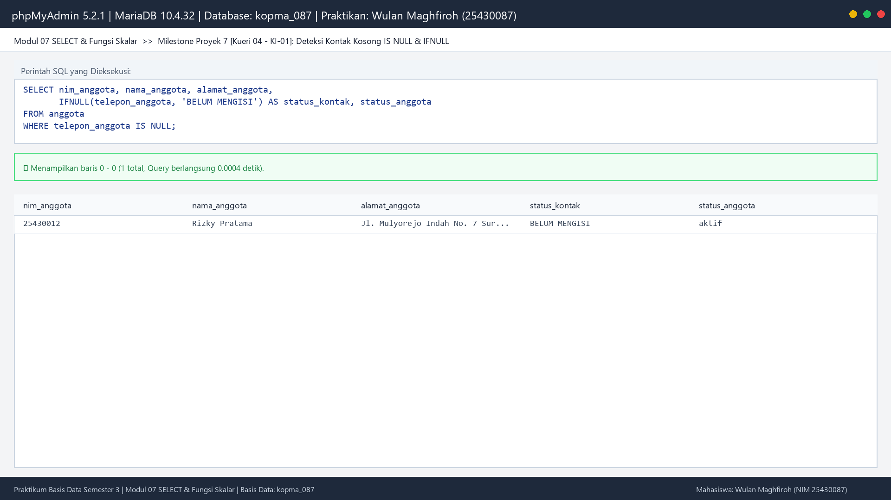  
*Gambar 7.4: Tangkapan layar phpMyAdmin eksekusi Kueri 04 penelusuran anggota tanpa nomor telepon dengan penggantian teks 'BELUM MENGISI'.*

### 6.5 Bukti Kueri 05 (KI-02): Transaksi Shift Harian BETWEEN & Hitung Kembalian
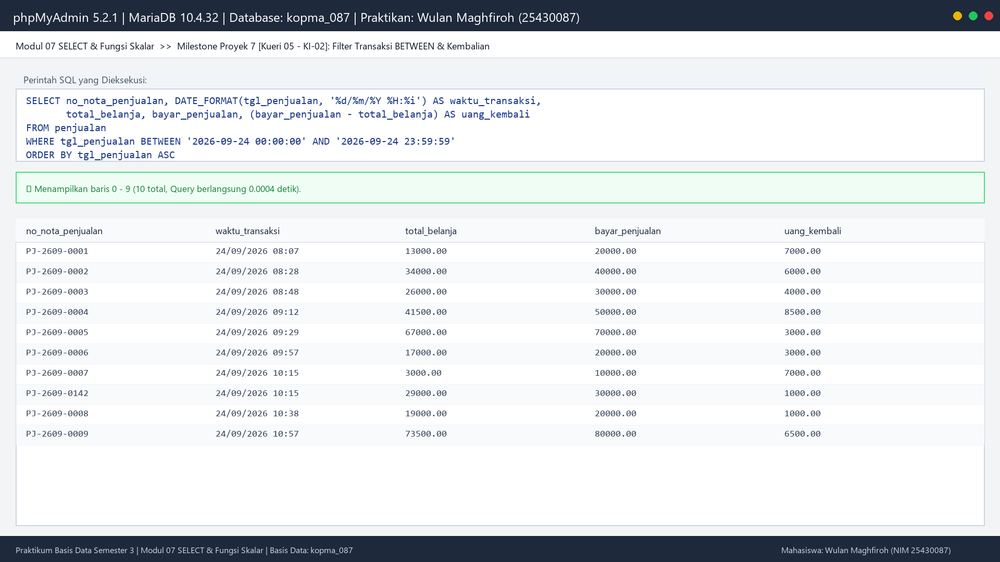  
*Gambar 7.5: Tangkapan layar phpMyAdmin eksekusi Kueri 05 rekapitulasi nota penjualan pada rentang shift 24 September 2026 beserta uang kembalian.*

### 6.6 Bukti Kueri 06 (KI-02): Segmentasi Pelanggan Umum IS NULL Belanja > 30rb
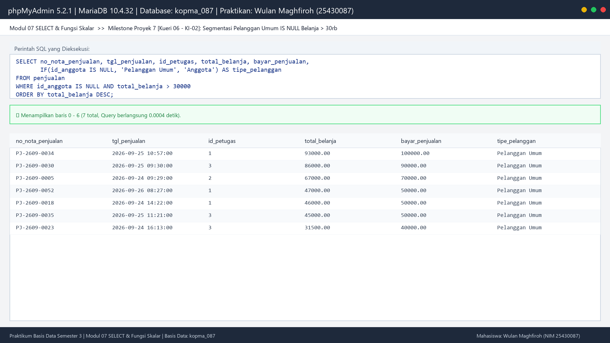  
*Gambar 7.6: Tangkapan layar phpMyAdmin eksekusi Kueri 06 identifikasi transaksi belanja pelanggan non-anggota bernilai signifikan.*

### 6.7 Bukti Kueri 07 (KI-02): Klasifikasi Skala Nilai Belanja dengan CASE WHEN
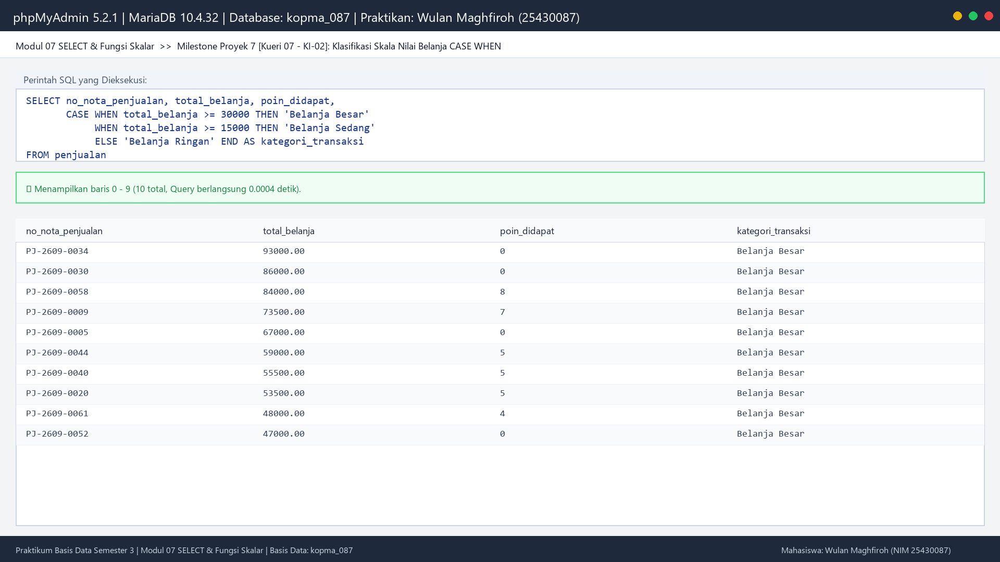  
*Gambar 7.7: Tangkapan layar phpMyAdmin eksekusi Kueri 07 pengelompokan transaksi ke dalam skala Belanja Besar, Sedang, dan Ringan.*

### 6.8 Bukti Kueri 08 (KI-01): Analisis Usia Anggota DATEDIFF & Pengelompokan Senioritas
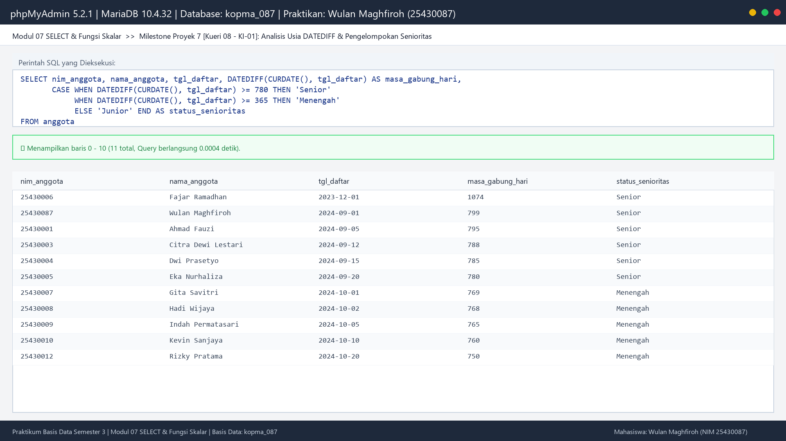  
*Gambar 7.8: Tangkapan layar phpMyAdmin eksekusi Kueri 08 perhitungan masa bergabung anggota dan klasifikasi tingkatan senioritas organisasi.*

### 6.9 Bukti Kueri 09 (KI-04): Audit Mutasi Poin Loyalitas Signifikan BETWEEN 2-5
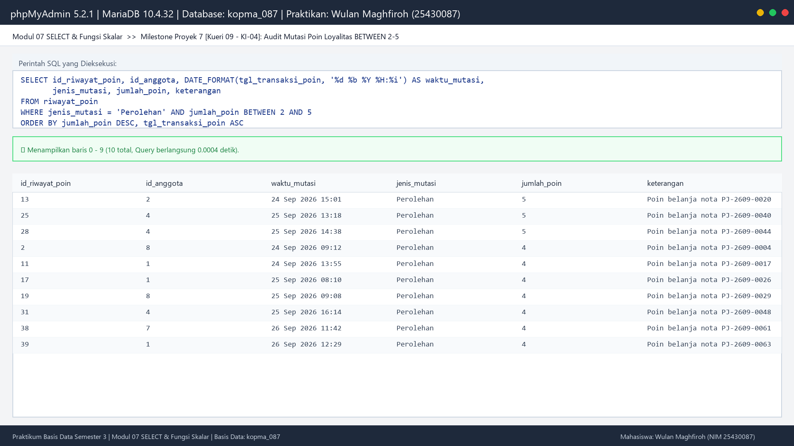  
*Gambar 7.9: Tangkapan layar phpMyAdmin eksekusi Kueri 09 audit mutasi perolehan poin loyalitas belanja bernilai antara 2 hingga 5 poin.*

### 6.10 Bukti Kueri 10 (KI-02): Identifikasi Transaksi Dibayar Uang Pas
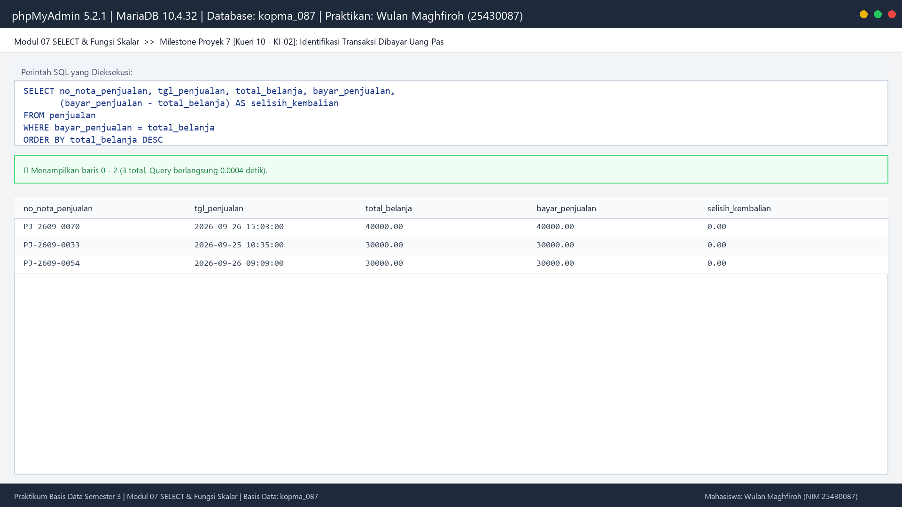  
*Gambar 7.10: Tangkapan layar phpMyAdmin eksekusi Kueri 10 penelusuran nota transaksi yang dibayar dengan uang pas (selisih kembalian = Rp0,00).*

---

## 7. Troubleshooting dan Solusi Kendala

Selama pelaksanaan eksperimen dan perancangan kueri Modul 7, diidentifikasi beberapa kendala umum beserta metodologi pemecahannya:

### Masalah 1: ERROR 1054 Unknown column ... in 'where clause'
- **Gejala:** Server memunculkan pesan kesalahan saat mengeksekusi kueri penyaringan yang merujuk pada alias hasil ekspresi kolom (misal: `WHERE kurang > 0`).
- **Penyebab Teknis:** Pelanggaran urutan evaluasi logis SQL. Klausul `WHERE` dievaluasi mendahului klausul `SELECT`, sehingga alias kolom belum dialokasikan ke dalam tabel simbol eksekusi server.
- **Solusi Tuntas:** Mengulang kembali ekspresi formulasi aslinya di dalam klausul `WHERE` (misal: `WHERE (stok_min_barang - stok_barang) > 0`) atau memeriksa ejaan nama kolom fisik tabel melalui perintah `DESCRIBE nama_tabel;`.

### Masalah 2: Hasil Kueri Kosong (*Empty Set*) Padahal Data Tersedia
- **Gejala:** Kueri berjalan tanpa memicu galat runtime apa pun, namun tidak ada baris data yang ditampilkan di layar (*silent failure*).
- **Penyebab Teknis:** Terjadi kesalahan semantik akibat penggunaan operator kesetaraan pada nilai kosong (`WHERE kolom = NULL`) yang dievaluasi menjadi `UNKNOWN` di bawah aturan Three-Valued Logic, atau perbandingan batas rentang tanggal bertipe DATETIME pada operator `BETWEEN '2026-09-24' AND '2026-09-24'` yang secara default mengasumsikan batas akhir pukul `00:00:00`.
- **Solusi Tuntas:** Mengganti perbandingan nilai kosong menjadi predikat unary `IS NULL`, serta menuliskan batas waktu penutupan harian secara eksplisit (`BETWEEN '2026-09-24 00:00:00' AND '2026-09-24 23:59:59'`) atau menggunakan fungsi tanggal `DATE(tgl_penjualan) = '2026-09-24'`.

### Masalah 3: Urutan Baris Data Berubah-ubah
- **Gejala:** Kueri yang sama menghasilkan urutan baris data yang berbeda saat dijalankan ulang, khususnya saat dipadukan dengan klausul pembatas `LIMIT`.
- **Penyebab Teknis:** Tanpa klausul `ORDER BY`, teori relasional murni menyatakan bahwa tabel basis data adalah himpunan tanpa urutan (*unordered set*). Mesin penyimpanan InnoDB mengembalikan baris berdasarkan urutan pembacaan blok fisik disk yang tidak deterministik.
- **Solusi Tuntas:** Selalu mendeklarasikan klausul `ORDER BY` secara eksplisit pada kolom kunci atau kriteria bisnis utama setiap kali urutan baris menjadi hal yang penting, terutama jika disertai pembatas `LIMIT`.

---

## 8. Refleksi dan Sinkronisasi Kompetensi SKKNI

Pelaksanaan praktikum Modul 7 ini secara substantif melatih penguasaan Standar Kompetensi Kerja Nasional Indonesia (SKKNI) Bidang Basis Data:
- **Kode Unit:** `J.62DMS00.010.1` / `J.62DMS00.011.1`
- **Judul Unit Kompetensi:** Menggunakan Bahasa Kueri Terstruktur (SQL) untuk Akses Basis Data
- **Elemen dan Indikator Ketercapaian Kompetensi:**
  1. *Elemen 1 (Menulis Pernyataan Kueri Dasar):* Mampu memilih dan memproyeksikan kolom spesifik, menetapkan alias atribut, serta mengeliminasi duplikasi data melalui kata kunci `DISTINCT`.
  2. *Elemen 2 (Menerapkan Kriteria Penyaringan Baris):* Menguasai perancangan predikat saring menggunakan operator perbandingan matematika, logika Boolean, rentang nilai `BETWEEN`, keanggotaan himpunan diskrit `IN`, pencarian pola string `LIKE`, serta penanganan nilai tak lengkap melalui `IS NULL`.
  3. *Elemen 3 (Memanipulasi Data Baris Menggunakan Fungsi Skalar):* Terampil memanfaatkan pustaka fungsi skalar bawaan RDBMS untuk mengolah teks, kalkulasi interval waktu, pembulatan finansial, dan logika kondisional bercabang `CASE WHEN` guna menghasilkan informasi analitik yang mendukung pengambilan keputusan manajerial.
  4. *Elemen 4 (Mendiagnosis dan Memperbaiki Kesalahan Kueri):* Mampu membedakan secara mendalam galat sintaksis mesin dan kesalahan semantik bisnis, menganalisis alur pemrosesan logis kueri, serta merumuskan batasan kueri satu tabel untuk diintegrasikan ke dalam rencana perancangan kueri multi-tabel pada tahap proyek berikutnya.

---
**Disusun dan Diverifikasi Resmi Oleh:**  
Wulan Maghfiroh (NIM 25430087)  
Praktikum Basis Data Semester 3 — Program Studi Sistem Informasi / Teknik Informatika  
Repositori GitHub: `basisdata-25430087`

