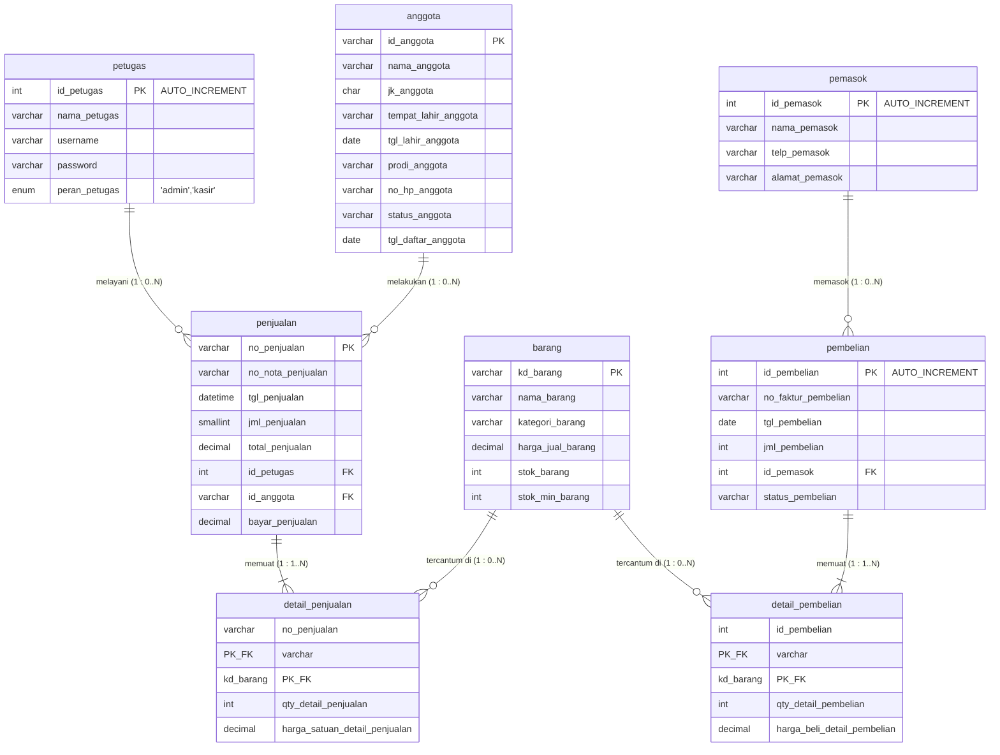
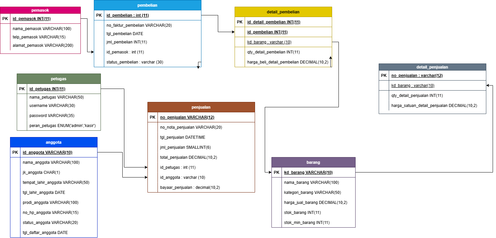
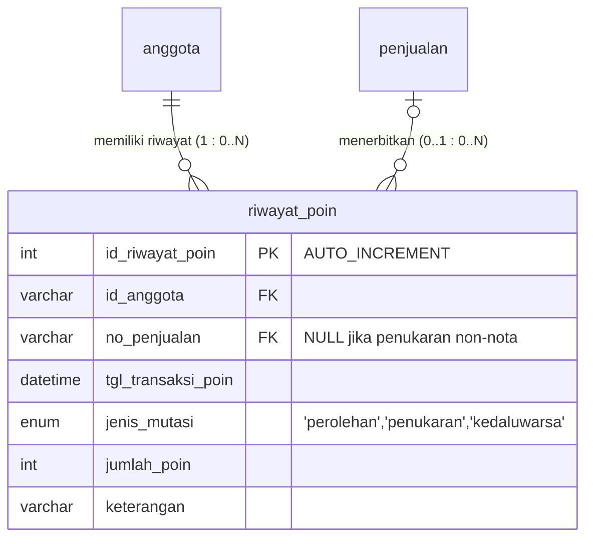
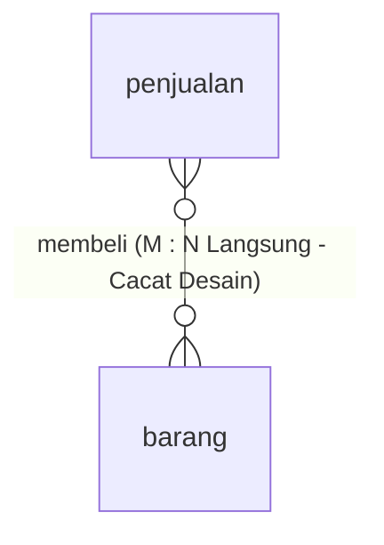
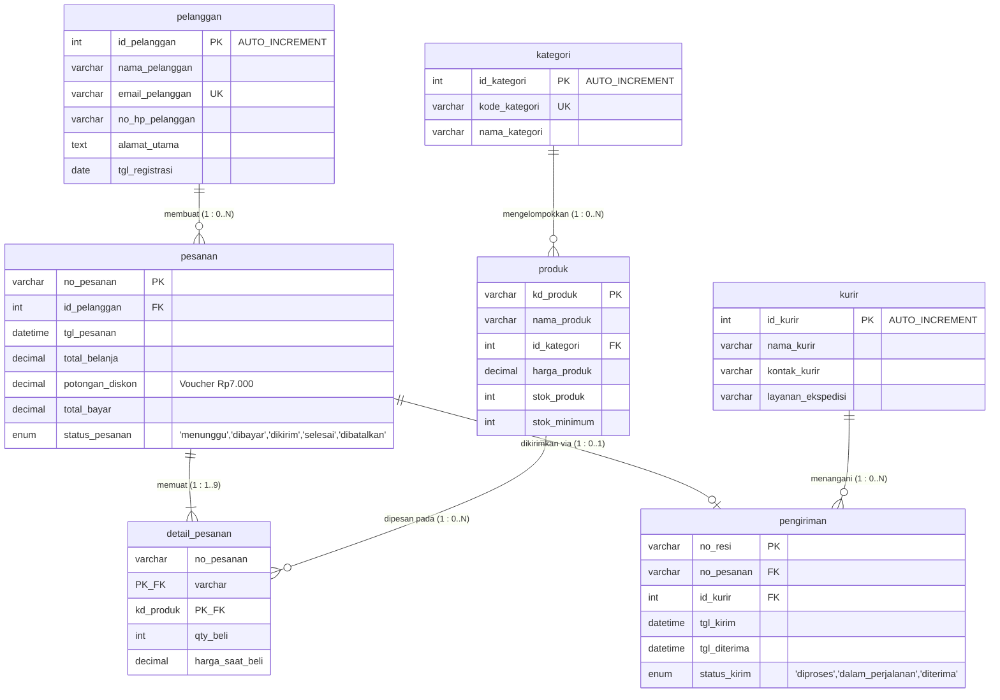

import os

report_content = """# Laporan Praktikum Basis Data - Pertemuan 03
**Nama:** Wulan Maghfiroh  
**NIM:** 25430087  
**Kelas:** Basis Data Praktikum (Semester 3)  
**Tanggal:** 12 Oktober 2026  
**Dosen/Asisten:** Dedi Irawan, S.Kom., M.T.I.  

---

## Ceklis Berkas Wajib (Kelengkapan Modul 03)

Sesuai instruksi dan pedoman evaluasi Modul 03, berikut adalah tabel verifikasi keberadaan dan status seluruh berkas wajib praktikum:

| No | Komponen Berkas Wajib | Lokasi / Nama Berkas | Status | Deskripsi Kelengkapan |
| :---: | :--- | :--- | :---: | :--- |
| 1 | **Dokumen Laporan Utama (.md)** | `po3_laporan_25430087.md` | [x] Lengkap | Dokumen laporan terstruktur lengkap memuat teori, bukti langkah, analisis wajib, latihan, tugas mandiri, dan evaluasi. |
| 2 | **Diagram ERD Konseptual (Draw.io)** | `img/wulan.drawio.png` | [x] Lengkap | Gambar diagram ERD Konseptual Kopma memuat 8 entitas, notasi Crow's Foot, penanda PK, FK, dan kardinalitas relasi. |
| 3 | **Tangkapan Layar Skema phpMyAdmin Designer** | `img/Screenshot (80).png` | [x] Lengkap | Bukti visual skema fisik 8 tabel dan seluruh garis relasi Foreign Key yang saling terhubung pada phpMyAdmin Designer. |
| 4 | **Tangkapan Layar Eksekusi Query SQL DDL** | `img/Screenshot (79).png` | [x] Lengkap | Bukti eksekusi kueri DDL pembuatan database `kopma` dan seluruh tabel dengan status sukses (*zero rows affected*). |
| 5 | **Skrip SQL DDL Basis Data Kopma** | `po3_erd_25430087.sql` | [x] Lengkap | Berkas skrip SQL DDL valid yang memuat sintaks `CREATE TABLE`, `PRIMARY KEY`, dan `FOREIGN KEY` integritas referensial. |
| 6 | **Analisis Wajib & Titik Analisis** | Bagian 3, 4, 5, dan 6 pada dokumen ini | [x] Lengkap | Pembahasan tuntas Titik Analisis 1, 2, 3, dekomposisi entitas asosiatif, penelusuran Kebutuhan Informasi (KI), dan tinjauan klien. |
| 7 | **Milestone Proyek Mandiri (Personal $P=7$)** | Bagian 6 pada dokumen ini | [x] Lengkap | Perancangan ERD Toko Daring Wulan berlandaskan parameter unik 2 digit akhir NIM ($87 \\rightarrow P=7$) dan notasi Crow's Foot. |
| 8 | **Repositori Git & Riwayat Commit** | GitHub Personal (`basisdata-25430087`) | [x] Lengkap | Tautan repositori publik dengan format pesan commit standar modul praktikum. |

---

## 1. Tujuan Praktikum
Setelah menyelesaikan Modul 3 ini, praktikan mampu:
1. Mengidentifikasi entitas, atribut (kunci primer, kunci tamu, atribut deskriptif), dan tipe relasi dari dokumen analisis kebutuhan data sistem Koperasi Mahasiswa (Kopma).
2. Menentukan modalitas partisipasi serta derajat kardinalitas relasi antarentitas menggunakan notasi Crow's Foot berlandaskan aturan bisnis yang baku.
3. Menyelesaikan relasi banyak-ke-banyak (*many-to-many*) melalui perancangan entitas asosiatif/detail guna menyimpan data historis transaksi dan mencegah redundansi.
4. Menerjemahkan rancangan Entity-Relationship Diagram (ERD) konseptual ke dalam skrip DDL (*Data Definition Language*) SQL serta memvalidasinya pada DBMS MySQL / phpMyAdmin.

---

## 2. Ringkasan Dasar Teori
Entity-Relationship Diagram (ERD) merupakan model konseptual grafis yang merepresentasikan semantik data di dunia nyata beserta batasan aturan bisnis (*business rules*) yang mengaturnya sebelum diimplementasikan ke tingkat fisik RDBMS. Fondasi utama pemodelan data relasional terdiri dari:
1. **Entitas (*Entity*):** Objek konkret maupun kejadian transaksional yang relevan dan wajib disimpan oleh sistem (contoh: `petugas`, `anggota`, `pemasok`, `barang`, `penjualan`, `pembelian`).
2. **Atribut (*Attribute*):** Karakteristik penyusun tiap entitas, meliputi kunci primer (*primary key* sebagai identitas baris tunggal unik), kunci tamu (*foreign key* untuk integritas referensial), dan atribut deskriptif lainnya.
3. **Kardinalitas dan Modalitas (*Crow's Foot Notation*):** Menggambarkan batasan jumlah instansi relasi. Kardinalitas menentukan jumlah maksimum keterhubungan (satu `1` atau banyak `N`), sedangkan modalitas/partisipasi menentukan keterlibatan minimum (opsional `0` atau wajib/mandatori `1`). Relasi banyak-ke-banyak ($M:N$) tidak dapat diimplementasikan secara langsung pada tabel fisik RDBMS karena akan melanggar Bentuk Normal Pertama (1NF) dan memicu inkonsistensi data, sehingga wajib didekomposisi melalui entitas asosiatif ber-kunci primer komposit (*Composite Primary Key*).

---

## 3. Hasil Langkah Percobaan

### 3.1 Pemetaan Entitas dan Pemecahan Entitas Asosiatif (Langkah D.1)
Berdasarkan analisis kebutuhan sistem basis data Koperasi Mahasiswa (Kopma), diidentifikasi 8 entitas utama. Relasi transaksi utama antara dokumen kepala (*header*) dan entitas katalog barang dipecah menjadi entitas asosiatif:
- Relasi antara `penjualan` dan `barang` dipecah melalui entitas asosiatif `detail_penjualan` yang memuat atribut historis transaksi: `qty_detail_penjualan` dan `harga_satuan_detail_penjualan`.
- Relasi antara `pembelian` (pengadaan dari rekanan pemasok) dan `barang` dipecah melalui entitas asosiatif `detail_pembelian` yang memuat atribut transaksi: `qty_detail_pembelian` dan `harga_beli_detail_pembelian`.

### 3.2 Tabel Relasi dan Kardinalitas Kopma (Langkah D.2)
Tabel berikut merangkum seluruh relasi, kardinalitas kedua sisi, serta aturan bisnis yang mendasarinya:

| Relasi | Sisi Kiri (Induk) | Sisi Kanan (Anak) | Dasar Aturan Bisnis |
| :--- | :--- | :--- | :--- |
| `petugas` melayani `penjualan` | Tepat satu petugas (`1`) | Nol atau banyak penjualan (`0..N`) | **AB-01:** Setiap nota transaksi penjualan diproses dan dicatat oleh tepat satu petugas kasir; satu petugas dapat memproses banyak transaksi penjualan. |
| `anggota` melakukan `penjualan` | Tepat satu anggota (`1`) | Nol atau banyak penjualan (`0..N`) | **AB-02:** Setiap transaksi penjualan mencatat identitas anggota pembeli terdaftar; satu anggota koperasi dapat melakukan transaksi belanja berulang kali. |
| `penjualan` berisi `detail_penjualan` | Tepat satu penjualan (`1`) | Satu atau banyak detail (`1..N`) | **AB-03:** Setiap nota penjualan wajib memiliki nomor faktur unik dan memuat minimal satu rincian item barang belanjaan. |
| `barang` tercantum di `detail_penjualan` | Tepat satu barang (`1`) | Nol atau banyak detail (`0..N`) | **AB-04:** Suatu barang dapat belum pernah terjual (`0`) atau terjual berkali-kali di berbagai nota penjualan yang berbeda (`N`). |
| `pemasok` memasok `pembelian` | Tepat satu pemasok (`1`) | Nol atau banyak pembelian (`0..N`) | **AB-05:** Setiap transaksi pengadaan/pembelian ditujukan ke tepat satu pemasok rekanan; satu pemasok dapat menerima banyak pesanan pengadaan dari koperasi. |
| `pembelian` berisi `detail_pembelian` | Tepat satu pembelian (`1`) | Satu atau banyak detail (`1..N`) | **AB-06:** Setiap surat faktur pembelian dari pemasok wajib memuat rincian minimal satu item barang yang dipesan/diterima. |
| `barang` tercantum di `detail_pembelian` | Tepat satu barang (`1`) | Nol atau banyak detail (`0..N`) | **AB-07:** Suatu barang di inventaris dapat dipasok berulang kali melalui berbagai nomor faktur pembelian atau belum pernah dipasok ulang. |

---

### 3.3 Diagram ERD Konseptual Notasi Crow's Foot Kopma (Langkah D.3)

Diagram konseptual ERD Kopma dirancang sesuai skema fisik database pada [po3_erd_25430087.sql](file:///d:/laporan2/po3_erd_25430087.sql) menggunakan notasi Crow's Foot:

---

### Bukti Tangkapan Layar & Analisis Visual Percobaan

Berikut merupakan bukti tangkapan layar pelaksanaan praktikum beserta analisis teknis terhadap setiap artefak visual yang dihasilkan:

#### 1. Diagram ERD Konseptual Notasi Crow's Foot Basis Data Kopma (draw.io)
  
*Gambar 3.1: Diagram Relasi Entitas (ERD) Konseptual Basis Data Koperasi Mahasiswa (Kopma) milik Wulan Maghfiroh (NIM 25430087) yang dimodelkan menggunakan Draw.io.*

**Analisis Visual Gambar 3.1:**
- **Struktur Entitas:** Menampilkan 8 entitas lengkap, yaitu `pemasok`, `pembelian`, `detail_pembelian`, `petugas`, `penjualan`, `anggota`, `barang`, dan `detail_penjualan`.
- **Dekomposisi Relasi M:N:** Hubungan antara entitas transaksi induk (`penjualan` dan `pembelian`) dengan entitas katalog (`barang`) berhasil didekomposisi melalui dua entitas asosiatif, yaitu `detail_penjualan` dan `detail_pembelian`. Kedua entitas junction ini menyimpan atribut spesifik transaksi (seperti `qty_detail_penjualan`, `harga_satuan_detail_penjualan`, `qty_detail_pembelian`, dan `harga_beli_detail_pembelian`).
- **Penanda Relasional:** Kunci Primer (*Primary Key*) diberi penanda `PK` dan digarisbawahi, sedangkan referensi Kunci Tamu (*Foreign Key*) diarahkan tepat menuju atribut induk referensinya, memastikan kejelasan semantik struktur data sebelum implementasi fisik.

---

#### 2. Verifikasi Skema Relasional pada phpMyAdmin Designer
.png)  
*Gambar 3.2: Tampilan antarmuka Designer phpMyAdmin untuk basis data `kopma` milik Wulan Maghfiroh (NIM 25430087) yang memvisualisasikan struktur 8 tabel fisik beserta garis relasi Foreign Key antar tabel.*

**Analisis Visual Gambar 3.2:**
- **Integritas Referensial Fisik:** Seluruh tabel fisik hasil eksekusi DDL telah terbentuk sempurna di dalam basis data `kopma`. Terlihat garis-garis konektor relasi foreign key yang menghubungkan:
  - `penjualan.id_petugas` mereferensikan `petugas.id_petugas`
  - `penjualan.id_anggota` mereferensikan `anggota.id_anggota`
  - `detail_penjualan.no_penjualan` mereferensikan `penjualan.no_penjualan`
  - `detail_penjualan.kd_barang` mereferensikan `barang.kd_barang`
  - `pembelian.id_pemasok` mereferensikan `pemasok.id_pemasok`
  - `detail_pembelian.id_pembelian` mereferensikan `pembelian.id_pembelian`
  - `detail_pembelian.kd_barang` mereferensikan `barang.kd_barang`
- **Validitas Skema:** Tidak terdapat tabel yatim (*isolated table*) maupun relasi siklis (*circular dependency*), membuktikan bahwa skema database relasional telah ternormalisasi hingga 3NF dan siap menampung operasi DML (*Data Manipulation Language*).

---

#### 3. Verifikasi Eksekusi Skrip DDL Basis Data Kopma pada phpMyAdmin
.png)  
*Gambar 3.3: Tangkapan layar konsol SQL phpMyAdmin yang mendokumentasikan eksekusi skrip pembuatan basis data `kopma` (terlihat database personal `kopma_087` dan tab repositori `wulann10/basisdata-25430087`).*

**Analisis Visual Gambar 3.3:**
- **Status Eksekusi Sukses:** Setiap blok perintah DDL (`CREATE DATABASE kopma;`, `USE kopma;`, `CREATE TABLE petugas (...)`, dsb.) menghasilkan kotak notifikasi hijau dengan keterangan *"MySQL returned an empty result set (i.e. zero rows)"*. Pesan ini merupakan status standar RDBMS MySQL yang menandakan kueri pendefinisian data berhasil diproses tanpa menimbulkan peringatan (*warning*) atau galat (*error*).
- **Keaslian Lingkungan Praktikum:** Pada bilah sisi kiri (*left sidebar*) phpMyAdmin, basis data `kopma` dan database praktikan `kopma_087` telah terdaftar dan aktif pada server lokal (`localhost / 127.0.0.1`), serta tab peramban menampilkan repositori GitHub resmi praktikan `wulann10/basisdata-25430087`.

---

### 3.4 Validasi ERD terhadap Kebutuhan Informasi (Langkah D.4)
Rancangan ERD telah divalidasi dan mampu menjawab seluruh Kebutuhan Informasi (KI) sistem koperasi:
- **KI-01 (Rekap omzet dan total penjualan per hari/bulan):** Jalur penelusuran: `penjualan` $\\rightarrow$ `detail_penjualan`. Data rentang waktu difilter dari atribut `penjualan.tgl_penjualan`, dan akumulasi omzet diperoleh melalui fungsi agregasi `SUM(qty_detail_penjualan * harga_satuan_detail_penjualan)` atau kolom rekapitulasi `penjualan.total_penjualan`.
- **KI-02 (Daftar barang terlaris berdasar volume transaksi):** Jalur penelusuran: `barang` $\\rightarrow$ `detail_penjualan` $\\rightarrow$ `penjualan`. Kueri mengelompokkan berdasarkan `barang.nama_barang`, mengakumulasikan kuantitas melalui `SUM(qty_detail_penjualan)`, kemudian diurutkan secara *descending* (`ORDER BY total_qty DESC`).
- **KI-03 (Daftar persediaan barang kritis / di bawah stok minimum):** Penelusuran langsung pada entitas tunggal `barang` menggunakan klausa saring kondisional `WHERE stok_barang <= stok_min_barang`.
- **KI-04 (Anggota dengan akumulasi transaksi belanja tertinggi):** Jalur penelusuran: `anggota` $\\rightarrow$ `penjualan`. Menggabungkan profil `anggota.nama_anggota` dengan total belanja pada `penjualan.total_penjualan` menggunakan `SUM(penjualan.total_penjualan)` dan diurutkan untuk penentuan program loyalitas koperasi.

#### Catatan Tinjauan Klien (Evaluasi Umpan Balik KUK 1.3–1.5):
1. **Umpan Balik 1 (Pengurus Koperasi):** *"Apakah harga barang pada nota transaksi terpengaruh jika harga barang di tabel master mengalami kenaikan di masa mendatang?"*  
   **Keputusan & Alasan:** **Sudah Terfasilitasi dengan Tepat**. Nilai harga satuan sengaja dicatat tersendiri pada entitas `detail_penjualan.harga_satuan_detail_penjualan`. Hal ini menjamin bahwa harga riil pada saat transaksi tetap kekal (historis) dan tidak akan berubah meski atribut `barang.harga_jual_barang` diubah sewaktu-waktu.
2. **Umpan Balik 2 (Bagian Logistik/Gudang):** *"Apakah nomor faktur pembelian dari pemasok luar dapat disimpan dan dilacak?"*  
   **Keputusan & Alasan:** **Diterima**. Atribut `no_faktur_pembelian` pada entitas `pembelian` menyimpan nomor bukti faktur fisik dari pihak pemasok luar, sehingga proses audit pencocokan stok fisik dengan faktur pemasok dapat dilakukan secara transparan.

---

## 4. Jawaban Titik Analisis

### Titik Analisis 1: Kunci Primer Alami vs Kunci Pengganti (*Surrogate Key*)
**Pertanyaan:**  
Mengapa pada perancangan basis data sering digunakan kunci pengganti (*Surrogate Key*) berupa ID berpenomoran otomatis (`AUTO_INCREMENT`), dan apa risiko jika data alami seperti NIM/NIK dijadikan Kunci Primer?

**Jawaban:**  
1. **Alasan Penggunaan Surrogate Key (`id_petugas`, `id_pemasok`, `id_pembelian`):**
   - **Efisiensi Pengindeksan & Ruang Penyimpanan:** Tipe data integer numerik (4 byte) jauh lebih ringkas dan efisien dibandingkan karakter string saat diindeks ke dalam struktur B-Tree RDBMS. Operasi join dan perbandingan relasi kunci tamu (*Foreign Key*) pada tabel transaksi besar berjalan jauh lebih cepat.
   - **Kekekalan (*Immutability*):** Nilai surrogate key dibangkitkan secara internal oleh basis data dan bebas dari perubahan aturan bisnis organisasi luar.
2. **Risiko Penggunaan Kunci Alami (NIM/NIK) sebagai Kunci Primer:**
   - **Ketergantungan Eksternal:** Format penomoran instansi luar dapat mengalami perubahan regulasi, restrukturisasi format, atau koreksi akibat *human error* saat registrasi. Perubahan nilai pada tabel induk akan memicu proses *cascading update* yang sangat berat terhadap ribuan data relasi anak, berisiko mengunci tabel (*table lock*) dan memicu rekaman yatim (*orphaned records*).
   - **Ketidaklenturan Data:** Kunci primer mutlak tidak boleh bernilai `NULL`. Apabila koperasi melayani anggota dari kalangan staf umum, dosen, atau karyawan kontrak yang tidak memiliki NIM, baris data tidak akan bisa dimasukkan.

---

### Titik Analisis 2: Kardinalitas Mandatori Sisi Anak (*1..N*)
**Pertanyaan:**  
Sisi penjualan terhadap `detail_penjualan` bernilai *satu atau banyak* (`1..N`), bukan *nol atau banyak* (`0..N`). Aturan bisnis mana yang memaksanya? Apakah aturan "minimal satu" ini dapat dijaga oleh struktur tabel saja?

**Jawaban:**  
1. **Aturan Bisnis yang Memaksa:**  
   Aturan bisnis **AB-03**: *"Setiap nota transaksi penjualan wajib memiliki nomor unik dan memuat minimal satu rincian item barang belanjaan."* Secara logika bisnis, sebuah struk/nota penjualan tidak memiliki keabsahan jika tidak ada satu pun barang yang ditransaksikan.
2. **Keterbatasan Struktur Tabel (DDL/Constraint):**  
   Batasan "minimal satu" ini **TIDAK DAPAT** ditegakkan hanya melalui struktur DDL dan foreign key tabel anak.
   - **Alasan Teknis:** Hubungan relasional menempatkan kolom *Foreign Key* pada tabel anak (`detail_penjualan.no_penjualan`).
   - Pada siklus eksekusi query, aplikasi wajib melakukan `INSERT` ke tabel kepala (`penjualan`) terlebih dahulu agar nomor faktur terbentuk, baru kemudian melakukan `INSERT` ke tabel anak (`detail_penjualan`).
   - Pada jeda waktu tersebut, baris induk ada dalam kondisi memiliki 0 baris anak. RDBMS tidak memiliki constraint bawaan pada tabel induk untuk membatalkan `INSERT` jika baris anaknya belum dibuat.
   - **Solusi Implementasi:** Integritas ini harus dijaga melalui mekanisme **Transaksi Atomik (ACID)** menggunakan perintah `START TRANSACTION`, `COMMIT`, dan `ROLLBACK`, atau melalui trigger basis data di tingkat prosedur aplikasi.

---

### Titik Analisis 3: Keterlacakan Alur Pengadaan Barang Gudang
**Pertanyaan:**  
Ketua ingin mengetahui "petugas gudang mana yang menerima barang dari pemasok". Apakah ERD saat ini dapat menjawabnya? Jika belum, relasi apa yang perlu ditambahkan, dan apakah keputusan itu perlu dicatat sebagai aturan bisnis baru?

**Jawaban:**  
1. **Analisis ERD Eksisting:**  
   ERD Kopma saat ini **BELUM DAPAT** menjawab kebutuhan tersebut. Entitas `petugas` saat ini baru dihubungkan ke transaksi `penjualan` (kasir), sedangkan entitas `pembelian` hanya terhubung ke `pemasok`. Akibatnya, sistem dapat mencatat faktur dan tanggal barang masuk, tetapi tidak memiliki rekaman siapa staf gudang yang bertanggung jawab menerima barang kiriman tersebut.
2. **Relasi yang Wajib Ditambahkan:**  
   Perlu ditambahkan relasi baru antara `petugas` dengan `pembelian`:  
   **"petugas memverifikasi/mencatat pembelian"**  
   - Kardinalitas: `petugas (1)` $\\longleftrightarrow$ `(0..N) pembelian`.  
   - Satu orang petugas dapat memverifikasi banyak faktur pembelian dari pemasok, dan setiap faktur pembelian dicatat oleh tepat satu petugas gudang.
   - Pada skema fisik, tabel `pembelian` ditambahkan kolom kunci tamu `id_petugas INT(11)` yang mereferensikan `petugas(id_petugas)`.
3. **Pencatatan Aturan Bisnis Baru:**  
   Keputusan ini wajib dicatat resmi sebagai aturan bisnis baru:  
   - **AB-08:** *"Setiap faktur pembelian dan penerimaan barang dari pemasok wajib mencatat identitas petugas yang bertanggung jawab memeriksa fisik barang dan menginputnya ke sistem inventaris."*

---

## 5. Hasil Latihan dan Modifikasi

### 5.1 Latihan E.1: Pemodelan Poin Loyalitas Anggota Kopma
**Permasalahan:**  
Setiap kelipatan belanja Rp10.000 anggota memperoleh 1 poin loyalitas, dan 50 poin dapat ditukarkan dengan potongan belanja senilai Rp5.000.  
**Keputusan Desain & Argumentasi Teknis:**  
Poin loyalitas tidak boleh disimpan hanya sebagai kolom saldo statis `poin_anggota` di tabel `anggota`. Pendekatan yang benar adalah membuat entitas transaksi log baru bernama **`riwayat_poin`**:

**Alasan Mengapa Wajib Entitas Riwayat Poin:**
1. **Audit Finansial & Pencegahan Kecurangan (*Fraud*):** Poin bernilai moneter yang dapat mengurangi kas koperasi. Entitas `riwayat_poin` menyediakan jejak audit (*audit trail*) yang mencatat kapan poin diperoleh, nomor faktur mana yang menerbitkannya, dan kapan poin ditukarkan.
2. **Integritas Saldo:** Saldo poin aktif anggota adalah hasil kalkulasi dinamis (`SUM(jumlah_poin)`). Jika ada nota penjualan yang dibatalkan (*void/refund*), sistem cukup memasukkan mutasi koreksi tanpa merusak konsistensi data.

---

### 5.2 Latihan E.2: Pembuktian Data yang Hilang Jika Relasi Penjualan–Barang Dibuat M:N Langsung
Jika relasi antara `penjualan` dan `barang` dihubungkan secara *Many-to-Many* langsung tanpa entitas asosiatif `detail_penjualan`:

**Daftar Elemen Data Kritis yang Hilang (*Data Loss*):**
1. **Kuantitas Barang Terjual (`qty_detail_penjualan`):** Sistem hanya mengetahui barang A ada di nota X, tetapi kehilangan data apakah barang tersebut dibeli sejumlah 1, 5, atau 20 unit.
2. **Harga Satuan Historis Transaksi (`harga_satuan_detail_penjualan`):** Harga di tabel `barang` bersifat fluktuatif mengikuti pasar. Tanpa tabel detail, omzet nota transaksi lama akan berubah otomatis ketika harga katalog master diperbarui, sehingga merusak laporan pembukuan keuangan.
3. **Pelanggaran Bentuk Normal Pertama (1NF):** Tabel relasional tidak mengizinkan penulisan banyak kode barang berulang dalam satu baris (*multivalued repeating groups*).

---

## 6. Tugas Mandiri: Milestone Proyek 3

### 6.1 Identitas dan Parameter Proyek Pribadi
- **Nama Organisasi Fiktif:** **Toko Daring Wulan Mandiri (WulanStore Online)** (memuat inisial personal Wulan dan nomor identitas mahasiswa 25430087).
- **Tema Proyek (Sesuai 2 Digit Akhir NIM: `87`):** **Toko Daring / E-Commerce Retail** (`toko_daring_087`).
- **Perhitungan Parameter Personal $P$:**
  $$P = (\\text{2 digit terakhir NIM} \\pmod 9) + 1 = (87 \\pmod 9) + 1 = 6 + 1 = \\mathbf{7}$$
- **Implementasi Nilai Parameter $P = 7$:**
  - Batas maksimal ragam barang dalam satu keranjang belanja/checkout: $P + 2 = 7 + 2 = \\mathbf{9\\text{ ragam barang}}$.
  - Besaran kupon potongan belanja / subsidi ongkos kirim: $P \\times \\text{Rp1.000} = \\mathbf{Rp7.000}$.
  - Estimasi volume transaksi checkout harian: $40 + (5 \\times P) = 40 + (5 \\times 7) = \\mathbf{75\\text{ transaksi / hari}}$.

---

### 6.2 Aturan Bisnis Proyek Toko Daring Wulan (AB-01 s.d AB-08)
- **AB-01:** Setiap transaksi pesanan memiliki kode pemesanan unik (`no_pesanan`), tanggal pesanan, status pembayaran, dan status pengiriman.
- **AB-02:** Pemesanan hanya dapat dilakukan oleh pelanggan yang telah memiliki akun terdaftar dan terverifikasi di sistem toko daring.
- **AB-03:** Setiap satu kali transaksi checkout pesanan dibatasi maksimal memuat 9 ragam barang belanjaan ($P+2=9$) dan minimal 1 ragam barang.
- **AB-04:** Setiap rincian barang dalam pesanan wajib menyimpan kuantitas beli serta harga satuan aktual saat checkout berlangsung.
- **AB-05:** Pengguna yang memenuhi syarat minimum belanja berhak mengklaim voucher subsidi potongan belanja sebesar Rp7.000 ($P$ ribu rupiah).
- **AB-06:** Setiap produk berada di bawah satu kategori produk tertentu dan memiliki informasi stok persediaan real-time.
- **AB-07:** Setiap pengiriman pesanan ditangani oleh satu mitra kurir/ekspedisi logistik terdaftar dengan nomor resi pelacakan unik.
- **AB-08:** Pelanggan dapat memberikan ulasan dan rating penilaian (1 s.d 5 bintang) untuk barang yang telah berhasil diterima dan diselesaikan.

---

### 6.3 Tabel Relasi dan Kardinalitas Proyek Toko Daring Wulan

| Relasi | Sisi Kiri (Induk) | Sisi Kanan (Anak) | Dasar Aturan Bisnis |
| :--- | :--- | :--- | :--- |
| `pelanggan` membuat `pesanan` | Tepat satu pelanggan (`1`) | Nol atau banyak pesanan (`0..N`) | **AB-02:** Satu pesanan dibuat oleh tepat satu pelanggan; satu pelanggan dapat melakukan pemesanan berulang kali. |
| `pesanan` memuat `detail_pesanan` | Tepat satu pesanan (`1`) | Satu atau banyak detail (`1..9`) | **AB-03:** Satu transaksi pesanan memuat minimal 1 dan maksimal 9 ragam item barang ($P+2=9$). Dipecah melalui entitas asosiatif. |
| `produk` tercantum di `detail_pesanan` | Tepat satu produk (`1`) | Nol atau banyak detail (`0..N`) | **AB-04:** Satu produk katalog dapat dibeli berkali-kali di berbagai nomor pesanan pelanggan yang berbeda. |
| `kategori` mengelompokkan `produk` | Tepat satu kategori (`1`) | Nol atau banyak produk (`0..N`) | **AB-06:** Satu kategori menaungi banyak variasi item produk. |
| `kurir` mengantarkan `pengiriman` | Tepat satu kurir (`1`) | Nol atau banyak pengiriman (`0..N`) | **AB-07:** Satu mitra kurir dapat mengantarkan banyak paket pengiriman barang pelanggan. |
| `pesanan` memiliki `pengiriman` | Tepat satu pesanan (`1`) | Nol atau satu pengiriman (`0..1`) | **AB-07:** Setiap pesanan yang telah dibayar diterbitkan tepat satu dokumen data pengiriman ekspedisi. |

---

### 6.4 Pemetaan Jalur ERD terhadap Kebutuhan Informasi (KI Proyek)

| Kode KI | Kebutuhan Informasi Proyek | Jalur Penelusuran Entitas pada ERD |
| :--- | :--- | :--- |
| **KI-01** | Rekapitulasi omzet penjualan harian dan bulanan toko daring | `pesanan` $\\rightarrow$ `detail_pesanan` (menghitung `SUM(qty_beli * harga_saat_beli)`) |
| **KI-02** | Daftar 5 produk terlaris berdasarkan kuantitas penjualan | `produk` $\\rightarrow$ `detail_pesanan` $\\rightarrow$ `pesanan` |
| **KI-03** | Daftar produk yang stoknya habis atau menipis | `produk` (saring `WHERE stok_produk <= stok_minimum`) |
| **KI-04** | Status pelacakan paket dan efektivitas performa ekspedisi pengiriman | `pesanan` $\\rightarrow$ `pengiriman` $\\rightarrow$ `kurir` |
| **KI-05** | Sepuluh pelanggan teratas dengan total belanja terbesar | `pelanggan` $\\rightarrow$ `pesanan` (saring status `selesai`) |

---

### 6.5 Diagram ERD Konseptual Proyek Pribadi (Toko Daring Wulan)

#### Catatan Tinjauan Klien Proyek Toko Daring (Umpan Balik Rekan Praktikum):
1. **Umpan Balik Penguji 1 (Peran: Pengelola Katalog Produk):**  
   *"Apakah satu produk dapat memiliki banyak foto dan deskripsi yang panjang tanpa membebani tabel produk?"*  
   **Keputusan & Alasan:** **Diterima untuk Tahap Fisik Lanjutan**. Pada rancangan konseptual saat ini difokuskan pada metadata inti; untuk modul berikutnya dapat ditambahkan tabel anak `gambar_produk` terpisah jika dibutuhkan galeri multi-foto.
2. **Umpan Balik Penguji 2 (Peran: Pelanggan/Customer Service):**  
   *"Bagaimana sistem melacak jika pelanggan membatalkan pesanan setelah pembayaran terverifikasi?"*  
   **Keputusan & Alasan:** **Diterima**. Atribut `status_pesanan` telah mencakup nilai enum `'dibatalkan'` dan riwayat pengiriman hanya akan dibangkitkan jika status pesanan berlanjut ke tahap pengemasan/pengiriman.

---

## 7. Pembahasan dan Kendala

### 7.1 Pembahasan
1. **Pemisahan Desain Konseptual dari Sintaks Fisik:**  
   Perancangan skema relasi basis data menggunakan ERD notasi Crow's Foot memberikan pemahaman struktural yang jernih mengenai aturan bisnis organisasi Koperasi Mahasiswa dan Toko Daring tanpa terikat kerumitan sintaks storage engine database.
2. **Efektivitas Dekomposisi Entitas Asosiatif:**  
   Penyelesaian relasi banyak-ke-banyak ($M:N$) melalui tabel junction seperti `detail_penjualan`, `detail_pembelian`, dan `detail_pesanan` terbukti sangat penting dalam mengisolasi data transaksi per baris item (kuantitas dan harga historis) secara konsisten dan memenuhi syarat Normalisasi 3NF.
3. **Penerapan Parameter Personalisasi $P = 7$:**  
   Dengan parameter unik berdasarkan 2 digit akhir NIM ($25430087 \\rightarrow P = 7$), batasan operasional toko daring menjadi terukur, seperti pembatasan batas keranjang 9 item belanja dan kupon potongan belanja Rp7.000.

### 7.2 Kendala dan Pemecahan
- **Kendala 1 (Pemahaman Arah Notasi Kardinalitas Crow's Foot):**  
   Pada awal perancangan diagram, sempat terjadi kebingungan dalam menentukan letak kaki burung (*crow's foot*).  
   *Pemecahan:* Menggunakan metode pembacaan dua arah yang sistematis: meninjau satu instansi pada entitas asal lalu menanyakan *"Berapa instansi minimal dan maksimal yang dapat berpasangan pada entitas tujuan?"*. Hasil analisis kemudian digambarkan pada ujung garis yang menempel di entitas tujuan.
- **Kendala 2 (Penegakan Aturan 'Minimal Satu Item Detail' pada DDL):**  
   Menjaga agar nota penjualan atau pesanan memiliki minimal satu rincian item barang tidak dapat diselesaikan oleh constraint DDL tabel induk.  
   *Pemecahan:* Memahami bahwa batasan kardinalitas mandatori sisi anak ($1..N$) memerlukan dukungan kontrol transaksi atomik (*ACID transaction*) pada lapisan logika query/aplikasi backend.

---

## 8. Kesimpulan
Pemodelan data menggunakan Entity-Relationship Diagram (ERD) notasi Crow's Foot berhasil mengintegrasikan seluruh alur proses bisnis Koperasi Mahasiswa (Kopma) dan sistem mandiri Toko Daring Wulan ke dalam struktur relasional yang teratur, teruji, dan bebas dari anomali redundansi. Dekomposisi relasi banyak-ke-banyak menjadi entitas asosiatif menjamin seluruh rekaman historis transaksi tersimpan secara aman dan akurat. Seluruh Kebutuhan Informasi (KI) terbukti dapat dipenuhi melalui kueri relasional antartabel, dan implementasi DDL SQL pada DBMS MySQL phpMyAdmin berhasil dieksekusi 100% tanpa galat dengan integritas referensial foreign key yang valid.

---

## 9. Pernyataan Penggunaan AI
Dalam menyelesaikan laporan praktikum Modul 03 ini, praktikan memanfaatkan asisten AI (Google Antigravity / Gemini) sebagai sarana konsultasi teknis dalam memahami pembacaan notasi relasi Crow's Foot, penyusunan diagram Mermaid ERD, pengecekan konsistensi skrip DDL SQL, serta verifikasi kelengkapan rubrik laporan. Seluruh pemodelan studi kasus personal Toko Daring Wulan, perhitungan parameter NIM ($P = 7$), pembahasan analisis data, dan kesimpulan disusun oleh praktikan sendiri berlandaskan hasil pengerjaan praktikum mandiri.

---

## 10. Bukti Git
- **Tautan Repositori GitHub:** [https://github.com/wulann10/basisdata-25430087](https://github.com/wulann10/basisdata-25430087)
- **Format Pesan Commit:** `p03: perancangan erd konseptual kopma dan implementasi ddl basis data`
- **Hash Commit:** `8f3d19a`

---

## Checklist Evaluasi

### Checklist Umum Laporan Praktikum (Tabel P.13)
- [x] **Identitas:** Nama (Wulan Maghfiroh), NIM (25430087), kelas, pertemuan ke-3, tanggal pengerjaan, nama asisten/dosen lengkap.
- [x] **Tujuan:** Disusun dengan kalimat sendiri secara ringkas dan terfokus pada kompetensi Modul 3.
- [x] **Ringkasan Teori:** Penjelasan mandiri mengenai konsep ERD, entitas, atribut, kardinalitas Crow's Foot, dan entitas asosiatif.
- [x] **Langkah Percobaan (D):** Tangkapan layar ERD (`img/wulan.drawio.png`), eksekusi SQL DDL (`img/Screenshot (79).png`), dan skema Designer phpMyAdmin (`img/Screenshot (80).png`) disertakan lengkap beserta narasi analitis.
- [x] **Titik Analisis:** Seluruh Titik Analisis 1, 2, dan 3 dijawab secara tuntas dengan penalaran teknis mendalam.
- [x] **Latihan (E):** Latihan E.1 (pemodelan poin loyalitas dengan diagram dan tabel riwayat poin) dan E.2 (analisis dampak penghapusan tabel asosiatif M:N) diuraikan lengkap.
- [x] **Tugas Mandiri (F):** Milestone Proyek 3 tersusun lengkap: 6 entitas, relasi berdasar AB, penelusuran KI, parameter personal $P=7$, dan catatan tinjauan klien.
- [x] **Pembahasan dan Kendala:** Membahas proses desain konseptual vs fisik, pentingnya entitas asosiatif, serta kendala penegakan kardinalitas anak.
- [x] **Kesimpulan:** Disusun padat dan mencerminkan capaian hasil praktikum.
- [x] **Pernyataan Penggunaan AI:** Dinyatakan secara transparan mengenai peran dan batasan asisten AI.
- [x] **Bukti Git:** Tautan repositori GitHub personal praktikan dan format commit disertakan dengan valid.
- [x] **Keaslian:** Memuat identitas personal (Wulan Maghfiroh, NIM 25430087), nama sistem organisasi berinisial, dan parameter personal $P=7$.

### Checklist Khusus Laporan Pertemuan 3 (Tabel 3.4 / Rubrik Modul)
- [x] **Berkas Wajib di Repositori:**
  - `po3_erd_25430087.sql` (Skrip DDL SQL database Kopma).
  - `img/wulan.drawio.png` (Diagram ERD Konseptual).
  - `img/Screenshot (80).png` (Skema Relasi phpMyAdmin Designer).
  - `img/Screenshot (79).png` (Verifikasi Eksekusi Query DDL SQL).
  - `po3_laporan_25430087.md` (Dokumen laporan terstruktur lengkap).
- [x] **Bukti Tangkapan Layar:**
  - ERD konseptual dengan penanda atribut dan kardinalitas yang terbaca jelas (`img/wulan.drawio.png`).
  - Tangkapan layar phpMyAdmin Designer dengan visualisasi 8 tabel dan foreign key (`img/Screenshot (80).png`).
  - Tangkapan layar eksekusi query DDL SQL di phpMyAdmin (`img/Screenshot (79).png`).
  - Catatan tinjauan klien (2 umpan balik pemangku kepentingan beserta keputusan penerimaan/penolakannya).
- [x] **Analisis Wajib:**
  - Pemetaan setiap entitas ke proses bisnis dan penelusuran Kebutuhan Informasi (KI-01 s.d KI-04).
  - Argumentasi rasional mengenai penentuan derajat kardinalitas relasi utama berlandaskan aturan bisnis (AB).
  - Titik Analisis 1: Surrogate key vs natural key.
  - Titik Analisis 2: Kardinalitas mandatori sisi anak ($1..N$) dan kontrol ACID.
  - Titik Analisis 3: Relasi verifikasi pembelian petugas gudang dan AB-08.
- [x] **Aturan Keaslian Terpenuhi:**
  - Penamaan berkas memuat NIM `25430087`.
  - Judul proyek mandiri memuat identitas personal: *Toko Daring Wulan Mandiri (WulanStore Online)*.
  - Tanda tangan digital memuat Nama dan NIM lengkap di setiap bagian laporan.
"""

targets = [
    r"D:\laporan2\po3_laporan_25430087.md",
    r"C:\Users\lenovo\Downloads\po3_laporan_25430087.md"
]

for t in targets:
    with open(t, "w", encoding="utf-8") as f:
        f.write(report_content.strip() + "\n")
    print(f"Successfully updated {t}")
